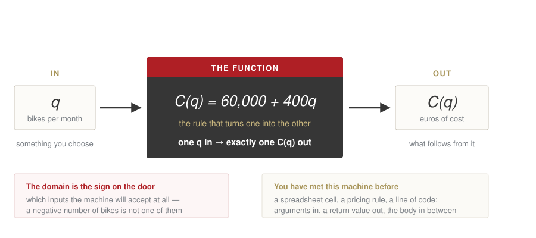
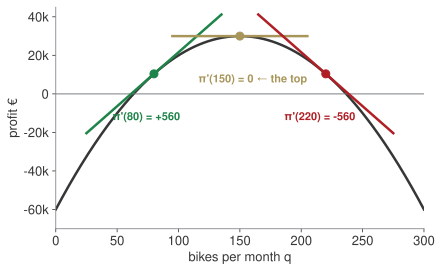

## Homework 1, at the board {.paper background-color="#eceff0"}

[PAPER · 15 minutes]{.kicker}

One of you takes us through it. Pick one drill you got stuck on. We want the working, the wrong turn included.

[Not an exam: the point is to see how you got there.]{.muted}

## Last week, in one minute

::: {.blocks}
::: {.blk .recap}
[Block A]{.blk-letter}How many bikes before we stop losing money?[100 — fixed cost ÷ contribution: 60,000 / 600]{.blk-answer}
:::
::: {.blk .recap}
[Block B]{.blk-letter}How many bikes should we make?[150, for €30,000 — vertex −b/2a; profitable between 63 and 237]{.blk-answer}
:::
::: {.blk .recap}
[Block C]{.blk-letter}How long until revenue doubles?[6.1 years — unknown in the exponent: $t = \ln 2 / \ln 1.12$]{.blk-answer}
:::
::: {.blk .recap}
[Block D]{.blk-letter}Is this battery cell within spec?[No — $|c - 500| \le 15$ means $[485, 515]$; 483 is out]{.blk-answer}
:::
:::

[The vertex formula only works for parabolas. Today: the tool that works for any curve.]{.red}

## Arno Bikes, on one card

:::: {.columns}
::: {.column width="36%"}
| the firm | |
|---|---|
| fixed cost | €60,000 / month |
| variable cost | €400 / bike |
| list price | €1,000 / bike |
| demand | $p = 1600 - 4q$ |

[$q$ = bikes per month. Nobody remembers this by heart: it stays on the slide.]{.muted}
:::
::: {.column width="64%"}
| the equations | | from |
|---|---|---|
| cost | $C(q) = 60{,}000 + 400q$ | wk 1 · A |
| revenue at list price | $R(q) = 1{,}000q$ | wk 1 · A |
| revenue with demand | $R(q) = pq = 1600q - 4q^2$ | wk 1 · B |
| profit $= R - C$ | $\pi(q) = -4q^2 + 1200q - 60{,}000$ | wk 1 · B |
| average cost | $AC(q) = C(q)/q$ | today · B |
:::
::::

[At list price: break-even at 100 bikes. With demand: best output 150 bikes for €30,000; break-evens at ≈ 63 and ≈ 237.]{.red}

## Where we are

:::: {.columns}
::: {.column width="56%"}
| Wk | Date | What you can do by hand |
|---|---|---|
| 1 | 24 Sep | equations, quadratics, logs ✓ |
| **2** | **1 Oct** | **read a function; limits; the derivative; first integrals** |
| 3 | 8 Oct | study a function; optimise |
| 4 | 15 Oct | interest, discounting, NPV |
| 5 | 22 Oct | bonds, duration, convexity |
:::
::: {.column width="44%"}
**Today serves both assessments.**

The **midterm** asks you to study a cost, a revenue and a profit function. Everything in that study is built on the derivative.

Three of the five items in the final's calculus question are here: a limit that factors, a derivative term by term, and a function recovered from its derivative.
:::
::::

[Last week you found the top of a hill with a formula that only works for parabolas. Today you get the one that works for any curve.]{.red}

## First, the midterm {.lab background-color="#2471a3"}

[BRIEFING · 35 minutes · before any mathematics]{.kicker}

:::: {.columns}
::: {.column width="46%"}
**The midterm, in four lines**

| | |
|---|---|
| **what** | 1,500-word paper (±10%) + oral, max 15 min |
| **weight** | 25% of the module: paper 80%, oral 20% |
| **paper due** | Sun 1 Nov, 23:59, on Turnitin |
| **oral** | week 6 |
:::
::: {.column width="54%"}
**What we do in the next 35 minutes**

1. Read the brief together, line by line.
2. Fix the checklist of a *full study of a function*: domain → limits → range → sign → max & min → convexity & inflection → sketch.
3. What the written sections want; Harvard referencing.
4. Plan backwards from 1 November.
:::
::::

[Questions now, not in the last week of October.]{.red}

## The questions with no formula

The brief also asks what in the world outside could hurt the firm, and what protectionism does to an economy. These are research questions, not calculus — but they are marked on the same idea: **every risk lands on a term of the function.**

| what goes wrong out there | how it reaches the firm | what moves in $C(q) = aq^{2} + bq + F$ or in $R(q)$ |
|---|---|---|
| input prices (battery cells, aluminium, oil) | suppliers reprice | $b$, the cost of one more unit |
| a tariff, a quota, retaliation | imported parts dearer; export markets shut | $b$; the revenue coefficient |
| the exchange rate | parts priced in dollars, sales in euros | $b$ and $R$ at once |
| energy, shipping routes | freight and power bills | $b$, sometimes $F$ |
| conflict, sanctions | a supplier disappears | capacity: the $aq^{2}$ term |
| a recession abroad | fewer orders, lower prices | $R$ |
| a new regulation | compliance cost | $F$ |

[One paragraph per risk: what it is, a source a sceptic would accept, the term it moves, and in which direction. A risk that never touches the function has not answered the question.]{.red}

## Four blocks today {.hub auto-animate=true}

::: {.blocks}
::: {.blk .now data-id="blkA"}
[Block A]{.blk-letter}What a function is, once you have to use one[domain · the four shapes]{.blk-tool}
:::
::: {.blk .next}
[Block B]{.blk-letter}What happens near a point you cannot reach[limits]{.blk-tool}
:::
::: {.blk .next}
[Block C]{.blk-letter}What does one more bike do to profit?[the derivative]{.blk-tool}
:::
::: {.blk .next}
[Block D]{.blk-letter}From the marginal back to the total[the integral]{.blk-tool}
:::
:::

## [Block A]{.section-kicker} What a function is, once you have to use one {.section-slide background-color="#AF1F25" auto-animate=true}

::: {.blk-fill data-id="blkA"}
:::

## A function is a machine

{fig-align="center" width="92%"}

You put something in, something comes out, and **what happens inside is the function**.

**The one rule:** each input gives **exactly one** output. Put in 50 bikes, get one cost — never two.

[A spreadsheet cell, a pricing rule, a line of code: the same picture. Keep it all term.]{.red}

## This is my half of the course, in one sentence

**Take a function a firm lives by, and study it until you can say what it does.**

:::: {.columns}
::: {.column width="50%"}
**Midterm** — study a cost, a revenue and a profit function, and sketch each one.
:::
::: {.column width="50%"}
**Final exam** — five questions in three hours; one of them is pure calculus: limits, derivatives, integrals, by hand.
:::
::::

[Today: the first pieces of the study (domain, limits, the derivative). Next week: the whole procedure.]{.red}

## Four functions, one firm

:::: {.columns}
::: {.column width="52%"}
| | |
|---|---|
| straight line | `C(q) = 60,000 + 400q` |
| parabola | `π(q) = −4q² + 1200q − 60,000` |
| exponential | `R(t) = 1.2 · 1.12ᵗ` |
| logarithm | `R(q) = 30 ln(q + 1)` |

Each one is a sentence about a business, written so it can be computed.
:::
::: {.column width="48%"}
**Domain** is the first question, always: for which `q` does this mean anything?

$$\begin{aligned}
\sqrt{q-20} \;&\text{ needs } q \geq 20 \\[2pt]
\ln(q-5) \;&\text{ needs } q > 5 \\[2pt]
\tfrac{120}{q-40} \;&\text{ breaks at } q = 40
\end{aligned}$$

[The exam asks "state the domain" and expects an interval, with the bracket chosen on purpose.]{.muted}
:::
::::

::: {.callout-important title="Bet before we compute"}
`π(100)` and `π(200)`. One is bigger. Which, and by how much?
:::

## Nothing here is memorised. Each rule is a question with no answer.

Ask what the symbol is *asking for*, and the restriction falls out on its own.

| the symbol | the question it asks | when there is no answer |
|---|---|---|
| $\sqrt{x}$ | *what number, times itself, gives `x`?* | `x < 0` — a square is never negative |
| $\ln x$ | *to what power must `e` be raised to give `x`?* | `x ≤ 0` — a positive base never reaches zero |
| $\dfrac{a}{x}$ | *how many `x` fit into `a`?* | `x = 0` — nothing fits into nothing |

. . .

So $\sqrt{q-20}$ needs **the thing inside**, not `q`, to be at least zero: `q − 20 ≥ 0`.

[Three rules, or one habit: put the bracket's contents where the rule's own question can be asked. You will never have to remember which is `≥` and which is `>` — `√0 = 0` is fine, `ln 0` is not.]{.red}

## Two domains: the algebra's, and the firm's

A model answer states **both**, and says why they differ.

:::: {.columns}
::: {.column width="50%"}
`R(q) = 30 ln(q + 1)`

- **algebraically**: `q + 1 > 0`, so `(−1, +∞)`
- **economically**: a quantity cannot be negative, so `[0, +∞)`

`C(q) = 0.4q² + 3q + 25`

- **algebraically**: any `q`, so `(−∞, +∞)`
- **economically**: `[0, +∞)` again
:::
::: {.column width="50%"}
Everything after this — limits, range, sign, the turning points — is studied on the **economic** domain.

So a parabola's vertex that falls at a negative `q` is **not** the firm's minimum cost. It exists on paper and nowhere else.

[Write it: "algebraically the vertex is at `q = −3.75`, outside the economic domain; on `[0, +∞)` cost only rises."]{.muted}
:::
::::

## Where the curve meets the axes

Two small systems, solved every time. They give the first points of the sketch.

| | set | for `C(q) = 0.4q² + 3q + 25` | for `R(q) = 30 ln(q + 1)` |
|---|---|---|---|
| **y-axis** | `q = 0` | `C(0) = 25`: the **fixed cost**, the bill at zero output | `R(0) = 30 ln 1 = 0`: no sales, no revenue |
| **x-axis** | `f(q) = 0` | `Δ = 9 − 40 < 0`: **never** zero — cost is always positive | `ln(q + 1) = 0 ⟺ q + 1 = 1 ⟺ q = 0`: only at the origin |

. . .

::: {.callout-tip title="Board sentence"}
The intercept is a number the Board already knows by another name: the fixed cost, or the revenue of an idle plant. Name it.
:::

## D1, D2, D3b — domains, axes, and the four functions {.paper background-color="#eceff0"}

[PAPER · drills.md]{.kicker}

12 minutes. Show all work, exam style. I walk round and look at your working.

## Four blocks today {.hub auto-animate=true}

::: {.blocks}
::: {.blk .done}
[Block A]{.blk-letter}What a function is, once you have to use one[domain · the four shapes]{.blk-tool}
:::
::: {.blk .now data-id="blkB"}
[Block B]{.blk-letter}What happens near a point you cannot reach[limits]{.blk-tool}
:::
::: {.blk .next}
[Block C]{.blk-letter}What does one more bike do to profit?[the derivative]{.blk-tool}
:::
::: {.blk .next}
[Block D]{.blk-letter}From the marginal back to the total[the integral]{.blk-tool}
:::
:::

## [Block B]{.section-kicker} Limits — what happens near a point you cannot reach {.section-slide background-color="#AF1F25" auto-animate=true}

::: {.blk-fill data-id="blkB"}
:::

## What does one bike cost? It depends how many you make.

The rent is €60,000 whether you build one bike or a thousand. **Split it between the bikes** — cost $C(q)$ from week 1, Block A, divided by $q$:

$$AC(q) = \frac{60{,}000 + 400q}{q} \;=\; \underbrace{\frac{60{,}000}{q}}_{\text{the rent, shared}} + \underbrace{400}_{\text{the parts, per bike}}$$

::: {.callout-important title="Bet before we compute"}
At 30 bikes a month, what does one bike cost the firm? At 300?
:::

## The rent, split thinner and thinner {.clip background-color="#000000"}

<video class="clipvideo" width="1000" height="562" controls muted loop playsinline data-autoplay preload="auto" poster="media/w02_avgcost_poster.png"><source src="media/w02_avgcost.mp4" type="video/mp4"></video>

The gold bar is the rent per bike. It shrinks; the €400 floor never moves.

## Where do you take a limit? Where the domain stops.

Inside the domain there is nothing to ask: substitute and read the value. A limit is for the **edges** — the places you cannot reach.

| the domain stops… | example | the limit to take |
|---|---|---|
| at a point that is excluded | $\dfrac{120}{q-40}$, $q \neq 40$ | from both sides: $q \to 40^{-}$ and $q \to 40^{+}$ |
| at an open end | $AC(q)$, $q > 0$ | from the allowed side only: $q \to 0^{+}$ |
| never — it runs on | $AC(q)$, $q > 0$ | $q \to +\infty$ (and $-\infty$ if the domain goes there) |

[Recipe: write the domain → list its edges → one limit per edge. $AC$ has domain $(0, +\infty)$: two edges, two limits.]{.red}

## Which is two limits, and a floor

$$\lim_{q \to 0^{+}} AC(q) = +\infty \qquad\qquad \lim_{q \to \infty} AC(q) = 400$$

**At `q = 0` the expression means nothing** — you cannot divide by nothing — but you can ask what happens *near* zero, and the answer is: ruinous. One bike carries the whole rent.

Far out, the shared rent vanishes and average cost settles onto the variable cost. It never goes below €400, because every bike really does need €400 of parts.

[**Economies of scale, in two limits.** And a limit is exactly this: not the value *at* a point, but the value the function heads towards as you approach it.]{.red}

## The one that looks impossible

$$\lim_{q \to 10} \frac{q^{2} - 100}{q - 10}$$

Why at 10? Because 10 is outside the domain (the denominator is zero there): an edge, so a limit. Substitute and you get `0/0`, which says nothing. So do not substitute first.

. . .

$$\frac{(q-10)(q+10)}{q-10} = q + 10 \;\longrightarrow\; 20$$

::: {.callout-tip title="Board sentence"}
`0/0` is not an answer, it is an instruction: factor, cancel, then substitute.
:::

## `0/0` is a promise: the same factor is hiding top and bottom

If the top and the bottom are **both zero** at $q = a$, both contain the factor $(q - a)$. So after factoring, $(q - a)$ **must** appear in both and cancel. If it does not, the factoring is wrong: go back, do not go on.

:::: {.columns}
::: {.column width="46%"}
1. **Substitute.** Is it really `0/0`? A number over a number is the answer; a number over `0` is an infinity.
2. **Factor both** until $(q - a)$ shows in each. Watch the sign: $a - q = -(q - a)$.
3. **Cancel, then substitute again.** If it is still `0/0`, there is another $(q - a)$: cancel once more.
:::
::: {.column width="54%"}
$$\lim_{q \to 3^{+}} \frac{(q-3)^{2}}{3q - q^{2}}$$

Top and bottom are 0 at 3, so $(q - 3)$ hides in both. The bottom does not show it — until you flip a sign:

$$3q - q^{2} = q(3 - q) = -q(q-3)$$

$$\frac{(q-3)^{2}}{-q(q-3)} = -\frac{q-3}{q} \;\longrightarrow\; -\frac{0}{3} = 0$$
:::
::::

[The check that saves marks: no $(q - a)$ in both after factoring means a mistake, not a hard limit.]{.red}

## One more limit at infinity: is there a slant asymptote?

A curve can approach a **sloping** line, not just a flat one. Two limits decide it:

$$m = \lim_{q \to \infty} \frac{f(q)}{q}, \qquad b = \lim_{q \to \infty} \big(f(q) - mq\big)$$

If both are finite numbers, `y = mq + b` is the slant asymptote. If `m` is infinite, or `m = 0` (then it is the horizontal case), there is none.

. . .

| | `m` | `b` | verdict |
|---|---|---|---|
| `C(q) = 0.4q² + 3q + 25` | `+∞` | — | **none**: a parabola outruns every line |
| `AC(q) = 0.4q + 3 + 25/q` | `0.4` | `3` | **`y = 0.4q + 3`**: the shared fixed cost fades away |
| `R(q) = 30 ln(q + 1)` | `0` | `+∞` | **none**, and no horizontal one either: it rises forever, ever more slowly |

[A report that writes "no asymptote" should have checked. Saying so in one line — "`C(q)/q → ∞`, so no slant asymptote" — is what separates a complete study from a good one.]{.red}

## D4, D5, D6, D7b — limits, including one from the exam {.paper background-color="#eceff0"}

[PAPER · drills.md]{.kicker}

15 minutes. D5 is a one-sided limit in exactly the form the final exam uses. D7b is the slant-asymptote check.

## Four blocks today {.hub auto-animate=true}

::: {.blocks}
::: {.blk .done}
[Block A]{.blk-letter}What a function is, once you have to use one[domain · the four shapes]{.blk-tool}
:::
::: {.blk .done}
[Block B]{.blk-letter}What happens near a point you cannot reach[limits]{.blk-tool}
:::
::: {.blk .now data-id="blkC"}
[Block C]{.blk-letter}What does one more bike do to profit?[the derivative]{.blk-tool}
:::
::: {.blk .next}
[Block D]{.blk-letter}From the marginal back to the total[the integral]{.blk-tool}
:::
:::

## [Block C]{.section-kicker} The derivative {.section-slide background-color="#AF1F25" auto-animate=true}

::: {.blk-fill data-id="blkC"}
:::

## How much does one more bike change profit?

At 80 bikes a month, what does the eighty-first bike add?

::: {.callout-important title="Bet before we compute"}
More than €1,000, between €0 and €1,000, or negative? Commit to one.
:::

The honest way to ask it: take two quantities, measure the change in profit, divide by the change in quantity. Then let the two quantities come together.

## Two points become one {.clip background-color="#000000"}

<video class="clipvideo" width="1000" height="562" controls muted loop playsinline data-autoplay preload="auto" poster="media/w02_secant_poster.png"><source src="media/w02_secant.mp4" type="video/mp4"></video>

The slope over an interval becomes the slope at a point.

## The definition, once

$$\pi'(a) \;=\; \lim_{h \to 0} \frac{\pi(a+h) - \pi(a)}{h}$$

You will use this definition roughly twice in your life. What you will use every day is what it produces:

| | |
|---|---|
| `qⁿ` | `n qⁿ⁻¹` |
| a constant | `0` |
| `a/qⁿ` | `a·q⁻ⁿ`, then as a power: `−n a q⁻ⁿ⁻¹` |
| `ln q` | `1/q` |
| `e^(kq)` | `k e^(kq)` |
| sums | differentiate term by term |

## Differentiating, as a procedure you can follow

Never ask "what is the derivative of this?" Ask the questions in order.

| ask | then |
|---|---|
| **1.** Is it a **sum**? | split it; do each piece alone |
| **2.** A **number**, no `q`? | it becomes `0` |
| **3.** A **fraction** `a/qⁿ`? | rewrite it as a power, `a·q⁻ⁿ`, and go to 4 |
| **4.** A **power** `a·qⁿ`? | `n` comes down in front, the power drops by one |
| **5.** A **log** `a·ln(q)`? | it becomes `a/q` |

$$-4q^{2} \to -8q \qquad 1200q \to 1200 \qquad -60{,}000 \to 0 \qquad 30\ln q \to \tfrac{30}{q}$$

. . .

$$\pi(q) = \underbrace{-4q^{2}}_{4} + \underbrace{1200q}_{4} \underbrace{- \,60{,}000}_{2} \;\longrightarrow\; \pi'(q) = -8q + 1200$$

[A lone `q` is `q¹`, so rule 4 leaves just the number in front of it.]{.muted}

. . .

**The fraction.** A `q` downstairs is a negative power upstairs. Then rule 4, unchanged:

$$\frac{1}{q^{2}} = q^{-2} \;\longrightarrow\; -2\,q^{-3} = -\frac{2}{q^{3}} \qquad\qquad AC(q) = \underbrace{\frac{60{,}000}{q}}_{3} + \underbrace{400}_{2} \;\longrightarrow\; AC'(q) = -\frac{60{,}000}{q^{2}}$$

[The `−2` comes down, the power drops by one to `−3`. The exponent is negative, so the derivative is negative: average cost falls at every `q` — block B's economies of scale, now as a sign.]{.red}

## Question 6: is there something *inside* something?

`ln(q + 1)` is not `ln q`. There is a second function hiding inside the first, and the midterm's revenue function is exactly this shape.

$$\frac{d}{dq}\,f\big(g(q)\big) \;=\; f'\big(g(q)\big) \cdot g'(q)$$

**Differentiate the outside, leave the inside alone, then multiply by the derivative of the inside.**

. . .

:::: {.columns}
::: {.column width="50%"}
$$\ln(q+1) \;\to\; \frac{1}{q+1}\cdot \underbrace{1}_{\text{inside}'} = \frac{1}{q+1}$$
$$\ln(3q) \;\to\; \frac{1}{3q}\cdot 3 = \frac{1}{q}$$
:::
::: {.column width="50%"}
$$(2q+5)^{4} \;\to\; 4(2q+5)^{3}\cdot 2 = 8(2q+5)^{3}$$
$$e^{0.12t} \;\to\; e^{0.12t}\cdot 0.12$$
:::
::::

[Why `ln(q+1)` looked free: the inside is `q + 1`, whose derivative is 1, so the multiplication does nothing and you never saw it. Change the inside to `3q` and it shows up.]{.red}

## The chain rule is the reason a few things work

| you will meet it in | as |
|---|---|
| the midterm | a revenue of the form `a · ln(q + 1)`, differentiated to find the optimum |
| week 4 | continuous compounding: `e^(it)` differentiates to `i·e^(it)` |
| week 5 | duration: the bond price is `(1+y)^(−t)`, and the `−t` comes down |
| block D, backwards | `∫ f'/f = ln\|f\|` is this rule read in reverse |

::: {.callout-tip title="Board sentence"}
Outside first, inside untouched, then multiply by the inside's derivative. If the inside is just `q`, the multiplication is by 1 and you never notice.
:::

## Read it off the curve

{fig-align="center" width="78%"}

Same curve, three places, three answers to the same question: **is the next bike worth making?**

## The tangent walks the curve {.clip background-color="#000000"}

<video class="clipvideo" width="1000" height="562" controls muted loop playsinline data-autoplay preload="auto" poster="media/w02_tangent_poster.png"><source src="media/w02_tangent.mp4" type="video/mp4"></video>

Positive, then flat, then negative. The flat point is the top.

## Move the price, watch the slope {.lab background-color="#2471a3"}

[LAB · session.ipynb § C]{.kicker}

1. Bet: if the price cut per extra bike were €3 instead of €4, would the best quantity rise or fall?
2. Then slide it, and watch where `π'(q) = 0` moves to.

The slider changes one number. The whole answer moves with it.

## Last week's formula, and this week's

:::: {.columns}
::: {.column width="50%"}
**Week 1, only for parabolas:**
$$q_v = -\frac{b}{2a} = -\frac{1200}{-8} = 150$$
:::
::: {.column width="50%"}
**Today, for anything:**
$$\pi'(q) = -8q + 1200 = 0 \;\Rightarrow\; q = 150$$
:::
::::

Same answer. But the second one still works when revenue is `30 ln(q+1)`, or cost is cubic, or the curve has no formula you recognise.

::: {.callout-tip title="Board sentence"}
The derivative answers one managerial question: what does one more unit do? Positive means make more, negative means make fewer, zero means stop.
:::

## D8, D9 — differentiate, then read the answer {.paper background-color="#eceff0"}

[PAPER · drills.md]{.kicker}

12 minutes. In D9 write the sentence a manager would say, not just the number.

## Four blocks today {.hub auto-animate=true}

::: {.blocks}
::: {.blk .done}
[Block A]{.blk-letter}What a function is, once you have to use one[domain · the four shapes]{.blk-tool}
:::
::: {.blk .done}
[Block B]{.blk-letter}What happens near a point you cannot reach[limits]{.blk-tool}
:::
::: {.blk .done}
[Block C]{.blk-letter}What does one more bike do to profit?[the derivative]{.blk-tool}
:::
::: {.blk .now data-id="blkD"}
[Block D]{.blk-letter}From the marginal back to the total[the integral]{.blk-tool}
:::
:::

## [Block D]{.section-kicker} Running it backwards: the integral {.section-slide background-color="#AF1F25" auto-animate=true}

::: {.blk-fill data-id="blkD"}
:::

## From the derivative back to the function

The exam asks this in one direction and the other. Given `f'`, find `f`.

$$f'(q) = 6q^{2} - 2q \quad\Longrightarrow\quad f(q) = 2q^{3} - q^{2} + c$$

. . .

The `c` is not decoration. Every function `2q³ − q² + c` has the same derivative, so one extra fact pins it down:

$$f(1) = 4 \;\Rightarrow\; 2 - 1 + c = 4 \;\Rightarrow\; c = 3$$

## And it means something

Given marginal cost `MC(q) = 0.8q + 3`, the cost function is

$$C(q) = 0.4q^{2} + 3q + c$$

and `c = C(0)` is the **fixed cost** — what you pay having produced nothing.

[The constant of integration is not a technicality here. It is the rent.]{.red}

## Running it backwards has a name: the integral

$$\int f'(q)\,dq \;=\; f(q) + c \qquad \text{read: “the function whose derivative is } f'\text{”}$$

Every derivative rule, read from right to left:

| you know | so, backwards |
|---|---|
| $q^{n} \to n\,q^{n-1}$ | $\displaystyle\int q^{n}\,dq = \frac{q^{n+1}}{n+1} + c \quad (n \neq -1)$ |
| $\ln q \to \dfrac{1}{q}$ | $\displaystyle\int \frac{1}{q}\,dq = \ln\lvert q\rvert + c$ |
| $\ln f(q) \to \dfrac{f'(q)}{f(q)}$ (chain rule) | $\displaystyle\int \frac{f'(q)}{f(q)}\,dq = \ln\lvert f(q)\rvert + c$ |
| a constant $\to 0$ | $\displaystyle\int k\,dq = kq + c$ |
| sums, term by term | integrate term by term |

[Power up by one, divide by the new power. The one power that rule cannot handle, $q^{-1}$, is exactly the one that becomes a log. And the check is free: differentiate your answer and you must get back what was inside.]{.red}

## The exam's integral: split the fraction first

The final's calculus question opens with a fraction to integrate. There is no rule for a fraction — so make it stop being one.

$$\int \frac{3q^{3} + 4q^{2} - 2}{q}\,dq$$

. . .

$$= \int \Big(3q^{2} + 4q - \frac{2}{q}\Big)\,dq \;=\; q^{3} + 2q^{2} - 2\ln\lvert q\rvert + c$$

::: {.callout-tip title="Board sentence"}
Divide every term by the denominator, then integrate each piece on its own. The `1/q` piece is the one that turns into a log.
:::

## When the top is the derivative of the bottom

A log appears whenever the top is the derivative of the bottom — exactly, or up to a constant you can factor out.

:::: {.columns}
::: {.column width="50%"}
$$\int \frac{1}{q-1}\,dq = \ln|q-1| + c$$

The bottom differentiates to 1. A shifted log, nothing more.
:::
::: {.column width="50%"}
$$\int \frac{q}{q^{2}-1}\,dq = \tfrac{1}{2}\ln|q^{2}-1| + c$$

The bottom differentiates to `2q`; the top is `q`, so put the missing `½` out front.
:::
::::

. . .

**Before integrating any fraction, ask one question: is the top the derivative of the bottom?** If yes, it is a log. If no, divide term by term and use the power rule.

[This is the chain rule read backwards, and the final's calculus question uses it.]{.red}

## Not quite the derivative? Fix the number in front

The top is often the derivative of the bottom **up to a number**. Make it exact: multiply inside by what is missing, divide outside by the same.

$$\int \frac{x}{x^{2}-1}\,dx \;=\; \frac{1}{2}\int \frac{\mathbf{2}x}{x^{2}-1}\,dx \;=\; \frac{1}{2}\ln\lvert x^{2}-1\rvert + c$$

. . .

| | the bottom gives | the top is | so put in front | answer |
|---|---|---|---|---|
| $\displaystyle\int \frac{3x}{x^{2}+4}dx$ | $2x$ | $3x = \tfrac{3}{2}\cdot 2x$ | $\tfrac{3}{2}$ | $\tfrac{3}{2}\ln(x^{2}+4) + c$ |
| $\displaystyle\int \frac{5}{2x+1}dx$ | $2$ | $5 = \tfrac{5}{2}\cdot 2$ | $\tfrac{5}{2}$ | $\tfrac{5}{2}\ln\lvert 2x+1\rvert + c$ |
| $\displaystyle\int \frac{x^{2}}{x^{3}-8}dx$ | $3x^{2}$ | $x^{2} = \tfrac{1}{3}\cdot 3x^{2}$ | $\tfrac{1}{3}$ | $\tfrac{1}{3}\ln\lvert x^{3}-8\rvert + c$ |

. . .

::: {.callout-important title="Two rules that keep it honest"}
Only a **number** can be moved outside the integral, never an `x`: $\int \frac{1}{x^{2}-1}dx$ is not a log of $x^{2}-1$. And **check by differentiating back**: $\frac{d}{dx}\,\tfrac12\ln\lvert x^{2}-1\rvert = \tfrac12 \cdot \frac{2x}{x^{2}-1}$ ✓. Keep the modulus: in a definite integral the inside is often negative.
:::

## The definite integral, and what it measures

Put two numbers on the integral sign: evaluate at the top, subtract the value at the bottom. The `c` cancels, so leave it out.

$$\int_{0}^{20} (0.8q + 3)\,dq = \Big[0.4q^{2} + 3q\Big]_{0}^{20} = 220$$

[Add up the marginal cost of the first twenty units and you get what those twenty cost, on top of the fixed cost.]{.muted}

. . .

And the one worth remembering, on Arno Bikes' marginal profit from block C:

$$\int_{100}^{150} \pi'(q)\,dq = \pi(150) - \pi(100) = €10{,}000$$

[The integral of the marginal is the change in the total. That sentence is the whole of integration.]{.red}

::: {.callout-tip title="Board sentence"}
Differentiate to ask what one more does. Integrate to ask what all of them did.
:::

## D11, D12, D13 — recover the function, then integrate {.paper background-color="#eceff0"}

[PAPER · drills.md]{.kicker}

10 minutes. Exam form: every answer ends with the constant found, not left as `c`. D13 is the final's first calculus item, in the same form.

## [Close]{.section-kicker} Take home {.section-slide background-color="#AF1F25"}

## Take home

1. Domain first, always. The exam gives marks for the interval.
2. `0/0` means factor, cancel, then substitute.
3. The derivative is the answer to "what does one more do?"
4. Running it backwards is the integral: power up and divide, `1/q` gives `ln`, and one fact pins the constant down. Between two limits, it is the change in the total.

**Homework 2** (`homework.md`), for Thursday 8 October, corrected together at the board: eight drills plus a memo to the Board on whether to build the next bike.

Write your own three take-home lines now, before you leave.
