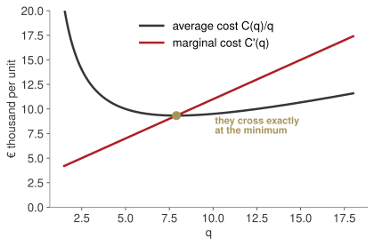
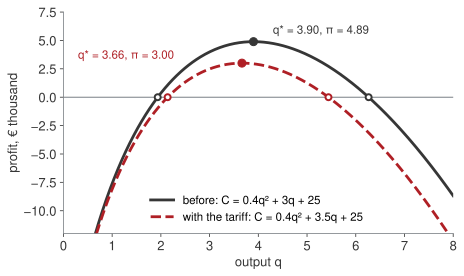
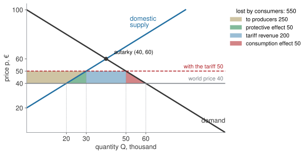

## Homework 2, at the board {.paper background-color="#eceff0"}

[PAPER · 15 minutes]{.kicker}

One of you takes us through it. One drill, and then the one sentence of your memo you are least sure of.

[Not an exam: the point is to see how you got there.]{.muted}

## Last week, in one minute

::: {.blocks}
::: {.blk .recap}
[Block A]{.blk-letter}What a function is, once you have to use one[Domain first, always — written as an interval]{.blk-answer}
:::
::: {.blk .recap}
[Block B]{.blk-letter}What happens near a point you cannot reach[0/0 → factor, cancel, substitute. Average cost falls towards €400, never below]{.blk-answer}
:::
::: {.blk .recap}
[Block C]{.blk-letter}What does one more bike do to profit?[$\pi'(q) = -8q + 1200$: the 81st bike adds €560; zero at 150]{.blk-answer}
:::
::: {.blk .recap}
[Block D]{.blk-letter}From the marginal back to the total[Integrate, add + C, pin C with one known value. The integral of the marginal is the change in the total]{.blk-answer}
:::
:::

[Today the pieces become one procedure: the full study of a function — the whole midterm.]{.red}

## Arno Bikes, on one card

:::: {.columns}
::: {.column width="36%"}
| the firm | |
|---|---|
| fixed cost | €60,000 / month |
| variable cost | €400 / bike |
| list price | €1,000 / bike |
| demand | $p = 1600 - 4q$ |

[$q$ = bikes per month. Nobody remembers this by heart: it stays on the slide.]{.muted}
:::
::: {.column width="64%"}
| the equations | | from |
|---|---|---|
| cost | $C(q) = 60{,}000 + 400q$ | wk 1 · A |
| revenue at list price | $R(q) = 1{,}000q$ | wk 1 · A |
| revenue with demand | $R(q) = pq = 1600q - 4q^2$ | wk 1 · B |
| profit $= R - C$ | $\pi(q) = -4q^2 + 1200q - 60{,}000$ | wk 1 · B |
| average cost | $AC(q) = C(q)/q$ | wk 2 · B |
| marginal profit | $\pi'(q) = -8q + 1200$ | wk 2 · C |
:::
::::

[At list price: break-even at 100 bikes. With demand: best output 150 bikes for €30,000; break-evens at ≈ 63 and ≈ 237.]{.red}

## Where we are

:::: {.columns}
::: {.column width="56%"}
| Wk | Date | What you can do by hand |
|---|---|---|
| 1 | 24 Sep | equations, quadratics, logs ✓ |
| 2 | 1 Oct | functions, limits, the derivative ✓ |
| **3** | **8 Oct** | **study a function; optimise** |
| 4 | 15 Oct | interest, discounting, NPV |
| 5 | 22 Oct | bonds, duration, convexity |
:::
::: {.column width="44%"}
**Today is the midterm.**

Not a rehearsal of part of it: the whole mathematical content of the midterm is the seven-step study you will do this morning, applied to a cost, a revenue and a profit function.
:::
::::

[There is a quiz in this session. It is short, it is not secret, and it covers weeks 1–3.]{.red}

## The seven steps, in the brief's own words

| | |
|---|---|
| 1 | **domain** — for which `q` does this mean anything? An interval. |
| 2 | **limits** — at the ends of the domain, and at any break: the asymptotes |
| 3 | **range** — what values the function actually takes |
| 4 | **sign** — where positive, where negative; the zeros are how you find out |
| 5 | **maxima and minima** — solve `f'(q) = 0`, then the **sign of `f''`** names each one |
| 6 | **convexity and inflection** — where `f''` changes sign |
| 7 | **sketch** — last, with every point above marked on it |

[These are the brief's own seven words, in the brief's own order. Answer in its vocabulary and the marker cannot miss what you have done.]{.red}

## Seven steps, watched once {.clip background-color="#000000"}

<video class="clipvideo" width="1000" height="562" controls muted loop playsinline data-autoplay preload="auto" poster="media/w03_study_poster.png"><source src="media/w03_study.mp4" type="video/mp4"></video>

The same profit function you already know, taken apart in the exam's order.

## Four blocks today, then the quiz {.hub auto-animate=true}

::: {.blocks}
::: {.blk .now data-id="blkA"}
[Block A]{.blk-letter}The study, done properly[the seven steps]{.blk-tool}
:::
::: {.blk .next}
[Block B]{.blk-letter}How much should the firm produce?[optimisation · MR = MC]{.blk-tool}
:::
::: {.blk .next}
[Block C]{.blk-letter}A tariff hits the firm[which term moves · the new optimum]{.blk-tool}
:::
::: {.blk .next}
[Block D]{.blk-letter}A tariff hits the country[surplus as an area · who pays]{.blk-tool}
:::
:::

## [Block A]{.section-kicker} The study, done properly {.section-slide background-color="#AF1F25" auto-animate=true}

::: {.blk-fill data-id="blkA"}
:::

## Step by step on a function you know

$$\pi(q) = -4q^{2} + 1200q - 60{,}000$$

:::: {.columns}
::: {.column width="50%"}
1. **Domain** `[0, +∞)` for a quantity.
2. **Limits** `π(0) = −60,000`; `π(q) → −∞` as `q → ∞`. No asymptote: a polynomial has none.
3. **Range** `(−∞, 30,000]` — it reaches its maximum and never exceeds it.
4. **Sign** zeros at `63.4` and `236.6`; positive between them.
:::
::: {.column width="50%"}
5. **Max / min** `π'(q) = −8q + 1200 = 0` → `q = 150`; `π''= −8 < 0`, so a **maximum**, `π(150) = 30,000`.
6. **Convexity** `π''< 0` everywhere: concave throughout, no inflection.
7. **Sketch** with all of the above marked.
:::
::::

::: {.callout-tip title="Board sentence"}
`f'` finds the candidates; `f''` says which kind each one is. Writing "maximum" without the second derivative earns nothing.
:::

## Limits at the edge: where the curve runs off the page

Step 2 asks for limits, and limits are how you find **asymptotes** — the lines the curve approaches and never meets. The resit asks for them by name.

:::: {.columns}
::: {.column width="50%"}
**Vertical.** Look at the edge of the domain.
`f(q) = 7 ln(q + 3)` is defined for `q > −3`, and

$$\lim_{q \to -3^{+}} 7\ln(q+3) = -\infty$$

so the line `q = −3` is a vertical asymptote.
:::
::: {.column width="50%"}
**Horizontal.** Look at infinity.
`AC(q) = 0.4q + 3 + 25/q` has none: it grows without bound.
But `(60,000 + 400q)/q → 400`, so `y = 400` **is** one.
:::
::::

[A sketch with no asymptote drawn, where one exists, is marked as an incomplete sketch.]{.red}

## The second derivative, in one line

$$f'' > 0 \;\Rightarrow\; \text{convex, holds water, a minimum}$$
$$f'' < 0 \;\Rightarrow\; \text{concave, spills water, a maximum}$$

An **inflection** is where `f''` changes sign: the curve stops bending one way and starts bending the other. In business that is where growth stops accelerating and begins to slow — the moment worth naming in a report.

## Step 6, properly: what the second derivative is telling you

$f'$ says whether the curve is **going up or down**. $f''$ says whether it is **bending up or down**. They are different questions, and the brief asks both.

| $f''$ | so $f'$ is… | the slope is… | shape | holds water? |
|---|---|---|---|---|
| $> 0$ | increasing | getting steeper (or less negative) | **convex** | yes — a bowl |
| $< 0$ | decreasing | getting flatter (or more negative) | **concave** | no — a dome |
| $= 0$ **and changes sign** | at a peak or trough | steepest, or flattest, right there | **inflection** | the switch |

. . .

::: {.callout-important title="The confusion to clear"}
The **maximum** is where $f' = 0$: growth *stops*. The **inflection** is where $f'' = 0$: growth is *fastest* and stops accelerating. In a sales curve those are two different months, and a report that names the wrong one is wrong.
:::

## Step 6 on a cubic (D3)

$$f(q) = q^{3} - 12q^{2} + 36q,\qquad f'(q) = 3(q-2)(q-6),\qquad f''(q) = 6q - 24$$

:::: {.columns}
::: {.column width="58%"}
| $q$ | 0 → 2 | 2 | 2 → 4 | 4 | 4 → 6 | 6 | 6 → 10 |
|---|---|---|---|---|---|---|---|
| $f'$ | + | 0 | − | − | − | 0 | + |
| $f''$ | − | − | − | **0** | + | + | + |
| shape | rising, concave | **max** (2, 32) | falling, concave | **inflection** (4, 16) | falling, convex | **min** (6, 0) | rising, convex |
:::
::: {.column width="42%"}
Three lines, and the marker can tick step 6:

1. $f''(q) = 6q - 24 = 0 \Rightarrow q = 4$.
2. $f'' < 0$ for $q < 4$: **concave**. $f'' > 0$ for $q > 4$: **convex**.
3. **Inflection at (4, 16)**, where the curve changes from dome to bowl.

[The inflection sits *between* the turning points: where the fall is steepest. If $f''$ never changes sign, write "no inflection; concave throughout" — that earns the step too.]{.muted}
:::
::::

## Step 6 in the words of a report

For the log-revenue firm of block B, $R(q) = 30\ln(q+1)$, $C(q) = 0.4q^{2} + 3q + 25$:

- $C''(q) = 0.8 > 0$: cost is **convex throughout** — each extra unit costs more than the last.
- $R''(q) = -30/(q+1)^{2} < 0$: revenue is **concave throughout** — each extra unit brings in less than the last. *Diminishing returns*, by name.
- So $\pi'' = R'' - C'' < 0$ everywhere: profit is **concave, with a single maximum and no inflection**. The optimum you find is the only one.

::: {.callout-tip title="Board sentence"}
Convexity is the second thing a Board wants to know after the optimum: is the ground falling away on both sides fast or slowly. $f''$ is that number.
:::

## D1 — the full study, in exam format {.paper background-color="#eceff0"}

[PAPER · drills.md]{.kicker}

15 minutes. This is the midterm's Q2 with different numbers. Write all seven steps, labelled.

## Four blocks today, then the quiz {.hub auto-animate=true}

::: {.blocks}
::: {.blk .done}
[Block A]{.blk-letter}The study, done properly[the seven steps]{.blk-tool}
:::
::: {.blk .now data-id="blkB"}
[Block B]{.blk-letter}How much should the firm produce?[optimisation · MR = MC]{.blk-tool}
:::
::: {.blk .next}
[Block C]{.blk-letter}A tariff hits the firm[which term moves · the new optimum]{.blk-tool}
:::
::: {.blk .next}
[Block D]{.blk-letter}A tariff hits the country[surplus as an area · who pays]{.blk-tool}
:::
:::

## [Block B]{.section-kicker} Optimisation, and what it is for {.section-slide background-color="#AF1F25" auto-animate=true}

::: {.blk-fill data-id="blkB"}
:::

## Where average cost is lowest

{fig-align="center" width="72%"}

::: {.callout-important title="Bet before we compute"}
Marginal cost crosses average cost. Is the crossing to the left of the minimum, at it, or to the right?
:::

## It is at the minimum, and that is not a coincidence

`C(q) = 0.4q² + 3q + 25`, so `AC(q) = 0.4q + 3 + 25/q`.

$$AC'(q) = 0.4 - \frac{25}{q^{2}} = 0 \;\Rightarrow\; q^{2} = 62.5 \;\Rightarrow\; q \approx 7.91$$

. . .

There `AC = 9.32` and `C'(7.91) = 9.32`. **Equal.**

While the next unit costs less than the average, it pulls the average down. When it costs more, it pushes it up. The average stops falling exactly when the two meet.

## The rule that runs every firm

$$\pi'(q) = 0 \quad\Longleftrightarrow\quad R'(q) = C'(q)$$

**Produce up to the point where the revenue from one more unit equals what that unit costs.**

. . .

For `R(q) = 30 ln(q+1)` and `C(q) = 0.4q² + 3q + 25`:

$$\frac{30}{q+1} = 0.8q + 3 \;\Rightarrow\; 4q^{2} + 19q - 135 = 0 \;\Rightarrow\; q \approx 3.90$$

## Push the log revenue {.lab background-color="#2471a3"}

[LAB · session.ipynb § B]{.kicker}

1. Bet: raise the coefficient on the log revenue from 30 to 40. Does the optimum move a lot, or a little?
2. Then raise the fixed cost from 25 to 60. Does the optimum move at all?

The second one has a lesson in it. Watch what changes and what does not.

## D4, D5 — optimise, and read the condition {.paper background-color="#eceff0"}

[PAPER · drills.md]{.kicker}

12 minutes. In D5 say what the firm should do, in a sentence, before you compute anything.

## Four blocks today, then the quiz {.hub auto-animate=true}

::: {.blocks}
::: {.blk .done}
[Block A]{.blk-letter}The study, done properly[the seven steps]{.blk-tool}
:::
::: {.blk .done}
[Block B]{.blk-letter}How much should the firm produce?[optimisation · MR = MC]{.blk-tool}
:::
::: {.blk .now data-id="blkC"}
[Block C]{.blk-letter}A tariff hits the firm[which term moves · the new optimum]{.blk-tool}
:::
::: {.blk .next}
[Block D]{.blk-letter}A tariff hits the country[surplus as an area · who pays]{.blk-tool}
:::
:::

## [Block C]{.section-kicker} A tariff hits the firm {.section-slide background-color="#AF1F25" auto-animate=true}

::: {.blk-fill data-id="blkC"}
:::

## The Board's question

The log-revenue firm of block B again: $R(q) = 30\ln(q+1)$, $C(q) = 0.4q^{2} + 3q + 25$, € thousand.

Of the **€3k** that one more unit costs, **€2.5k** is a part bought from outside the EU. The EU puts a **20% tariff** on it.

::: {.callout-important title="Bet before we compute"}
Does profit at the best output fall by less than 20%, by about 20%, or by more?
:::

## Which term moves, and which does not

$$C(q) = \underbrace{0.4q^{2}}_{\text{inside the plant}} + \underbrace{3q}_{\text{bought per unit}} + \underbrace{25}_{\text{fixed}}$$

| term | what it pays for | the tariff… |
|---|---|---|
| $0.4q^{2}$ | congestion, overtime, a machine run harder: costs **inside** the plant | does not touch it |
| $3q$ | parts and materials bought **per unit** — the imported part is here | raises it: $3 + 0.20 \times 2.5 = 3.5$ |
| $25$ | rent, salaries, the plant | does not touch it |

. . .

$$C_{t}(q) = 0.4q^{2} + 3.5q + 25 \qquad\text{in general}\qquad C_{t}(q) = aq^{2} + (b + t\,m)\,q + F$$

[`t` the tariff rate, `m` the imported content of one unit. Revenue stays where it was **if** the firm cannot pass the cost on to its customers — say so in the report, it is an assumption.]{.red}

## Re-solve: the same steps, one number changed

$$\pi_{t}'(q) = \frac{30}{q+1} - 0.8q - 3.5 = 0$$

Multiply by $(q+1)$: $30 = (0.8q + 3.5)(q + 1) = 0.8q^{2} + 4.3q + 3.5$, so

$$8q^{2} + 43q - 265 = 0, \qquad \Delta = 1849 + 8480 = 10{,}329, \qquad q = \frac{-43 + 101.63}{16} \approx 3.66$$

$\pi_{t}''(q) = -\dfrac{30}{(q+1)^{2}} - 0.8 < 0$: a **maximum**. $\pi_{t}(3.66) \approx 3.00$.

## The picture

{fig-align="center" width="74%"}

The whole curve moves down and to the left; it moves more the more you produce, because the tariff is paid on every unit.

## Before and after, in one table

| | before | with the tariff | change |
|---|---|---|---|
| best output $q^{*}$ | 3.90 | 3.66 | −6% |
| profit at $q^{*}$ | 4.89 | 3.00 | **−39%** |
| profitable window | 1.94 to 6.26 | 2.14 to 5.44 | narrower at both ends |

. . .

**A check you can do in your head:** the tariff costs €0.5k per unit, times about 3.9 units, is €1.95k. The exact loss is €1.89k — a little less, because the firm cuts output and stops paying the tariff on the units it drops.

::: {.callout-tip title="Board sentence"}
A 20% tariff on one part took 39% of our profit. Not because the part is most of our cost, but because profit is the small number left after cost.
:::

## A zero you cannot find with algebra

The break-even asks $\pi_{t}(q) = 30\ln(q+1) - 0.4q^{2} - 3.5q - 25 = 0$. A log and a square in the same equation: **no formula solves it.** You approximate it, and you say so.

:::: {.columns}
::: {.column width="52%"}
| $q$ | $\pi_{t}(q)$ | |
|---|---|---|
| 2 | −0.64 | loss |
| 2.5 | +1.33 | profit: **the zero is between** |
| 2.25 | +0.46 | between 2 and 2.25 |
| 2.125 | −0.06 | between 2.125 and 2.25 |
| 2.1875 | +0.21 | between 2.125 and 2.1875 |
:::
::: {.column width="48%"}
Halve the interval, keep the half where the sign changes. Four steps give **`q ≈ 2.1`** to one decimal (exactly 2.139).

[This is the method called **bisection**. In a report: "the equation has no closed-form solution; by bisection, break-even is at `q ≈ 2.14`". That sentence is worth marks; a number with no method is not.]{.muted}
:::
::::

## D11, D12 — the tariff, by hand {.paper background-color="#eceff0"}

[PAPER · drills.md]{.kicker}

15 minutes. D11 is the brief's tariff question with different numbers. Say which term moves **before** you compute.

## Four blocks today, then the quiz {.hub auto-animate=true}

::: {.blocks}
::: {.blk .done}
[Block A]{.blk-letter}The study, done properly[the seven steps]{.blk-tool}
:::
::: {.blk .done}
[Block B]{.blk-letter}How much should the firm produce?[optimisation · MR = MC]{.blk-tool}
:::
::: {.blk .done}
[Block C]{.blk-letter}A tariff hits the firm[which term moves · the new optimum]{.blk-tool}
:::
::: {.blk .now data-id="blkD"}
[Block D]{.blk-letter}A tariff hits the country[surplus as an area · who pays]{.blk-tool}
:::
:::

## [Block D]{.section-kicker} A tariff hits the country {.section-slide background-color="#AF1F25" auto-animate=true}

::: {.blk-fill data-id="blkD"}
:::

## From one firm to a whole country

A **small open economy** buys a good on the world market and is too small to move its price: it takes the world price as given.

:::: {.columns}
::: {.column width="48%"}
$$Q_{d} = 100 - p \qquad\text{demand}$$
$$Q_{s} = p - 20 \qquad\text{domestic supply}$$

world price **€40**; the government adds a tariff of **€10** a unit.
`Q` in thousand units.
:::
::: {.column width="52%"}
| | price | bought | made at home | imported |
|---|---|---|---|---|
| closed (autarky) | 60 | 40 | 40 | 0 |
| free trade | 40 | 60 | 20 | **40** |
| with the tariff | 50 | 50 | 30 | **20** |
:::
::::

::: {.callout-important title="Bet before we compute"}
Consumers lose. Producers and the treasury gain. Do the gains cover the loss?
:::

## A surplus is an area, and an area is an integral

The price rises from 40 to 50. On every unit still bought, consumers pay €10 more; on the units they stop buying, they lose what the purchase was worth to them. Added up, that is the area to the left of the demand curve:

$$\Delta CS = \int_{40}^{50} (100 - p)\,dp = \Big[100p - \tfrac{p^{2}}{2}\Big]_{40}^{50} = 3750 - 3200 = \mathbf{550}$$

. . .

$$\Delta PS = \int_{40}^{50} (p - 20)\,dp = \Big[\tfrac{p^{2}}{2} - 20p\Big]_{40}^{50} = 250 - 0 = \mathbf{250} \qquad \text{tariff revenue} = 10 \times 20 = \mathbf{200}$$

[Last week's integral, put to work: the integral of a schedule between two prices is the money that changed hands.]{.red}

## The picture

{fig-align="center" width="82%"}

## Who pays, and what is simply lost

| effect | the area | € thousand | |
|---|---|---|---|
| **redistributive** | consumers → domestic producers | 250 | a transfer |
| **revenue** | consumers → the treasury | 200 | a transfer |
| **protective** | units made at home for more than the world price | 50 | **lost** |
| **consumption** | units no longer bought at all | 50 | **lost** |
| | consumers' total loss | **550** | |

. . .

The two triangles add up to the **deadweight loss**, `100`: money nobody receives. The country as a whole is poorer by it.

::: {.callout-tip title="Board sentence"}
A tariff moves money from buyers to sellers and to the state, and destroys a slice on the way. The slice is the cost of protection.
:::

## What the triangles leave out — the part your report must add

The picture is one market, one period, no reaction from abroad. A protectionism question asks for more, each point with a source:

- **retaliation** — the trading partner answers with tariffs on *your* exports
- **input costs downstream** — the firm of block C is the buyer here: a tariff on parts is a cost for every firm that uses them
- **prices** — passed on to consumers, it shows up as inflation and lower real income
- **size and openness** — a small economy that trades most of what it produces has the most to lose from closed borders
- **uncertainty** — when rules can change overnight, firms postpone investment
- **red tape** — customs, compliance, paperwork: a cost on every shipment

[Harvard citations for each; two good sources read properly beat eight listed.]{.muted}

## D13, D14 — welfare, by hand {.paper background-color="#eceff0"}

[PAPER · drills.md]{.kicker}

12 minutes. Draw the picture first, label every area, then integrate.

## Quiz {.lab background-color="#2471a3"}

[20 minutes · weeks 1–3 · not secret, not a trap]{.kicker}

Five short items: one domain, one limit, one derivative with its managerial reading, one stationary point with its nature, one integral.

Marked and returned next week. It counts for nothing and tells us both a great deal.

## [Close]{.section-kicker} Take home {.section-slide background-color="#AF1F25"}

## Take home

1. Seven steps, in order. `f'` finds the point, `f''` names it.
2. Marginal equals average at the bottom of the average.
3. Produce until marginal revenue equals marginal cost.
4. A tariff on a part moves one term of the cost: the cost of one more unit. Re-solve, and the firm makes less and earns less.
5. For the country, consumers lose more than producers and the treasury gain together. The two triangles left over are the price of protection.

**Homework 3** (`homework.md`), for Thursday 15 October, corrected together at the board: four drills plus a **400–500 word Board report** — a dry run of the midterm, with a hand-drawn sketch.

Write your own three take-home lines now, before you leave.
