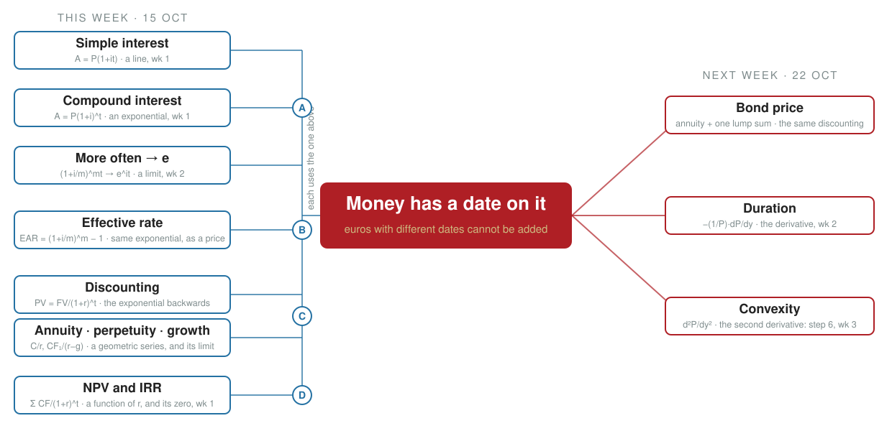
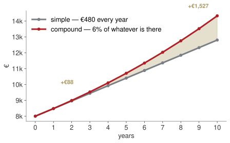
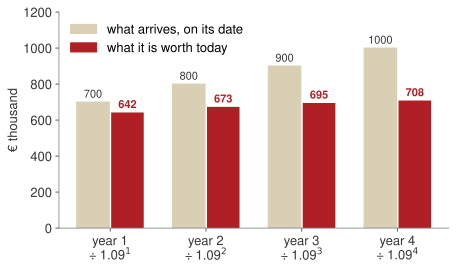
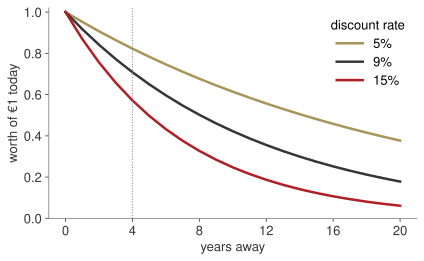
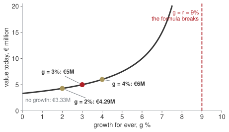
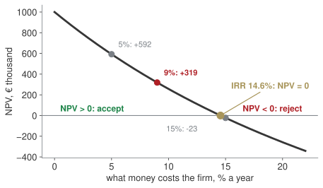

## Homework 3, at the board {.paper background-color="#eceff0"}

[PAPER · 15 minutes]{.kicker}

One of you takes us through it. The Board report, read aloud by its author. The room says what it would cut.

[Not an exam: the point is to see how you got there.]{.muted}

## Last week, in one minute

::: {.blocks}
::: {.blk .recap}
[Block A]{.blk-letter}The study, done properly[Seven steps in the brief's order; $f'$ finds the point, $f''$ names it]{.blk-answer}
:::
::: {.blk .recap}
[Block B]{.blk-letter}How much should the firm produce?[Until $R'(q) = C'(q)$. Average cost is lowest where MC = AC]{.blk-answer}
:::
::: {.blk .recap}
[Quiz]{.blk-letter}Weeks 1–3, five items[Marked and back today. Step 6, convexity: see the week-3 deck and drills, which now say more about it.]{.blk-answer}
:::
:::

[That closes the calculus. Today every euro gets a date.]{.red}

## Where we are

:::: {.columns}
::: {.column width="56%"}
| Wk | Date | What you can do by hand |
|---|---|---|
| 1–2 | 24 Sep – 1 Oct | algebra, limits, the derivative, first integrals ✓ |
| 3 | 8 Oct | study a function, optimise ✓ |
| **4** | **15 Oct** | **interest, EAR, discounting, NPV, a firm's value** |
| 5 | 22 Oct | bonds, duration, convexity |
:::
::: {.column width="44%"}
**A change of subject, not of method.**

The calculus is behind you; from here the mathematics is arithmetic done carefully. What is new is that **every euro now carries a date**, and two euros with different dates cannot be added.

The resit's multiple-choice block is entirely this and next week.
:::
::::

## The case for two weeks

::: {.callout-note title="Arno Bikes, a decision"}
A new assembly line costs **€2.4M today** and is expected to return **€700k, €800k, €900k and €1,000k** at the end of each of the next four years. Its money costs it **9% a year** (where that number comes from is the last part of block D).
:::

::: {.callout-important title="Bet before we compute"}
It returns €3.4M on a €2.4M outlay. Is that a million of profit? Yes or no — commit before the arithmetic.
:::

## Four blocks today {.hub auto-animate=true}

::: {.blocks}
::: {.blk .now data-id="blkA"}
[Block A]{.blk-letter}What does compounding actually do?[simple · compound · e]{.blk-tool}
:::
::: {.blk .next}
[Block B]{.blk-letter}Which of two quotes is cheaper?[the effective rate]{.blk-tool}
:::
::: {.blk .next}
[Block C]{.blk-letter}What is a future euro worth today?[discounting · annuities · growth]{.blk-tool}
:::
::: {.blk .next}
[Block D]{.blk-letter}Build the line or not?[NPV · IRR · WACC]{.blk-tool}
:::
:::

## The two weeks, as one map

{fig-align="center" width="100%"}

[Each box is built from the one before it; the words on the arrow say how. Today the blue chain; Thursday 22nd the red one, and the mock of the final's calculus question.]{.muted}

## [Block A]{.section-kicker} Interest, and what compounding actually does {.section-slide background-color="#AF1F25" auto-animate=true}

::: {.blk-fill data-id="blkA"}
:::

## €8,000 at 6%. Build it year by year.

**Simple** — 6% of the **original** €8,000, every year. €480, then €480, then €480.

| end of | interest | balance |
|---|---|---|
| year 1 | `6% × 8,000 = 480` | 8,480 |
| year 2 | `6% × 8,000 = 480` | 8,960 |
| year 3 | `6% × 8,000 = 480` | **9,440** |

. . .

$$A = P(1 + it)$$

[**P** the *principal*, what you put in · **i** the rate per year · **t** the years · **A** the *amount* at the end.]{.muted}

The `t` is a **multiplication**, because you are adding the same amount `t` times.

## Now 6% of whatever is actually there

**Compound** — the interest earns interest, so the amount grows too.

| end of | interest | balance |
|---|---|---|
| year 1 | `6% × 8,000 = 480.00` | 8,480.00 |
| year 2 | `6% × 8,480 = 508.80` | 8,988.80 |
| year 3 | `6% × 8,988.80 = 539.33` | **9,528.13** |

. . .

$$A = P(1+i)^{t}$$

The `t` is now an **exponent**, because each year multiplies by `1.06` again. `8,000 × 1.06 × 1.06 × 1.06`.

[That is the whole difference, and it is visible in the table before it is visible in the formula: one column repeats, the other climbs.]{.red}

## Three years is €88. Ten is not.

{fig-align="center" width="78%"}

The gold gap is what compounding adds. It is €88 after three years and **€1,527 after ten** — and it is the same 6% throughout.

[Nobody in finance means "simple" when they say interest. It is in the syllabus so that you can name what compounding adds, and so that you recognise the gap when someone quotes you the wrong one.]{.muted}

## A rate that moves by one point

€10,000 at 5%, compounded annually. Now the rate moves — up a point, down a point.

::: {.callout-important title="Bet before we compute"}
Over twenty years, on €10,000, how much is one point of interest worth?
:::

. . .

| rate | 8 years | 20 years |
|---|---|---|
| 4% | 13,685.69 | 21,911.23 |
| **5%** | **14,774.55** | **26,532.98** |
| 6% | 15,938.48 | 32,071.35 |

One point is about €1,100 over eight years and **€4,600 to €5,500 over twenty**. The rate sits in the base of a power: a point of rate is multiplied by itself `t` times, and the longer the horizon the more it matters.

## More often is more

$$A = P\left(1 + \frac{i}{m}\right)^{mt}$$

`m` is how many times a year interest is added. €5,000 at 8% nominal for 4 years, quarterly: `5000(1.02)¹⁶ = €6,863.93`.

::: {.callout-important title="Bet before we compute"}
Compound 12% a year every single day instead of once. How much more than €1,120 does €1,000 become?
:::

## The ceiling, and where *e* comes from {.clip background-color="#000000"}

<video class="clipvideo" width="1000" height="562" controls muted loop playsinline data-autoplay preload="auto" poster="media/w04_compounding_poster.png"><source src="media/w04_compounding.mp4" type="video/mp4"></video>

1,120 · 1,123.60 · 1,125.51 · 1,126.83 · 1,127.34 → **1,127.50**.

## Continuous compounding

$$\lim_{m \to \infty}\left(1 + \frac{i}{m}\right)^{m} = e^{\,i} \qquad\Longrightarrow\qquad A = P e^{\,it}$$

In week 1 `e` was "the base your calculator's `ln` uses". Here it earns its place: it is the ceiling on compounding, and the gap between weekly and continuous is sixteen cents on a thousand euros.

::: {.callout-tip title="Board sentence"}
Compounding more often always helps, and always by less. The limit is `e`.
:::

## A is a function — and you know how to study one

$$A(t) = P(1+i)^{t}, \qquad t \ge 0$$

| step | | |
|---|---|---|
| 1 · domain | $[0, \infty)$ | time runs forward |
| 2 · limits | $A(0) = P$; $A(t) \to \infty$ as $t \to \infty$ | no ceiling: a 5% deposit doubles every 14 years, for ever |
| 5 · monotone | $A'(t) = A(t)\ln(1+i) > 0$ | always rising; and the rise is proportional to what is already there |
| 6 · convexity | $A''(t) = A(t)\ln^{2}(1+i) > 0$ | **convex throughout, no inflection**: growth that keeps accelerating |

. . .

Simple interest is $A = P(1+it)$: a straight line, $A'' = 0$. That is the whole difference between the two tables, said with step 6.

[Challenge, in the drills: D15 is this study on paper; D16 is the same seven steps on the NPV curve you will meet in block D — its zero has a name.]{.red}

## Four blocks today {.hub auto-animate=true}

::: {.blocks}
::: {.blk .done}
[Block A]{.blk-letter}What does compounding actually do?[simple · compound · e]{.blk-tool}
:::
::: {.blk .now data-id="blkB"}
[Block B]{.blk-letter}Which of two quotes is cheaper?[the effective rate]{.blk-tool}
:::
::: {.blk .next}
[Block C]{.blk-letter}What is a future euro worth today?[discounting · annuities · growth]{.blk-tool}
:::
::: {.blk .next}
[Block D]{.blk-letter}Build the line or not?[NPV · IRR · WACC]{.blk-tool}
:::
:::

## [Block B]{.section-kicker} The effective rate — the only honest comparison {.section-slide background-color="#AF1F25" auto-animate=true}

::: {.blk-fill data-id="blkB"}
:::

## Two quotes, same nominal rate, different price

:::: {.columns}
::: {.column width="46%"}
$$EAR = \left(1 + \frac{i}{m}\right)^{m} - 1$$

| 12% nominal, compounded | EAR |
|---|---|
| semi-annually | 12.36% |
| quarterly | 12.55% |
| monthly | 12.68% |
| continuously | 12.75% |
:::
::: {.column width="54%"}
Bank A: **7.8% compounded monthly**. Bank B: **8% compounded annually**.

::: {.callout-important title="Bet before we compute"}
Which do you borrow from?
:::

::: {.fragment}
A: `(1 + 0.078/12)¹² − 1 = 8.085%`. B: `8.000%`.
**Borrow from B.** The lower headline rate is the dearer loan.
:::
:::
::::

[A nominal rate is not a price until you know `m`.]{.red}

## D4, D5 — put everything on the same basis {.paper background-color="#eceff0"}

[PAPER · drills.md]{.kicker}

10 minutes. Every answer states `m` explicitly before the arithmetic.

## Four blocks today {.hub auto-animate=true}

::: {.blocks}
::: {.blk .done}
[Block A]{.blk-letter}What does compounding actually do?[simple · compound · e]{.blk-tool}
:::
::: {.blk .done}
[Block B]{.blk-letter}Which of two quotes is cheaper?[the effective rate]{.blk-tool}
:::
::: {.blk .now data-id="blkC"}
[Block C]{.blk-letter}What is a future euro worth today?[discounting · annuities · growth]{.blk-tool}
:::
::: {.blk .next}
[Block D]{.blk-letter}Build the line or not?[NPV · IRR · WACC]{.blk-tool}
:::
:::

## [Block C]{.section-kicker} What is a future euro worth today — and a whole firm? {.section-slide background-color="#AF1F25" auto-animate=true}

::: {.blk-fill data-id="blkC"}
:::

## The line pays €700k in a year. What is that worth today?

::: {.callout-important title="Bet before we compute"}
€700k, guaranteed, twelve months from now. Is that worth €700k to the firm today — more, or less?
:::

. . .

Block A, with Arno Bikes' rate of **9%**: put money in today, it is multiplied by `1.09` in a year.

| today | | in one year |
|---|---|---|
| €642.20k | `× 1.09` → | €700.00k |
| **?** | ← `÷ 1.09` | €700.00k |

. . .

So €700k in a year is worth `700 / 1.09 =` **€642.20k** today: the sum that, left at 9%, *becomes* €700k. [Discounting is compounding run backwards. Nothing else about it is new.]{.red}

## Two years away: divide twice

€800k arrives in **two** years. Undo two years of growth:

`800 ÷ 1.09 ÷ 1.09 = 800 / 1.09² =` **€673.34k** [check: `673.34 × 1.09 × 1.09 = 800` ✓]{.muted}

. . .

$$PV = \frac{FV}{(1+r)^{t}}$$

[**FV** *future value*, the sum on its own date · **PV** *present value*, what it is worth today · **r** the rate, here called the *discount rate* · **t** how many years away.]{.muted}

. . .

:::: {.columns}
::: {.column width="52%"}
| €1 arriving in | is worth today, at 9% |
|---|---|
| 1 year | `1/1.09 = 0.9174` |
| 2 years | `1/1.09² = 0.8417` |
| 3 years | `1/1.09³ = 0.7722` |
| 4 years | `1/1.09⁴ = 0.7084` |
:::
::: {.column width="48%"}
This column is the **discount factor**: what one euro on that date is worth now. Every present value is *amount × factor*.

[Keep this column. Block D is this column and nothing else.]{.red}
:::
::::

## The further away, the more it shrinks

{fig-align="center" width="74%"}

[The gold bars are what the line pays, each on its own date. The red bars are the same money brought to today. Year 4 pays the most and loses the most.]{.muted}

## Why 9%, and why does a later euro count for less?

**Because money has a cost.** Arno Bikes' money costs it 9% a year — that is its **cost of capital**. A euro that arrives in a year instead of today is a year in which it could have paid back 9% or earned 9%. Discounting charges each future euro for its wait.

. . .

[Inflation and risk do not need a separate step: they are already inside the rate. A riskier flow is discounted at a higher rate.]{.muted}

. . .

[Where the 9% itself comes from — who lent the money and what they want for it — is the last part of block D.]{.red}

## The rate decides how much it shrinks

:::: {.columns}
::: {.column width="40%"}
The same **€1,000 in four years**, today:

| rate | worth today |
|---|---|
| 5% | €822.70 |
| **9%** | **€708.43** |
| 15% | €571.75 |

Same euros, same date. Only the rate changed, and the answer moved by €250.
:::
::: {.column width="60%"}
{width="100%"}
:::
::::

::: {.callout-tip title="Board sentence"}
Euros with different dates cannot be added. Bring each to today first — and the rate you bring them with decides the answer.
:::

## D7, D8 — one sum, brought to today {.paper background-color="#eceff0"}

[PAPER · drills.md]{.kicker}

8 minutes. Write the factor on its own line before you multiply: `1/(1.07)⁵ = …`, then `10,000 × … = …`.

## The same payment, every year: add the factors

The firm leases a machine out for **€500k a year, four years**, at 9%. Four present values — the factors are the column you already have:

`500 × (0.9174 + 0.8417 + 0.7722 + 0.7084) = 500 × 3.2397 ≈` **€1,619.86k**

. . .

:::: {.columns}
::: {.column width="50%"}
**Annuity** — the same `C`, `n` times. The bracket is that sum of factors, already done:
$$PV = C\,\frac{1 - (1+r)^{-n}}{r}$$
`500 × (1 − 1.09⁻⁴)/0.09 = 500 × 3.2397` ✓
:::
::: {.column width="50%"}
**Perpetuity** — the same `C` for ever. The factors keep coming but keep shrinking, and their sum stops at `1/r`:
$$PV = \frac{C}{r}$$
`500 / 0.09 =` **€5,555.56k**
:::
::::

[Loans, leases, pensions and — next week — bond coupons are all annuities. You need the formula only because adding thirty factors by hand is slow.]{.muted}

## D9 — annuities and perpetuities {.paper background-color="#eceff0"}

[PAPER · drills.md]{.kicker}

7 minutes. Say first which it is — fixed number of payments, or for ever — then write the formula.

## What is the whole firm worth?

[BEYOND THE SYLLABUS]{.kicker}

:::: {.columns}
::: {.column width="52%"}
A buyer asks the Board for a price. A firm is a stream of yearly cash, so it is priced like a stream.

- next year's **free cash flow**: €300k [— the cash left for the owners after costs, taxes and the investment needed to keep going]{.muted}
- growing **3% a year, for ever**
- cost of capital **9%**

No growth: a perpetuity, `300 / 0.09 =` **€3.33M**.

::: {.callout-important title="Bet before we compute"}
With 3% growth — how much?
:::
:::
::: {.column width="48%"}
| Year | Cash flow (€k) | PV at 9% (€k) |
|---|---|---|
| 1 | 300.00 | 275.23 |
| 2 | 309.00 | 260.08 |
| 3 | 318.27 | 245.76 |
| 4 | 327.82 | 232.23 |
| 5 | 337.65 | 219.45 |
| … | grows 3% | shrinks |

[The flows grow by 3%, the discounting takes off 9%: each row is worth a bit less than the one before, but the rows never stop.]{.muted}
:::
::::

## A perpetuity, with the growth taken off the rate

$$PV = \frac{CF_1}{r - g} = \frac{300}{0.09 - 0.03} = \frac{300}{0.06} = \textbf{€5M}$$

[Same as `C/r`, except the rate is reduced by the growth. With `g = 0` it *is* `C/r`.]{.muted}

. . .

:::: {.columns}
::: {.column width="60%"}
{width="100%"}
:::
::: {.column width="40%"}
| g | value |
|---|---|
| 2% | €4.29M |
| **3%** | **€5.00M** |
| 4% | €6.00M |

One point of growth is worth about a million. As `g` approaches `r` the denominator approaches zero and the value explodes (a limit, week 2). [It only works with `g < r`.]{.red}
:::
::::

## D10–D12 — a growing stream, a firm's price {.paper background-color="#eceff0"}

[PAPER · drills.md]{.kicker}

10 minutes. D11 ends with one sentence for the Board.

## Four blocks today {.hub auto-animate=true}

::: {.blocks}
::: {.blk .done}
[Block A]{.blk-letter}What does compounding actually do?[simple · compound · e]{.blk-tool}
:::
::: {.blk .done}
[Block B]{.blk-letter}Which of two quotes is cheaper?[the effective rate]{.blk-tool}
:::
::: {.blk .done}
[Block C]{.blk-letter}What is a future euro worth today?[discounting · annuities · growth]{.blk-tool}
:::
::: {.blk .now data-id="blkD"}
[Block D]{.blk-letter}Build the line or not?[NPV · IRR · WACC]{.blk-tool}
:::
:::

## [Block D]{.section-kicker} NPV — the decision itself {.section-slide background-color="#AF1F25" auto-animate=true}

::: {.blk-fill data-id="blkD"}
:::

## Back to the line: every flow to today, then add

Each flow × its factor from block C. Year 0 is today, so its factor is 1.

| Year | Flow (€k) | × factor at 9% | = worth today (€k) |
|---|---|---|---|
| 0 | −2,400 | 1 | −2,400.00 |
| 1 | 700 | 0.9174 | 642.20 |
| 2 | 800 | 0.8417 | 673.34 |
| 3 | 900 | 0.7722 | 694.97 |
| 4 | 1,000 | 0.7084 | 708.43 |
| | | **sum = NPV** | **+318.94** |

. . .

[**Net Present Value**: *present* because everything is brought to today, *net* because the outlay is in the sum. The same table as one line:]{.muted}
$$NPV = -2{,}400 + \frac{700}{1.09} + \frac{800}{1.09^{2}} + \frac{900}{1.09^{3}} + \frac{1{,}000}{1.09^{4}} = +318.94$$

## So the bet was wrong

The Board member said "€3.4M back on €2.4M out, a million of profit".

. . .

That million added euros from four different years as if they were the same euro. Brought to today, the gain is **€319k** — still positive, still worth doing, a third of what it looked like.

::: {.callout-tip title="Board sentence"}
Bring every flow to today at our cost of capital and add them. Positive: build it — the line pays for its money and leaves €319k over. Negative: don't.
:::

## What if money cost more?

:::: {.columns}
::: {.column width="34%"}
Same flows, different rate:

| rate | NPV (€k) |
|---|---|
| 5% | +592 |
| **9%** | **+319** |
| 12% | +139 |
| 15% | −23 |

The dearer the money, the more each future euro shrinks, the lower the NPV.
:::
::: {.column width="66%"}
{width="100%"}
:::
::::

## Move the rate, watch the sign {.clip background-color="#000000"}

<video class="clipvideo" width="1000" height="562" controls muted loop playsinline data-autoplay preload="auto" poster="media/w04_npv_poster.png"><source src="media/w04_npv.mp4" type="video/mp4"></video>

Somewhere between 12% and 15% the NPV crosses zero.

## The crossing has a name: IRR

The **internal rate of return** is the rate at which NPV is exactly zero. For the line, **14.6%**.

. . .

**What it tells you.** The line stays worth building as long as money costs the firm less than 14.6%. Ours costs 9%: 5.6 points of room.

. . .

**What it does not.** It is not a decision rule on its own: between two projects the higher IRR can be the one that makes less money. Decide on NPV; quote IRR as the safety margin.

## Push the cost of capital {.lab background-color="#2471a3"}

[LAB · session.ipynb § D]{.kicker}

1. Bet: at what rate does this project stop being worth doing?
2. Then slide, and read the crossing.
3. Now delay the first €700k by a year. What happens to the IRR, and why?

## Last question: why 9%?

We have used 9% all morning. It is not the bank's rate — the bank charges 6%. The €2.4M came from **two** places, and each wants paying.

| Who put the money in | Amount | What they want each year | Cost to the firm each year |
|---|---|---|---|
| Shareholders, 60% | €1,440k | 12% → €172.8k | €172.8k |
| Bank, 40% | €960k | 6% → €57.6k | €43.2k [interest cuts taxable profit; at 25% tax, a quarter comes back]{.muted} |
| **Total** | **€2,400k** | | **€216.0k** |

. . .

`216 / 2,400 =` **9.0%** a year. That is the cost of capital: what the line must earn just to pay the people who financed it. [Shareholders want more than the bank because they are paid last and carry the risk.]{.muted}

## The same table, as a formula: WACC

Each source's cost, weighted by its share of the money — a **weighted average cost of capital**.

$$WACC = \frac{E}{V}\,r_e \;+\; \frac{D}{V}\,r_d(1-\tau)$$

| | | Arno Bikes |
|---|---|---|
| `E/V`, `D/V` | share of equity, share of debt | 0.6, 0.4 |
| `r_e`, `r_d` | what shareholders expect, what the bank charges | 12%, 6% |
| `(1 − τ)` | the tax saving on interest | 0.75 |

`0.6 × 12% + 0.4 × 6% × 0.75 = 7.2% + 1.8% =` **9.0%**

::: {.callout-tip title="Board sentence"}
The discount rate is not a guess: it is what our own money costs us. A project with positive NPV at our WACC pays everyone who financed it and leaves something over.
:::

## D13, D13b, D14 — the case, decided {.paper background-color="#eceff0"}

[PAPER · drills.md]{.kicker}

12 minutes. Lay out the table with a row for year 0. Then say accept or reject, in one sentence.

## [Close]{.section-kicker} Take home {.section-slide background-color="#AF1F25"}

## Take home

1. A nominal rate is not a price until you know how often it compounds. Compare on EAR.
2. Compounding more often always helps, and always by less. The ceiling is `e`.
3. Money with different dates cannot be added. Bring each sum to today by dividing by $(1+r)^t$ — compounding run backwards.
4. A firm growing for ever is worth $CF_1/(r-g)$; the gap $r-g$ is where the valuation's risk sits.
5. NPV = every flow brought to today, outlay included, added up. Accept when it is positive at your own cost of capital; IRR is the rate where it crosses zero.
6. The cost of capital is the WACC: what shareholders and lenders want, weighted by their share of the money, with the tax saving on interest.

**Homework 4**, for Thursday 22 October: nine drills plus a memo correcting the Board member. Next week: the same arithmetic applied to a bond.
