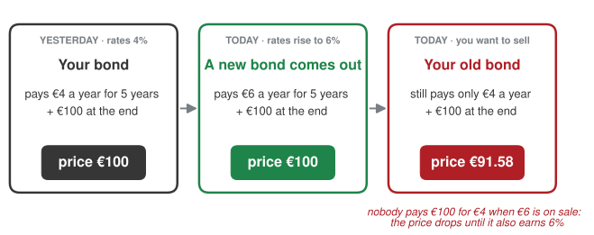
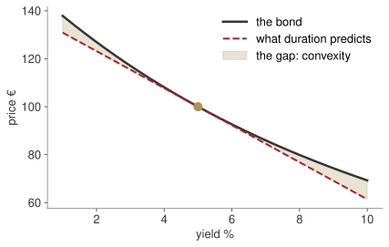
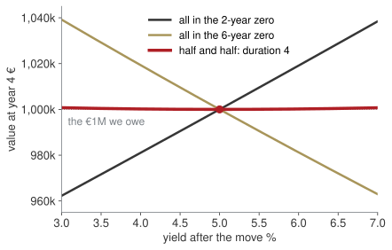
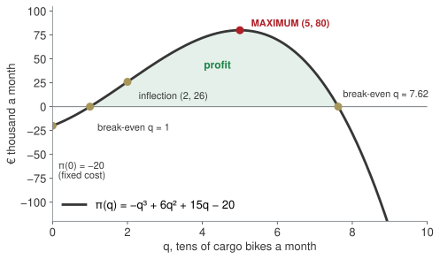
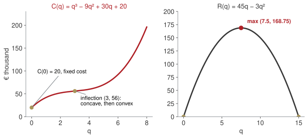

## Homework 4, at the board {.paper background-color="#eceff0"}

[PAPER · 15 minutes]{.kicker}

One of you takes us through it. The memo to the Board member. Would they accept it? Why not?

[Not an exam: the point is to see how you got there.]{.muted}

## Last week, in one minute

::: {.blocks}
::: {.blk .recap}
[Block A]{.blk-letter}What does compounding actually do?[More often always helps, by less each time; the ceiling is $e^{r}$]{.blk-answer}
:::
::: {.blk .recap}
[Block B]{.blk-letter}Which of two quotes is cheaper?[Compare on $EAR = (1 + r/n)^{n} - 1$, never on the nominal rate]{.blk-answer}
:::
::: {.blk .recap}
[Block C]{.blk-letter}What is a future euro worth today?[Discount before adding: $PV = FV/(1+r)^{t}$]{.blk-answer}
:::
::: {.blk .recap}
[Block D]{.blk-letter}Build the line or not?[NPV = +€319k at 9% — accept; IRR is where NPV crosses zero]{.blk-answer}
:::
:::

[Today the same arithmetic prices a bond, and a derivative tells you what a rate rise costs.]{.red}

## Where we are — the last of my five

:::: {.columns}
::: {.column width="56%"}
| Wk | Date | What you can do by hand |
|---|---|---|
| 1–2 | 24 Sep – 1 Oct | algebra, limits, the derivative ✓ |
| 3 | 8 Oct | study, optimise, integrate ✓ |
| 4 | 15 Oct | interest, discounting, NPV ✓ |
| **5** | **22 Oct** | **bonds, duration, convexity** |
:::
::: {.column width="44%"}
**Today closes the loop.**

A bond is an annuity plus a lump sum — last week's arithmetic, nothing new. Duration is a derivative — week 2's. Convexity is a second derivative — week 3's.

Then: a full study of a cost, a revenue and a profit, in the midterm's own format.
:::
::::

[The midterm is due Sunday 1 November on Turnitin. Reading week has one optional office hour: bring a draft.]{.red}

## Today's question

::: {.callout-note title="Arno Bikes, a reserve"}
The firm keeps **€1M in bonds** as a cash reserve. The Board has read that rates may rise by a point and asks: **should we be worried?**
:::

By the end of the session you will answer that with two numbers and a sentence.

## Four blocks today {.hub auto-animate=true}

::: {.blocks}
::: {.blk .now data-id="blkA"}
[Block A]{.blk-letter}What is this bond worth?[pricing]{.blk-tool}
:::
::: {.blk .next}
[Block B]{.blk-letter}How much does a rate rise cost?[duration]{.blk-tool}
:::
::: {.blk .next}
[Block C]{.blk-letter}What the straight line misses[convexity, then immunisation]{.blk-tool}
:::
::: {.blk .next}
[Block D]{.blk-letter}A full study, midterm format[cost, revenue, profit]{.blk-tool}
:::
:::

## [Block A]{.section-kicker} Pricing a bond — nothing new {.section-slide background-color="#AF1F25" auto-animate=true}

::: {.blk-fill data-id="blkA"}
:::

## A bond is a promise with dates on it

$$P = \sum_{t=1}^{n} \frac{c \cdot F}{(1+y)^{t}} \;+\; \frac{F}{(1+y)^{n}}$$

An annuity of coupons, plus the face value at the end. You priced both last week.

. . .

A 5-year bond, 4% coupon, face €100, yield 6%:

$$P = 4 \times 4.212364 + 74.73 = 16.85 + 74.73 = €91.58$$

::: {.callout-important title="Bet before we compute"}
Why is it below 100? Answer in one sentence, without arithmetic.
:::

## Rates rise. Why is your old bond worth less?

{fig-align="center" width="96%"}

Same €100 at the end, €2 less every year. A buyer takes yours only at a discount: the price falls until your bond also earns 6% — that is the €91.58.

## The rule that follows from the formula

| | |
|---|---|
| coupon **>** yield | **premium** — price above face |
| coupon **=** yield | **par** — price equals face |
| coupon **<** yield | **discount** — price below face |

The bond pays 4% on its face; the market wants 6%. The only way to deliver 6% is to sell it for less than 100.

[Price and yield move in opposite directions. Always, for every bond, with no exceptions.]{.red}

## D1, D2, D3 — price it three ways {.paper background-color="#eceff0"}

[PAPER · drills.md]{.kicker}

12 minutes. Show the annuity part and the redemption part separately. D3 is in the resit's exact format.

## Four blocks today {.hub auto-animate=true}

::: {.blocks}
::: {.blk .done}
[Block A]{.blk-letter}What is this bond worth?[pricing]{.blk-tool}
:::
::: {.blk .now data-id="blkB"}
[Block B]{.blk-letter}How much does a rate rise cost?[duration]{.blk-tool}
:::
::: {.blk .next}
[Block C]{.blk-letter}What the straight line misses[convexity, then immunisation]{.blk-tool}
:::
::: {.blk .next}
[Block D]{.blk-letter}A full study, midterm format[cost, revenue, profit]{.blk-tool}
:::
:::

## [Block B]{.section-kicker} Duration — the slope of that curve {.section-slide background-color="#AF1F25" auto-animate=true}

::: {.blk-fill data-id="blkB"}
:::

## The picture the Board needs

{fig-align="center" width="74%"}

Price against yield is a **curve**, not a line. Duration is the straight line that touches it where you are standing now.

## Duration is a derivative {.clip background-color="#000000"}

<video class="clipvideo" width="1000" height="562" controls muted loop playsinline data-autoplay preload="auto" poster="media/w05_duration_poster.png"><source src="media/w05_duration.mp4" type="video/mp4"></video>

`dP/dy = −772`, and written as a percentage, `D_mod = 7.72`.

## Two durations, and the difference matters

:::: {.columns}
::: {.column width="50%"}
**Macaulay** — the average time to being repaid, weighted by present value:
$$D = \sum_{t} t \cdot \frac{PV(CF_t)}{P}$$
Measured in **years**.
:::
::: {.column width="50%"}
**Modified** — the same thing turned into a sensitivity:
$$D_{\text{mod}} = \frac{D}{1+y} = -\frac{1}{P}\frac{dP}{dy}$$
Measured in **% per 1% of yield**.
:::
::::

. . .

$$\frac{\Delta P}{P} \;\approx\; -D_{\text{mod}} \times \Delta y$$

A 10-year 5% bond at par has `D_mod = 7.72`: a one-point rise in yields costs about **7.7% of its value**.

## Three rules worth memorising

| other things equal | duration |
|---|---|
| longer maturity | **rises** — money comes back later |
| higher coupon | **falls** — more comes back sooner |
| higher yield | **falls** — distant coupons discounted harder |

A zero-coupon bond's Macaulay duration is exactly its maturity: there is nothing to pull the average forward.

::: {.callout-tip title="Board sentence"}
Duration is how many percent you lose for each percent rates rise. It is one number, and it is the first one a Board asks for.
:::

## D5, D6 — compute it, then use it {.paper background-color="#eceff0"}

[PAPER · drills.md]{.kicker}

15 minutes. The weights column must sum to 1. If it does not, stop before computing the duration.

## Four blocks today {.hub auto-animate=true}

::: {.blocks}
::: {.blk .done}
[Block A]{.blk-letter}What is this bond worth?[pricing]{.blk-tool}
:::
::: {.blk .done}
[Block B]{.blk-letter}How much does a rate rise cost?[duration]{.blk-tool}
:::
::: {.blk .now data-id="blkC"}
[Block C]{.blk-letter}What the straight line misses[convexity, then immunisation]{.blk-tool}
:::
::: {.blk .next}
[Block D]{.blk-letter}A full study, midterm format[cost, revenue, profit]{.blk-tool}
:::
:::

## [Block C]{.section-kicker} Convexity — the gap the line misses {.section-slide background-color="#AF1F25" auto-animate=true}

::: {.blk-fill data-id="blkC"}
:::

## Duration says €92.28. The truth is €92.64.

::: {.callout-important title="Bet before we compute"}
The straight-line estimate is wrong. Is it wrong in the holder's favour, or against?
:::

. . .

The curve lies **above** the tangent on both sides. So duration alone **overstates the loss** when yields rise, and **understates the gain** when they fall.

## Watch the gap open {.clip background-color="#000000"}

<video class="clipvideo" width="1000" height="562" controls muted loop playsinline data-autoplay preload="auto" poster="media/w05_convexity_poster.png"><source src="media/w05_convexity.mp4" type="video/mp4"></video>

Small move, small gap. Large move, large gap — and always the same way.

## The second term

$$\frac{\Delta P}{P} \;\approx\; -D_{\text{mod}}\,\Delta y \;+\; \tfrac{1}{2}\,C\,(\Delta y)^{2}$$

| estimate | price at 6% |
|---|---|
| duration only | €92.28 |
| duration + convexity | €92.66 |
| **the truth** | **€92.64** |

Two cents out instead of thirty-six. The half and the square are both easy to drop, and both change the answer.

## Between two bonds of the same duration, the more convex one is worth more. {.statement}

More upside, less downside, for the same first-order risk. You usually pay for it.

## D8, D11 — the reserve, decided {.paper background-color="#eceff0"}

[PAPER · drills.md]{.kicker}

15 minutes. D11 answers the Board's question: a portfolio duration, a euro figure, and a sentence.

## The answer to this morning's question

€400k at `D_mod = 7.72`, €600k at `D_mod = 1.90`:

$$D_{\text{portfolio}} = 0.4(7.72) + 0.6(1.90) = 4.23$$
$$\Delta V \approx -4.23 \times 1\% \times €1{,}000{,}000 = -€42{,}280$$

. . .

"A one-point rise costs the reserve about €42,000, a little over 4%. About three quarters of the exposure sits in the ten-year holding; shortening it would roughly halve the figure. Convexity means the true loss is slightly smaller than this."

## Can we stop worrying?

::: {.callout-note title="Arno Bikes, a payment"}
The new building costs **€1M, due in exactly 4 years**. The firm sets the money aside **today**, in zero-coupon bonds yielding **5%**. Then rates move.
:::

::: {.callout-important title="Bet before we compute"}
Short bonds, long bonds, or a mix? Which choice leaves the €1M there in year 4, whichever way rates go?
:::

[Beyond the syllabus: the step after duration, from measuring the risk to removing it.]{.muted}

## Rates rise. Two things happen at once.

:::: {.columns}
::: {.column width="50%"}
**Prices fall** [— bad]{.red}

Whatever we still hold at year 4 is worth less. The longer the bond, the bigger the fall: that is duration.
:::
::: {.column width="50%"}
**Coupons reinvest at more** [— good]{.red}

Whatever comes back before year 4 earns the higher rate until the payment. The sooner it comes back, the more it gains.
:::
::::

. . .

Short bonds: reinvestment wins. Long bonds: the price fall wins.

[If the duration of what we hold equals the date of what we owe, the two effects offset — to first order.]{.red}

## How much in each bond?

$$PV = \frac{€1{,}000{,}000}{(1.05)^{4}} = €822{,}702$$

A zero's duration is its maturity. Put a share $w$ in a **2-year** zero, the rest in a **6-year** zero:

$$2w + 6(1-w) = 4 \quad\Longrightarrow\quad w = \tfrac{1}{2}$$

. . .

| | invested today | pays |
|---|---|---|
| 2-year zero | €411,351 | €453,515 in year 2 — reinvested to year 4 |
| 6-year zero | €411,351 | €551,250 in year 6 — sold at year 4 |

## Rates jump the day after we buy. Is the €1M still there?

:::: {.columns}
::: {.column width="42%"}
| yield after | value at year 4 | vs €1M |
|---|---|---|
| 3% | €1,000,740 | +740 |
| 4% | €1,000,183 | +183 |
| 5% | €1,000,000 | 0 |
| 6% | €1,000,180 | +180 |
| 7% | €1,000,712 | +712 |

At 6%: $453{,}515 \times 1.06^{2} + \dfrac{551{,}250}{1.06^{2}}$.
:::
::: {.column width="58%"}
{width="100%"}
:::
::::

[Slightly **above** €1M either way: that is convexity again, working for us.]{.red}

## What we tell the Board

::: {.callout-tip title="Board sentence"}
Hold bonds whose duration equals the date of the payment, and a move in rates, up or down, cannot hurt it: what we lose on prices we make back on reinvestment.
:::

. . .

One condition. As time passes the date gets closer and durations drift apart, so the match is **reset every year** — immunisation is a routine, not a purchase.

## D12 — immunise a smaller payment {.paper background-color="#eceff0"}

[PAPER · drills.md]{.kicker}

5 minutes. Duration equation first, then the euros. D13 checks it after a move; it is for home if time runs short.

## Four blocks today {.hub auto-animate=true}

::: {.blocks}
::: {.blk .done}
[Block A]{.blk-letter}What is this bond worth?[pricing]{.blk-tool}
:::
::: {.blk .done}
[Block B]{.blk-letter}How much does a rate rise cost?[duration]{.blk-tool}
:::
::: {.blk .done}
[Block C]{.blk-letter}What the straight line misses[convexity, then immunisation]{.blk-tool}
:::
::: {.blk .now data-id="blkD"}
[Block D]{.blk-letter}A full study, midterm format[cost, revenue, profit]{.blk-tool}
:::
:::

## [Block D]{.section-kicker} A full study — the midterm's format {.section-slide background-color="#AF1F25" auto-animate=true}

::: {.blk-fill data-id="blkD"}
:::

## Arno Bikes launches a cargo bike

::: {.callout-note title="The case"}
$q$ = cargo bikes a month, **in tens** · all figures in **€ thousand a month** · the price is $p = 45 - 3q$
:::

$$C(q) = q^{3} - 9q^{2} + 30q + 20 \qquad R(q) = p \cdot q = 45q - 3q^{2}$$
$$\pi(q) = R(q) - C(q) = -q^{3} + 6q^{2} + 15q - 20$$

Three functions, seven steps each, every result turned into a sentence. That is the midterm.

::: {.callout-important title="Bet before we compute"}
How many cargo bikes a month should the firm make? Guess before the derivative.
:::

## Profit, the seven steps

| | step | what we find |
|---|---|---|
| 1 | **domain** | the price must not go negative: $45 - 3q \ge 0$, so $q \in [0, 15]$ |
| 2 | **limits** | a polynomial: no asymptotes; $\pi(0) = -20$ (the fixed cost), $\pi(15) = -1{,}820$ |
| 3 | **range** | from the lowest to the highest value it reaches: $[-1{,}820,\ 80]$ |
| 4 | **sign** | $\pi = -(q-1)(q^{2}-5q-20)$: zeros at $q = 1$ and $q = \tfrac{5+\sqrt{105}}{2} \approx 7.62$; positive in between |
| 5 | **max / min** | $\pi'(q) = -3q^{2} + 12q + 15 = -3(q-5)(q+1) = 0 \Rightarrow q = 5$; $\pi''(5) = -18 < 0$: a **maximum**, $\pi(5) = 80$ |
| 6 | **convexity** | $\pi''(q) = 12 - 6q$: convex on $[0, 2)$, concave on $(2, 15]$; **inflection** at $(2, 26)$ |
| 7 | **sketch** | next slide — every point above, marked |

## The sketch, with everything on it

{fig-align="center" width="78%"}

## Cost and revenue — the same seven steps, shorter

:::: {.columns}
::: {.column width="50%"}
**Cost** $C(q) = q^{3} - 9q^{2} + 30q + 20$

- domain $[0, +\infty)$; $C(0) = 20$, the fixed cost
- $C'(q) = 3(q^{2} - 6q + 10) > 0$ always: **no max or min**, cost only rises
- $C''(q) = 6(q-3)$: concave, then convex; **inflection** $(3, 56)$
- range $[20, +\infty)$; always positive
:::
::: {.column width="50%"}
**Revenue** $R(q) = 45q - 3q^{2}$

- domain $[0, 15]$; zeros at $0$ and $15$
- $R'(q) = 45 - 6q = 0 \Rightarrow q = 7.5$
- $R''(q) = -6 < 0$: a **maximum**, $R(7.5) = 168.75$; concave everywhere
- range $[0,\ 168.75]$
:::
::::

## Cost and revenue, sketched

{fig-align="center" width="90%"}

Cost: never turns, but bends at 30 bikes. Revenue: turns at 75 bikes, where the falling price starts to win.

## From numbers to sentences

| you found | you write for the Board |
|---|---|
| $q^{*} = 5$ | "Make 50 cargo bikes a month." |
| $\pi(5) = 80$ | "At that output we earn €80,000 a month." |
| zeros $1$ and $7.62$ | "We make money between 10 and 76 bikes; outside that window we lose." |
| $\pi''(5) < 0$ | "50 is a genuine peak, not a dip or a flat spot." |
| $C$ inflects at $q = 3$ | "Each extra bike gets cheaper up to 30 a month, then dearer." |
| $R$ peaks at $7.5$ | "Selling more than 75 a month would bring in *less* money: the price falls too far." |

[Revenue peaks at 75 bikes, profit at 50. The Board's question is profit.]{.red}

## Your midterm, in this order

1. The mathematics, on paper — seven steps for each function, every number checked twice
2. The sketches, by hand, every point marked
3. Findings: one sentence for each result
4. The qualitative sections, with Harvard sources tied to the functions
5. The executive summary, **last**

[Due Sunday 1 November, 23:59, Turnitin — submit on Saturday. The mock of the final's calculus question (`mock_exam.md`) is for home: thirty minutes, timed.]{.red}

## [Close]{.section-kicker} Handing over {.section-slide background-color="#AF1F25"}

## Take home

1. A bond is an annuity plus a lump sum. Price and yield move in opposite directions.
2. Duration is the slope: how many percent you lose per percent of yield.
3. Longer maturity raises it; a bigger coupon lowers it.
4. Convexity is the curvature the slope misses, and it is always in the holder's favour.
5. Match the duration of what you hold to the date of what you owe, and a rate move cannot hurt the payment.
6. A study is seven steps, in the brief's words; every number gets its sentence for the Board.

## What happens next

| | |
|---|---|
| **Homework 5** | due Wednesday 28 October, 23:59 — lighter, on purpose |
| **Reading week** | 26–30 October, no class; one optional online office hour |
| **Midterm** | due **Sunday 1 November, 23:59, Turnitin** |
| **Presentations** | week of 2 November |
| **Weeks 6–10** | Vincenzo Nardelli, online: probability, distributions, statistics |

I mark the midterm and stay your reference for it. Everything from weeks 1–3 is what it is built on; everything from weeks 4–5 is the resit's financial-mathematics block and the exam items around it.

[Bring a draft to the office hour. A blank page is a harder conversation than a wrong one.]{.muted}
