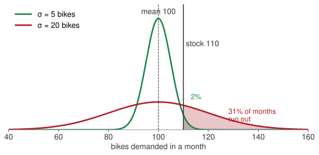
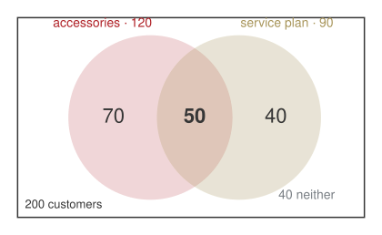
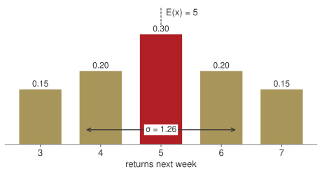

## Who I am

:::: {.columns}
::: {.column width="28%"}
{width="100%"}
:::
::: {.column width="72%"}
**Vincenzo Nardelli, PhD** · Assistant Professor · Founder, Intuo and Geotobler

::: {.incremental}
- **Economics**, then **MSc Statistical Sciences**, Università Cattolica
- **PhD, Statistics and Data Science**, Milano-Bicocca
- **Visiting Scholar**, Center for Spatial Data Science, University of Chicago, and Brunel University of London
- **Assistant Professor**, Università Cattolica, Rome: spatial statistics and econometrics; teaches Statistics, Coding, Big Data
- **Founder, Intuo** (AI consulting) and **Geotobler** (geospatial AI, SaaS)
:::

:::
::::

## Weeks 1–5: every number was known

:::: {.columns}
::: {.column width="50%"}
::: {.bigtable}
| Arno Bikes, so far | |
|---|---|
| Fixed cost | €60,000 a month |
| Variable cost | €400 a bike |
| List price | €1,000 a bike |
| Break-even | 100 bikes a month |
| Cost of capital | 9% a year |
| The bond it bought | 4% coupon, 5 years |
:::
[Every one of these was given. You solved for the rest.]{.muted}
:::
::: {.column width="50%" .fragment}
**Weeks 6–10: the same firm, and the founder does not know the numbers.**

- How many customers next month?
- How many bikes come back under warranty?
- How far does a battery *really* go?
- Which supplier sent the faulty batch?

::: {.fragment}
[A number she does not know is not a number she can ignore. It is a number with a spread.]{.red}
:::

:::
::::

## Planning on the average, and running out

:::: {.columns}
::: {.column width="58%"}

:::
::: {.column width="42%" .fragment}
Demand averages **100 bikes a month**. The founder stocks **110** — "ten more than average, we are safe".

Same average, two very different months.

If demand moves by about 5 bikes, she runs out in **2%** of months. If it moves by about 20, she runs out **one month in three**.

::: {.fragment}
[The mean was never the problem. The spread is. For the spread we need the variance — and the rest of today.]{.red}
:::

:::
::::

## Where the weeks go

:::: {.columns}
::: {.column width="60%"}
| Wk | Date | What you will be able to do by hand |
|---|---|---|
| 6 | 5 Nov · **today, in person** | count, condition, update; mean and spread; what a distribution is |
| 7 | 9 Nov · **online** | three shapes: binomial, Poisson, the normal; deciding under uncertainty |
| 8 | 16 Nov | how sure are we of a number: confidence intervals, tests |
| 9 | 23 Nov | one line through the data: regression and forecasting |
| 10 | 30 Nov | review and quiz |

: {tbl-colwidths="[8,26,66]"}
:::
::: {.column width="40%"}
**One case, five sessions.** Arno Bikes, the firm from weeks 1–5. Every number you see from now on is one of its numbers.

Today we are in this room. From next Monday the four remaining sessions are online. A calculator and a notebook are all you need today.
:::
::::

[Every technique in this course is here because an assessment asks for it. I will tell you which one, every time.]{.red}

## How today runs

::: {.blocks .four}
::: {.blk .recap}
[10:00 · 10']{.blk-letter}The bridge[From certain numbers to uncertain ones.]{.blk-answer}
:::
::: {.blk .now}
[10:10 → 12:20]{.blk-letter}Three questions from the founder[Each one: her question and your bet **on paper** → the picture → one formula with a number → the sentence for the Board. Break at 11:15.]{.blk-tool}
:::
::: {.blk .recap}
[12:20 · 20']{.blk-letter}Take home[Three lines to remember, the three answers for the founder, the homework.]{.blk-answer}
:::
::: {.blk .recap}
[Monday]{.blk-letter}Online[Three shapes, and how to decide with them.]{.blk-answer}
:::
:::

[Bets are written, not said. Write a number on your sheet before I compute; the surprise is where the learning is. No drills during the session: three short ones are online, with solutions, for tonight.]{.muted}

## The case: Arno Bikes, this quarter

::: {.bigtable}
| | |
|---|---|
| **e-bike assembler, Florence** | |
| Customers last quarter | 200 |
| Batteries bought last month | 1,000, from two suppliers |
| Returns under warranty | about 5 a week |
| Staff | 8 people |
:::

[None of these is a fixed cost or a list price. Each one moves.]{.muted}

## Three questions from the founder {.hub auto-animate=true}

::: {.blocks}
::: {.blk .now data-id="blkA"}
[Block A]{.blk-letter}How many of our customers do both?[sets · the addition law · counting]{.blk-tool}
:::
::: {.blk .next}
[Block B]{.blk-letter}Which supplier sent the faulty batteries?[conditional probability · Bayes]{.blk-tool}
:::
::: {.blk .next}
[Block C]{.blk-letter}How many returns next week?[mean and variance · the language of distributions]{.blk-tool}
:::
:::

## [Block A · sets, the addition law, counting]{.section-kicker} How many of our customers do both? {.section-slide background-color="#AF1F25" auto-animate=true}

::: {.blk-fill data-id="blkA"}
:::

## Sets: six words, with Arno Bikes next to each

| word | in plain words | at Arno Bikes |
|---|---|---|
| **set** | a collection of things, listed or described | the 200 customers of last quarter |
| **subset** | a set wholly inside another | the ones who bought accessories |
| **universal set** | everything we are talking about | all 200 customers |
| **complement** | everything in the universal set *not* in A | the customers who did **not** buy accessories |
| **intersection** $A \cap B$ | in A **and** in B | bought accessories **and** a service plan |
| **union** $A \cup B$ | in A **or** in B, or both | bought at least one of the two |

: {tbl-colwidths="[20,42,38]"}

. . .

[A definition is one sentence a non-mathematician can read. "The set of customers that…", never a symbol alone.]{.red}

## Venn diagram: 200 customers, who bought both?

:::: {.columns}
::: {.column width="48%"}
The founder's CRM says: **120** bought accessories, **90** bought a service plan, **40** bought neither.

She wants to upsell the ones who bought **both**. How many are they?

::: {.callout-important title="Bet before we compute"}
Write a number down. Is it more or fewer than 30?
:::
:::
::: {.column width="52%" .fragment}

Bought at least one: $200 - 40 = 160$. Then $120 + 90 = 210$ counts the "both" customers twice:

$$n(A \cup S) = n(A) + n(S) - n(A \cap S)$$

$$160 = 120 + 90 - \text{both} \;\Rightarrow\; \text{both} = \textbf{50}$$
:::
::::

## The addition law: divide every count by 200

:::: {.columns}
::: {.column width="52%"}
**Probability is a long-run share.** Of the last 200 customers, 50 bought both: pick one at random and

$$P(\text{both}) = \frac{50}{200} = .25$$

The same identity, divided by $N$, is the **addition law**:

$$P(A \cup S) = P(A) + P(S) - P(A \cap S)$$

$$= .60 + .45 - .25 = \textbf{.80}$$

[Eight customers in ten bought at least one of the two.]{.muted}
:::
::: {.column width="48%" .fragment}
::: {.bigtable}
| | count | share |
|---|---:|---:|
| accessories only | 70 | .35 |
| both | 50 | .25 |
| service plan only | 40 | .20 |
| neither | 40 | .20 |
| **total** | **200** | **1.00** |
:::

Shares are never negative and add to 1. The **complement** is $1 - .80 = .20$: the "neither" row.
:::
::::

::: {.callout-tip title="Board sentence"}
Eighty per cent of our customers buy at least one extra; a quarter buy both. "Or" adds the two shares, then takes the overlap out once.
:::

## Three of eight for the trade fair: pick them one at a time {.clip background-color="#000000"}

<video class="clipvideo" width="1000" height="562" controls muted loop playsinline data-autoplay preload="auto" poster="media/w06_choices_poster.png"><source src="media/w06_choices.mp4" type="video/mp4"></video>

## Combinations: a team of three, order does not matter

:::: {.columns}
::: {.column width="44%"}
Eight people work at Arno Bikes. The founder sends **three** to the Milan trade fair.

::: {.callout-important title="Bet before we compute"}
How many different teams of three? More or fewer than 100?
:::

A team is a team: Anna, Luca, Sara is the same team as Sara, Anna, Luca.
:::
::: {.column width="56%" .fragment}
::: {.fragment}
$$\binom{8}{3} = \frac{8!}{3!\,(8-3)!}$$

- $\binom{8}{3}$ reads **"8 choose 3"**: the number of groups of 3 you can pick from 8.
- $n!$ reads **"n factorial"**: $n \cdot (n-1) \cdot (n-2) \cdots 1$, the ways to line up $n$ people. $3! = 6$, $8! = 40{,}320$.
:::

::: {.fragment}
Never compute the big factorials. Cancel first:

$$\frac{8!}{3!\,5!} = \frac{8 \cdot 7 \cdot 6 \cdot \cancel{5!}}{3! \cdot \cancel{5!}} = \frac{8 \cdot 7 \cdot 6}{3 \cdot 2 \cdot 1} = \frac{336}{6} = \textbf{56}$$
:::
:::
::::

. . .

[Fifty-six teams. The bottom of the fraction, $3!$, removes the orderings that do not count.]{.red}

## Permutations: three named roles, order matters

:::: {.columns}
::: {.column width="50%"}
Now the three have **named roles**: stand lead, demo rider, sales.

Anna as lead and Luca as rider is **not** the same as Luca as lead and Anna as rider. Swapping two people changes the outcome.

$$P^{8}_{3} = \frac{8!}{(8-3)!} = \frac{8!}{5!} = 8 \cdot 7 \cdot 6 = \textbf{336}$$

Three decisions in a row: 8 choices for lead, 7 left for rider, 6 for sales.
:::
::: {.column width="50%" .fragment}
::: {.bigtable}
| | formula | result |
|---|---|---:|
| teams (combinations) | $\dfrac{8!}{3!\,5!}$ | 56 |
| roles (permutations) | $\dfrac{8!}{5!}$ | 336 |
| ratio | $3! = 6$ | |
:::

Each team of three can be arranged in $3! = 6$ ways: $56 \times 6 = 336$.

::: {.fragment}
[One question decides which formula: does swapping two people change the outcome? No: combinations. Yes: permutations.]{.red}
:::

:::
::::

## Three questions from the founder {.hub auto-animate=true}

::: {.blocks}
::: {.blk .done}
[Block A]{.blk-letter}How many of our customers do both?[sets · the addition law · counting]{.blk-tool}
:::
::: {.blk .now data-id="blkB"}
[Block B]{.blk-letter}Which supplier sent the faulty batteries?[conditional probability · Bayes]{.blk-tool}
:::
::: {.blk .next}
[Block C]{.blk-letter}How many returns next week?[mean and variance · the language of distributions]{.blk-tool}
:::
:::

## [Block B · conditional probability and Bayes]{.section-kicker} Which supplier sent the faulty batteries? {.section-slide background-color="#AF1F25" auto-animate=true}

::: {.blk-fill data-id="blkB"}
:::

## Two-way table: a faulty battery is on the bench

:::: {.columns}
::: {.column width="48%"}
Last month Arno Bikes bought **1,000** batteries from two suppliers.

- **Volta** sent **700**. Its defect rate is **2%**.
- **Ampere** sent **300**. Its defect rate is **5%**.

A faulty battery is on the bench. The label has fallen off.

::: {.callout-important title="Bet before we compute"}
Which supplier is it most likely from? Type the name and a share.
:::
:::
::: {.column width="52%" .fragment}
**Build the table from the three facts.**

::: {.incremental}
- Volta: $700 \times 2\% = 14$ faulty, $700 - 14 = 686$ good
- Ampere: $300 \times 5\% = 15$ faulty, $300 - 15 = 285$ good
- Totals: $29$ faulty, $971$ good, $1{,}000$ batteries
:::

::: {.fragment}
::: {.bigtable}
| | good | faulty | total |
|---|---:|---:|---:|
| **Volta** | 686 | 14 | 700 |
| **Ampere** | 285 | 15 | 300 |
| **total** | 971 | 29 | 1,000 |
:::
:::
:::
::::

## Conditional probability: a cell over a total

$$P(A \mid B) = \frac{\text{number in both } A \text{ and } B}{\text{number in } B}$$

**"Given B"** means: look only at B's row (or column), and ask what share of it is A. Everything else in the table is ignored.

:::: {.columns}
::: {.column width="50%"}
Same cell, **14**, on top.

**Given Volta, faulty?** Look only at Volta's row, 700 batteries:

$$P(F \mid \text{Volta}) = \frac{14}{700} = \textbf{.02}$$
:::
::: {.column width="50%" .fragment}
**Given faulty, Volta?** Look only at the faulty column, 29 batteries:

$$P(\text{Volta} \mid F) = \frac{14}{29} = \textbf{.48}$$
:::
::::

. . .

[Two different questions, two different totals underneath. Say which total before you divide.]{.red}

## Conditional probability, the row: given the supplier, how often faulty?

:::: {.columns}
::: {.column width="50%"}
::: {.bigtable}
| | good | faulty | total | **share faulty** |
|---|---:|---:|---:|---:|
| **Volta** | 686 | **14** | **700** | **.02** |
| **Ampere** | 285 | **15** | **300** | **.05** |
| **total** | 971 | 29 | 1,000 | .029 |
:::
:::
::: {.column width="50%" .fragment}
$$P(F \mid \text{Volta}) = \frac{14}{700} = \textbf{.02}$$

$$P(F \mid \text{Ampere}) = \frac{15}{300} = \textbf{.05}$$

These are the defect rates we started from. Reading the rows gives nothing new, and that is the point: it confirms the table is built right.

Overall, $P(F) = 29/1{,}000 = .029$: between the two, closer to Volta's because Volta sends more.
:::
::::

## Conditional probability, the column: given faulty, which supplier?

:::: {.columns}
::: {.column width="50%"}
::: {.bigtable}
| | good | **faulty** | share of the faulty |
|---|---:|---:|---:|
| **Volta** | 686 | **14** | **.48** |
| **Ampere** | 285 | **15** | **.52** |
| **total** | 971 | **29** | 1.00 |
:::
:::
::: {.column width="50%" .fragment}
$$P(\text{Volta} \mid F) = \frac{14}{29} = \textbf{.48}$$

$$P(\text{Ampere} \mid F) = \frac{15}{29} = \textbf{.52}$$

Most batteries come from Volta. Most **faulty** batteries come from Ampere, just: a higher defect rate on a smaller volume.

::: {.callout-tip title="Board sentence"}
The faulty battery is slightly more likely from Ampere, 52 to 48. Audit Ampere's line, but do not switch supplier on one battery.
:::
:::
::::

## Independence: compare the rows

:::: {.columns}
::: {.column width="55%"}
Supplier and fault are **independent** if knowing the supplier does not change the share of faulty: every row shows the same share as the total.

| | share faulty | |
|---|---:|---|
| Volta | .02 | |
| Ampere | .05 | |
| overall | .029 | |

The rows differ. Knowing the supplier **does** change the share: supplier and fault are **dependent**.
:::
::: {.column width="45%" .fragment}
Had both rows read .029, the supplier would tell you nothing about the fault, and the two-way table would have nothing to say.

::: {.fragment}
[Compare the rows, then say the word. "Independent" without the comparison is a guess.]{.red}
:::

:::
::::

## Bayes: the column, with shares instead of counts

The founder's prior: "probably Volta, they send 70%". One faulty battery is the evidence. Update in three columns:

::: {.bigtable}
| supplier | prior share | × defect rate | = faulty, as a share of all | ÷ total faulty |
|---|---:|---:|---:|---:|
| Volta | .70 | .02 | .014 | .014 / .029 = **.48** |
| Ampere | .30 | .05 | .015 | .015 / .029 = **.52** |
| total | 1.00 | | .029 | 1.00 |
:::

. . .

This is the faulty column of the table, in shares. The formula is the same table in symbols:

$$P(\text{Ampere} \mid F) = \frac{P(F \mid \text{Ampere})\,P(\text{Ampere})}{P(F)} = \frac{.05 \times .30}{.029} = \textbf{.52}$$

. . .

[Before the evidence Ampere was .30; after, .52. A 30% supplier at twice the defect rate is only a coin-flip suspect.]{.red}

## Three questions from the founder {.hub auto-animate=true}

::: {.blocks}
::: {.blk .done}
[Block A]{.blk-letter}How many of our customers do both?[sets · the addition law · counting]{.blk-tool}
:::
::: {.blk .done}
[Block B]{.blk-letter}Which supplier sent the faulty batteries?[conditional probability · Bayes]{.blk-tool}
:::
::: {.blk .now data-id="blkC"}
[Block C]{.blk-letter}How many returns next week?[mean and variance · the language of distributions]{.blk-tool}
:::
:::

## [Block C · mean and variance, the language of distributions]{.section-kicker} How many returns next week? {.section-slide background-color="#AF1F25" auto-animate=true}

::: {.blk-fill data-id="blkC"}
:::

## Mean and variance: five weeks of returns, by hand

:::: {.columns}
::: {.column width="42%"}
::: {.bigtable}
| week | returns $x$ | $x - \bar{x}$ | $(x - \bar{x})^{2}$ |
|---|---:|---:|---:|
| 1 | 4 | −1 | 1 |
| 2 | 7 | 2 | 4 |
| 3 | 3 | −2 | 4 |
| 4 | 6 | 1 | 1 |
| 5 | 5 | 0 | 0 |
| **sum** | **25** | 0 | **10** |
:::
:::
::: {.column width="58%" .fragment}
**The mean**: the total, shared equally.

$$\bar{x} = \frac{\sum x}{n} = \frac{25}{5} = \textbf{5 returns a week}$$

**The variance**: the average squared distance from the mean. Why $n - 1$ underneath? The five distances always add to zero, so once four are known the fifth is fixed: only four of them are free. Dividing by 5 would make the spread look smaller than it is.

$$s^{2} = \frac{\sum (x - \bar{x})^{2}}{n - 1} = \frac{10}{4} = 2.5 \qquad s = \sqrt{2.5} = \textbf{1.58}$$

**Reading.** A typical week is 5 returns, give or take about 1.6. The deviations always sum to zero — a check, not a result.
:::
::::

## Five weeks of returns: the distances cancel, the squares do not {.clip background-color="#000000"}

<video class="clipvideo" width="1000" height="562" controls muted loop playsinline data-autoplay preload="auto" poster="media/w06_spread_poster.png"><source src="media/w06_spread.mp4" type="video/mp4"></video>

## Random variable: next week's returns, a number with its shares

:::: {.columns}
::: {.column width="38%"}
Twenty weeks of history, turned into shares: in 3 of 20 weeks there were 3 returns, in 4 of 20 there were 4, and so on.

::: {.bigtable}
| returns $x$ | share $P(x)$ |
|---:|---:|
| 3 | .15 |
| 4 | .20 |
| 5 | .30 |
| 6 | .20 |
| 7 | .15 |
| **sum** | **1.00** |
:::
:::
::: {.column width="62%" .fragment}
A **random variable** is next week's number, before we see it, with a share attached to each value it can take. The shares add up to 1.

**The expected value** is the mean of the five-row table with the shares as weights: each value, times how often it happens, added up.

$$E(x) = \sum x\,P(x)$$

$$= 3(.15) + 4(.20) + 5(.30) + 6(.20) + 7(.15)$$

$$= .45 + .80 + 1.50 + 1.20 + 1.05 = \textbf{5.0}$$

**Reading.** Expect 5 returns a week. No single week has exactly 5.0; over 50 weeks, about 250.
:::
::::

## Variance of a random variable: how far from 5?

::: {.bigtable}
| returns $x$ | share $P(x)$ | distance $x - \mu$ | squared $(x - \mu)^{2}$ | weighted $(x - \mu)^{2}\,P(x)$ |
|---:|---:|---:|---:|---:|
| 3 | .15 | −2 | 4 | 4 × .15 = .60 |
| 4 | .20 | −1 | 1 | 1 × .20 = .20 |
| 5 | .30 | 0 | 0 | 0 × .30 = 0 |
| 6 | .20 | 1 | 1 | 1 × .20 = .20 |
| 7 | .15 | 2 | 4 | 4 × .15 = .60 |
| **sum** | **1.00** | | | **1.60** |
:::

:::: {.columns}
::: {.column width="60%"}
Same recipe as the five weeks: distance from the mean, squared, then averaged, with the shares as weights.

$$\sigma^{2} = \sum (x - \mu)^{2}\,P(x) = \textbf{1.60}$$

$$\sigma = \sqrt{1.60} = \textbf{1.26}$$
:::
::: {.column width="40%" .fragment}
**Reading.** Expect 5 returns, give or take about 1.3.

::: {.fragment}
[Same two formulas as the five weeks: once with $1/n$ as the weight, once with the shares.]{.red}
:::

:::
::::

## A distribution: the whole table in one picture

:::: {.columns}
::: {.column width="56%"}

:::
::: {.column width="44%" .fragment}
The table of shares, drawn: each value on the floor, its share as the height. That picture **is** the distribution of next week's returns.

Two numbers summarise it: **where it sits** ($E(x) = 5$) and **how wide it is** ($\sigma = 1.26$).

::: {.fragment}
Ask the picture, not the mean: a week with **7** returns is the top of the table, not a crisis; a week with **8 or more** has not happened in twenty weeks.
:::

::: {.fragment}
::: {.callout-tip title="Board sentence"}
Plan the workshop for five returns a week, give or take one or two. Seven is a normal bad week; eight would be news.
:::
:::
:::
::::

## The language of distributions: five words, with Arno Bikes next to each

| word | in plain words | at Arno Bikes |
|---|---|---|
| **random variable** | a number we do not know yet, with its shares | next week's returns |
| **distribution** | the full list of values and shares, or its picture | the bars from 3 to 7 |
| **expected value** $E(x)$ | the long-run average of that number | 5 returns a week |
| **standard deviation** $\sigma$ | how far a typical week sits from the average | 1.26 returns |
| **parameter** | the one or two numbers that pin a distribution down | mean 5, spread 1.26 |

: {tbl-colwidths="[24,42,34]"}

. . .

[Our table came from twenty weeks of history. Next Monday the shares come from a formula instead — and the words stay exactly the same.]{.red}

## Next Monday: three shapes {.statement}

::: {.blocks}
::: {.blk .next .fragment}
[Binomial]{.blk-letter}How many of these $n$?[Twelve test rides, each buys or not: how many buyers?]{.blk-answer}
:::
::: {.blk .next .fragment}
[Poisson]{.blk-letter}How many in this interval?[Helpline calls in an hour, returns in a week.]{.blk-answer}
:::
::: {.blk .next .fragment}
[The normal]{.blk-letter}The bell[Battery ranges piling up around 90 km; what range to print on the box.]{.blk-answer}
:::
:::

. . .

[Three ready-made tables of shares. Same five words, same $E(x)$ and $\sigma$ — and then: how to decide with them.]{.muted}

## [Close]{.section-kicker} Take home {.section-slide background-color="#AF1F25"}

## Take home

::: {.blocks}
::: {.blk .recap .fragment}
[A]{.blk-letter}"Or" adds, then takes the overlap out once["Or" adds the two shares and subtracts "both". Order matters: multiply down the tree. Order does not: divide by $k!$.]{.blk-answer}
:::
::: {.blk .recap .fragment}
[B]{.blk-letter}"Given" names a total["Given" means: look only at that row or column, and divide by its total. A supplier's share, times its defect rate, is its share of the faulty.]{.blk-answer}
:::
::: {.blk .recap .fragment}
[C]{.blk-letter}Mean and spread, twice[Once with $1/n$ as the weight, once with the shares. A random variable is a number with its shares; the picture of those shares is its distribution.]{.blk-answer}
:::
:::

. . .

[The mean was never the problem. The spread is: that is why every answer today came with a "give or take".]{.red}

## Three answers for the founder

::: {.blocks}
::: {.blk .done .fragment}
[A]{.blk-letter}How many customers do both?[Eighty per cent buy at least one extra; a quarter buy both. Fifty-six possible teams for the fair.]{.blk-answer}
:::
::: {.blk .done .fragment}
[B]{.blk-letter}Which supplier sent the faulty battery?[Slightly more likely Ampere, 52 to 48. Audit the line, do not switch supplier on one battery.]{.blk-answer}
:::
::: {.blk .done .fragment}
[C]{.blk-letter}How many returns next week?[Five, give or take one or two. Seven is a normal bad week; eight would be news.]{.blk-answer}
:::
:::

**Homework 6** (`homework.md`), due **Sunday 8 November, 23:59 on Moodle**: three short exercises + a 100–150-word memo to the founder on the faulty battery. Short on purpose: we meet again on Monday. Corrected together at the start of Monday's session.

. . .

[Next Monday, online: three shapes — binomial, Poisson, the normal — and how to decide with them.]{.red}

## Formulas, on one page: the six we used

::: {.bigtable style="font-size:.78em"}
| question | formula | this morning |
|---|---|---|
| at least one of two | $P(A \cup B) = P(A) + P(B) - P(A \cap B)$ | $.60 + .45 - .25 = .80$ |
| teams, order irrelevant | $\binom{n}{k} = \dfrac{n!}{k!\,(n-k)!}$ | $\binom{8}{3} = 56$ |
| roles, order matters | $P^{n}_{k} = \dfrac{n!}{(n-k)!}$ | $8 \cdot 7 \cdot 6 = 336$ |
| given | $P(A \mid B) = \dfrac{\text{both}}{\text{total of } B}$ | $14 / 700 = .02$, $14 / 29 = .48$ |
| update on evidence | $P(A \mid B) = \dfrac{P(B \mid A)\,P(A)}{P(B)}$ | $.05 \times .30 / .029 = .52$ |
| mean and spread: a list, then with shares | $\bar{x} = \dfrac{\sum x}{n}, \; s^{2} = \dfrac{\sum (x-\bar{x})^{2}}{n-1} \quad\big|\quad E(x) = \sum x\,P(x), \; \sigma^{2} = \sum (x-\mu)^{2} P(x)$ | $5$, $\sqrt{2.5} = 1.58 \;\big|\; 5.0$, $\sqrt{1.60} = 1.26$ |
:::

[Six lines. None of them was the hard part. The hard part was saying which one.]{.muted}
