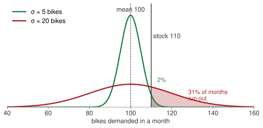
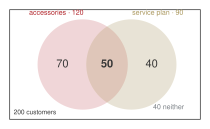

## Who I am

:::: {.columns}
::: {.column width="28%"}
{width="100%"}
:::
::: {.column width="72%"}
**Vincenzo Nardelli, PhD** · Assistant Professor · Founder, Intuo and Geotobler

::: {.incremental}
- **Economics**, then **MSc Statistical Sciences**, Università Cattolica
- **PhD, Statistics and Data Science**, Milano-Bicocca
- **Visiting Scholar**, Center for Spatial Data Science, University of Chicago, and Brunel University of London
- **Assistant Professor**, Università Cattolica, Rome: spatial statistics and econometrics; teaches Statistics, Coding, Big Data
- **Founder, Intuo** (AI consulting) and **Geotobler** (geospatial AI, SaaS)
:::

:::
::::

## Weeks 1–5: every number was known

:::: {.columns}
::: {.column width="50%"}
::: {.bigtable}
| Arno Bikes, so far | |
|---|---|
| Fixed cost | €60,000 a month |
| Variable cost | €400 a bike |
| List price | €1,000 a bike |
| Break-even | 100 bikes a month |
| Cost of capital | 9% a year |
| The bond it bought | 4% coupon, 5 years |
:::
[Every one of these was given. You solved for the rest.]{.muted}
:::
::: {.column width="50%" .fragment}
**Weeks 7–10: the same firm, and the founder does not know the numbers.**

- How many customers next month?
- How many bikes come back under warranty?
- How far does a battery *really* go?
- Which supplier sent the faulty batch?

::: {.fragment}
[A number she does not know is not a number she can ignore. It is a number with a spread.]{.red}
:::

:::
::::

## Planning on the average, and running out

:::: {.columns}
::: {.column width="58%"}

:::
::: {.column width="42%" .fragment}
Demand averages **100 bikes a month**. The founder stocks **110** — "ten more than average, we are safe".

Same average, two very different months.

If demand moves by about 5 bikes, she runs out in **2%** of months. If it moves by about 20, she runs out **one month in three**.

::: {.fragment}
[The mean was never the problem. The spread is. For the spread we need the variance — and the rest of today.]{.red}
:::

:::
::::

## Where the four weeks go

:::: {.columns}
::: {.column width="58%"}
| Wk | Date | What you will be able to do by hand |
|---|---|---|
| 7 | 9 Nov · **in person** | count, condition, update; mean and spread; binomial, Poisson, normal |
| 8 | 16 Nov | how sure are we of a number: confidence intervals, tests, one regression line |
| 9 | 23 Nov | several causes at once; a trend through time |
| 10 | 30 Nov | review; one last round of practice on paper |

: {tbl-colwidths="[8,24,68]"}
:::
::: {.column width="42%"}
**One case, four Mondays.** Arno Bikes, the firm from weeks 1–5. Every number you see from now on is one of its numbers.

Today is the only day we meet in this room. Paper, a calculator, and the normal table — or `NORM.S.DIST` on your phone.
:::
::::

[Every technique in this room is here because an assessment asks for it. I will tell you which one, every time.]{.red}

## How today runs

::: {.blocks .four}
::: {.blk .recap}
[10:00 · 10']{.blk-letter}The bridge[From certain numbers to uncertain ones.]{.blk-answer}
:::
::: {.blk .now}
[10:10 → 12:35]{.blk-letter}Four questions from the founder[Each one: her question and your bet on paper → the picture → one formula with a number → the sentence for the Board. Break at 11:10.]{.blk-tool}
:::
::: {.blk .recap}
[12:35 · 15']{.blk-letter}Take home[Four lines to remember, the four answers for the founder, the homework.]{.blk-answer}
:::
::: {.blk .recap}
[Next Monday]{.blk-letter}Remote[How sure are we of that number?]{.blk-answer}
:::
:::

[Bets are written, not said. Write a number before I compute; the surprise is where the learning is.]{.muted}

## The case: Arno Bikes, this quarter

::: {.bigtable}
| | |
|---|---|
| **e-bike assembler, Florence** | |
| Customers last quarter | 200 |
| Batteries bought last month | 1,000, from two suppliers |
| Returns under warranty | about 5 a week |
| Helpline | about 3 calls an hour |
| Battery range, as measured | 90 km on average, give or take 8 |
:::

[None of these is a fixed cost or a list price. Each one moves.]{.muted}

## Four questions from the founder {.hub auto-animate=true}

::: {.blocks}
::: {.blk .now data-id="blkA"}
[Block A]{.blk-letter}How many of our customers do both?[sets · the addition law · counting]{.blk-tool}
:::
::: {.blk .next}
[Block B]{.blk-letter}Which supplier sent the faulty batteries?[conditional probability · Bayes]{.blk-tool}
:::
::: {.blk .next}
[Block C]{.blk-letter}How many returns next week?[mean and variance · binomial · Poisson]{.blk-tool}
:::
::: {.blk .next}
[Block D]{.blk-letter}What range do we promise?[the normal]{.blk-tool}
:::
:::

## [Block A · sets, the addition law, counting]{.section-kicker} How many of our customers do both? {.section-slide background-color="#AF1F25" auto-animate=true}

::: {.blk-fill data-id="blkA"}
:::

## Sets: six words, with Arno Bikes next to each

| word | in plain words | at Arno Bikes |
|---|---|---|
| **set** | a collection of things, listed or described | the 200 customers of last quarter |
| **subset** | a set wholly inside another | the ones who bought accessories |
| **universal set** | everything we are talking about | all 200 customers |
| **complement** | everything in the universal set *not* in A | the customers who did **not** buy accessories |
| **intersection** $A \cap B$ | in A **and** in B | bought accessories **and** a service plan |
| **union** $A \cup B$ | in A **or** in B, or both | bought at least one of the two |

: {tbl-colwidths="[20,42,38]"}

. . .

[A definition is one sentence a non-mathematician can read. "The set of customers that…", never a symbol alone.]{.red}

## Venn diagram: 200 customers, who bought both?

:::: {.columns}
::: {.column width="48%"}
The founder's CRM says: **120** bought accessories, **90** bought a service plan, **40** bought neither.

She wants to upsell the ones who bought **both**. How many are they?

::: {.callout-important title="Bet before we compute"}
Write a number. Is it more or fewer than 30?
:::
:::
::: {.column width="52%" .fragment}

Bought at least one: $200 - 40 = 160$. Then $120 + 90 = 210$ counts the "both" customers twice:

$$n(A \cup S) = n(A) + n(S) - n(A \cap S)$$

$$160 = 120 + 90 - \text{both} \;\Rightarrow\; \text{both} = \textbf{50}$$
:::
::::

## The addition law: divide every count by 200

:::: {.columns}
::: {.column width="52%"}
**Probability is a long-run share.** Of the last 200 customers, 50 bought both: pick one at random and

$$P(\text{both}) = \frac{50}{200} = .25$$

The same identity, divided by $N$, is the **addition law**:

$$P(A \cup S) = P(A) + P(S) - P(A \cap S)$$

$$= .60 + .45 - .25 = \textbf{.80}$$

[Eight customers in ten bought at least one of the two.]{.muted}
:::
::: {.column width="48%" .fragment}
::: {.bigtable}
| | count | share |
|---|---:|---:|
| accessories only | 70 | .35 |
| both | 50 | .25 |
| service plan only | 40 | .20 |
| neither | 40 | .20 |
| **total** | **200** | **1.00** |
:::

Shares are never negative and add to 1. The **complement** is $1 - .80 = .20$: the "neither" row.
:::
::::

::: {.callout-tip title="Board sentence"}
Eighty per cent of our customers buy at least one extra; a quarter buy both. "Or" adds the two shares, then takes the overlap out once.
:::

## Three of eight for the trade fair: pick them one at a time {.clip background-color="#000000"}

<video class="clipvideo" width="1000" height="562" controls muted loop playsinline data-autoplay preload="auto" poster="media/w07_choices_poster.png"><source src="media/w07_choices.mp4" type="video/mp4"></video>

## Combinations: a team of three, order does not matter

:::: {.columns}
::: {.column width="44%"}
Eight people work at Arno Bikes. The founder sends **three** to the Milan trade fair.

::: {.callout-important title="Bet before we compute"}
How many different teams of three? More or fewer than 100?
:::

A team is a team: Anna, Luca, Sara is the same team as Sara, Anna, Luca.
:::
::: {.column width="56%" .fragment}
::: {.fragment}
$$\binom{8}{3} = \frac{8!}{3!\,(8-3)!}$$

- $\binom{8}{3}$ reads **"8 choose 3"**: the number of groups of 3 you can pick from 8.
- $n!$ reads **"n factorial"**: $n \cdot (n-1) \cdot (n-2) \cdots 1$, the ways to line up $n$ people. $3! = 6$, $8! = 40{,}320$.
:::

::: {.fragment}
Never compute the big factorials. Cancel first:

$$\frac{8!}{3!\,5!} = \frac{8 \cdot 7 \cdot 6 \cdot \cancel{5!}}{3! \cdot \cancel{5!}} = \frac{8 \cdot 7 \cdot 6}{3 \cdot 2 \cdot 1} = \frac{336}{6} = \textbf{56}$$
:::
:::
::::

. . .

[Fifty-six teams. The bottom of the fraction, $3!$, removes the orderings that do not count.]{.red}

## Permutations: three named roles, order matters

:::: {.columns}
::: {.column width="50%"}
Now the three have **named roles**: stand lead, demo rider, sales.

Anna as lead and Luca as rider is **not** the same as Luca as lead and Anna as rider. Swapping two people changes the outcome.

$$P^{8}_{3} = \frac{8!}{(8-3)!} = \frac{8!}{5!} = 8 \cdot 7 \cdot 6 = \textbf{336}$$

Three decisions in a row: 8 choices for lead, 7 left for rider, 6 for sales.
:::
::: {.column width="50%" .fragment}
::: {.bigtable}
| | formula | result |
|---|---|---:|
| teams (combinations) | $\dfrac{8!}{3!\,5!}$ | 56 |
| roles (permutations) | $\dfrac{8!}{5!}$ | 336 |
| ratio | $3! = 6$ | |
:::

Each team of three can be arranged in $3! = 6$ ways: $56 \times 6 = 336$.

::: {.fragment}
[One question decides which formula: does swapping two people change the outcome? No: combinations. Yes: permutations.]{.red}
:::

:::
::::

## Four questions from the founder {.hub auto-animate=true}

::: {.blocks}
::: {.blk .done}
[Block A]{.blk-letter}How many of our customers do both?[sets · the addition law · counting]{.blk-tool}
:::
::: {.blk .now data-id="blkB"}
[Block B]{.blk-letter}Which supplier sent the faulty batteries?[conditional probability · Bayes]{.blk-tool}
:::
::: {.blk .next}
[Block C]{.blk-letter}How many returns next week?[mean and variance · binomial · Poisson]{.blk-tool}
:::
::: {.blk .next}
[Block D]{.blk-letter}What range do we promise?[the normal]{.blk-tool}
:::
:::

## [Block B · conditional probability and Bayes]{.section-kicker} Which supplier sent the faulty batteries? {.section-slide background-color="#AF1F25" auto-animate=true}

::: {.blk-fill data-id="blkB"}
:::

## Two-way table: a faulty battery is on the bench

:::: {.columns}
::: {.column width="48%"}
Last month Arno Bikes bought **1,000** batteries from two suppliers.

- **Volta** sent **700**. Its defect rate is **2%**.
- **Ampere** sent **300**. Its defect rate is **5%**.

A faulty battery is on the bench. The label has fallen off.

::: {.callout-important title="Bet before we compute"}
Which supplier is it most likely from? Write the name and a share.
:::
:::
::: {.column width="52%" .fragment}
**Build the table from the three facts.**

::: {.incremental}
- Volta: $700 \times 2\% = 14$ faulty, $700 - 14 = 686$ good
- Ampere: $300 \times 5\% = 15$ faulty, $300 - 15 = 285$ good
- Totals: $29$ faulty, $971$ good, $1{,}000$ batteries
:::

::: {.fragment}
::: {.bigtable}
| | good | faulty | total |
|---|---:|---:|---:|
| **Volta** | 686 | 14 | 700 |
| **Ampere** | 285 | 15 | 300 |
| **total** | 971 | 29 | 1,000 |
:::
:::
:::
::::

## Conditional probability: a cell over a total

$$P(A \mid B) = \frac{\text{number in both } A \text{ and } B}{\text{number in } B}$$

**"Given B"** means: look only at B's row (or column), and ask what share of it is A. Everything else in the table is ignored.

:::: {.columns}
::: {.column width="50%"}
Same cell, **14**, on top.

**Given Volta, faulty?** Look only at Volta's row, 700 batteries:

$$P(F \mid \text{Volta}) = \frac{14}{700} = \textbf{.02}$$
:::
::: {.column width="50%" .fragment}
**Given faulty, Volta?** Look only at the faulty column, 29 batteries:

$$P(\text{Volta} \mid F) = \frac{14}{29} = \textbf{.48}$$
:::
::::

. . .

[Two different questions, two different totals underneath. Say which total before you divide.]{.red}

## Conditional probability, the row: given the supplier, how often faulty?

:::: {.columns}
::: {.column width="50%"}
::: {.bigtable}
| | good | faulty | total | **share faulty** |
|---|---:|---:|---:|---:|
| **Volta** | 686 | **14** | **700** | **.02** |
| **Ampere** | 285 | **15** | **300** | **.05** |
| **total** | 971 | 29 | 1,000 | .029 |
:::
:::
::: {.column width="50%" .fragment}
$$P(F \mid \text{Volta}) = \frac{14}{700} = \textbf{.02}$$

$$P(F \mid \text{Ampere}) = \frac{15}{300} = \textbf{.05}$$

These are the defect rates we started from. Reading the rows gives nothing new, and that is the point: it confirms the table is built right.

Overall, $P(F) = 29/1{,}000 = .029$: between the two, closer to Volta's because Volta sends more.
:::
::::

## Conditional probability, the column: given faulty, which supplier?

:::: {.columns}
::: {.column width="50%"}
::: {.bigtable}
| | good | **faulty** | share of the faulty |
|---|---:|---:|---:|
| **Volta** | 686 | **14** | **.48** |
| **Ampere** | 285 | **15** | **.52** |
| **total** | 971 | **29** | 1.00 |
:::
:::
::: {.column width="50%" .fragment}
$$P(\text{Volta} \mid F) = \frac{14}{29} = \textbf{.48}$$

$$P(\text{Ampere} \mid F) = \frac{15}{29} = \textbf{.52}$$

Most batteries come from Volta. Most **faulty** batteries come from Ampere, just: a higher defect rate on a smaller volume.

::: {.callout-tip title="Board sentence"}
The faulty battery is slightly more likely from Ampere, 52 to 48. Audit Ampere's line, but do not switch supplier on one battery.
:::
:::
::::

## Independence: compare the rows

:::: {.columns}
::: {.column width="55%"}
Supplier and fault are **independent** if knowing the supplier does not change the share of faulty: every row shows the same share as the total.

| | share faulty | |
|---|---:|---|
| Volta | .02 | |
| Ampere | .05 | |
| overall | .029 | |

The rows differ. Knowing the supplier **does** change the share: supplier and fault are **dependent**.
:::
::: {.column width="45%" .fragment}
Had both rows read .029, the supplier would tell you nothing about the fault, and the two-way table would be a waste of paper.

::: {.fragment}
[Compare the rows, then say the word. "Independent" without the comparison is a guess.]{.red}
:::

:::
::::

## Bayes: the column, with shares instead of counts

The founder's prior: "probably Volta, they send 70%". One faulty battery is the evidence. Update in three columns:

::: {.bigtable}
| supplier | prior share | × defect rate | = faulty, as a share of all | ÷ total faulty |
|---|---:|---:|---:|---:|
| Volta | .70 | .02 | .014 | .014 / .029 = **.48** |
| Ampere | .30 | .05 | .015 | .015 / .029 = **.52** |
| total | 1.00 | | .029 | 1.00 |
:::

. . .

This is the faulty column of the table, in shares. The formula is the same table in symbols:

$$P(\text{Ampere} \mid F) = \frac{P(F \mid \text{Ampere})\,P(\text{Ampere})}{P(F)} = \frac{.05 \times .30}{.029} = \textbf{.52}$$

. . .

[Before the evidence Ampere was .30; after, .52. A 30% supplier at twice the defect rate is only a coin-flip suspect.]{.red}

## Four questions from the founder {.hub auto-animate=true}

::: {.blocks}
::: {.blk .done}
[Block A]{.blk-letter}How many of our customers do both?[sets · the addition law · counting]{.blk-tool}
:::
::: {.blk .done}
[Block B]{.blk-letter}Which supplier sent the faulty batteries?[conditional probability · Bayes]{.blk-tool}
:::
::: {.blk .now data-id="blkC"}
[Block C]{.blk-letter}How many returns next week?[mean and variance · binomial · Poisson]{.blk-tool}
:::
::: {.blk .next}
[Block D]{.blk-letter}What range do we promise?[the normal]{.blk-tool}
:::
:::

## [Block C · mean and variance, binomial, Poisson]{.section-kicker} How many returns next week? {.section-slide background-color="#AF1F25" auto-animate=true}

::: {.blk-fill data-id="blkC"}
:::

## Mean and variance: five weeks of returns, by hand

:::: {.columns}
::: {.column width="42%"}
::: {.bigtable}
| week | returns $x$ | $x - \bar{x}$ | $(x - \bar{x})^{2}$ |
|---|---:|---:|---:|
| 1 | 4 | −1 | 1 |
| 2 | 7 | 2 | 4 |
| 3 | 3 | −2 | 4 |
| 4 | 6 | 1 | 1 |
| 5 | 5 | 0 | 0 |
| **sum** | **25** | 0 | **10** |
:::
:::
::: {.column width="58%" .fragment}
**The mean**: the total, shared equally.

$$\bar{x} = \frac{\sum x}{n} = \frac{25}{5} = \textbf{5 returns a week}$$

**The variance**: the average squared distance from the mean. Why $n - 1$ underneath? The five distances always add to zero, so once four are known the fifth is fixed: only four of them are free. Dividing by 5 would make the spread look smaller than it is.

$$s^{2} = \frac{\sum (x - \bar{x})^{2}}{n - 1} = \frac{10}{4} = 2.5 \qquad s = \sqrt{2.5} = \textbf{1.58}$$

**Reading.** A typical week is 5 returns, give or take about 1.6. The deviations always sum to zero — a check, not a result.
:::
::::

## Five weeks of returns: the distances cancel, the squares do not {.clip background-color="#000000"}

<video class="clipvideo" width="1000" height="562" controls muted loop playsinline data-autoplay preload="auto" poster="media/w07_spread_poster.png"><source src="media/w07_spread.mp4" type="video/mp4"></video>

## Random variable: next week's returns, a number with its shares

:::: {.columns}
::: {.column width="38%"}
Twenty weeks of history, turned into shares: in 3 of 20 weeks there were 3 returns, in 4 of 20 there were 4, and so on.

::: {.bigtable}
| returns $x$ | share $P(x)$ |
|---:|---:|
| 3 | .15 |
| 4 | .20 |
| 5 | .30 |
| 6 | .20 |
| 7 | .15 |
| **sum** | **1.00** |
:::
:::
::: {.column width="62%" .fragment}
A **random variable** is next week's number, before we see it, with a share attached to each value it can take. The shares add up to 1.

**The expected value** is the mean of the five-row table with the shares as weights: each value, times how often it happens, added up.

$$E(x) = \sum x\,P(x)$$

$$= 3(.15) + 4(.20) + 5(.30) + 6(.20) + 7(.15)$$

$$= .45 + .80 + 1.50 + 1.20 + 1.05 = \textbf{5.0}$$

**Reading.** Expect 5 returns a week. No single week has exactly 5.0; over 50 weeks, about 250.
:::
::::

## Variance of a random variable: how far from 5?

::: {.bigtable}
| returns $x$ | share $P(x)$ | distance $x - \mu$ | squared $(x - \mu)^{2}$ | weighted $(x - \mu)^{2}\,P(x)$ |
|---:|---:|---:|---:|---:|
| 3 | .15 | −2 | 4 | 4 × .15 = .60 |
| 4 | .20 | −1 | 1 | 1 × .20 = .20 |
| 5 | .30 | 0 | 0 | 0 × .30 = 0 |
| 6 | .20 | 1 | 1 | 1 × .20 = .20 |
| 7 | .15 | 2 | 4 | 4 × .15 = .60 |
| **sum** | **1.00** | | | **1.60** |
:::

:::: {.columns}
::: {.column width="60%"}
Same recipe as the five weeks: distance from the mean, squared, then averaged, with the shares as weights.

$$\sigma^{2} = \sum (x - \mu)^{2}\,P(x) = \textbf{1.60}$$

$$\sigma = \sqrt{1.60} = \textbf{1.26}$$
:::
::: {.column width="40%" .fragment}
**Reading.** Expect 5 returns, give or take about 1.3.

::: {.fragment}
[Same two formulas as the five weeks: once with $1/n$ as the weight, once with the shares.]{.red}
:::

:::
::::

## Binomial: twelve test rides, how many buy?

:::: {.columns}
::: {.column width="55%"}
Saturday: **12** test rides. From the CRM, one rider in four buys: $p = .25$, and each decides alone.

::: {.callout-important title="Bet before we compute"}
How many buyers is most likely? And the chance of exactly 3?
:::

The **binomial**: a fixed number $n$ of yes/no trials, the same $p$ each time, independent.

$$P(x) = \binom{n}{x}\, p^{x}\, (1-p)^{n-x}$$

- $\binom{n}{x}$: the ways to pick **which** $x$ of the $n$ riders buy
- $p^{x}$: those $x$ all buy
- $(1-p)^{n-x}$: the other $n - x$ all do not
:::
::: {.column width="45%" .fragment}

[The shape for $n = 12$, $p = .25$: the bar at 3 is the tallest.]{.muted style="font-size:.8em"}
:::
::::

## Binomial: exactly 3 buyers out of 12, the steps

:::: {.columns}
::: {.column width="55%"}
**1. The ways to pick which 3 buy.**

$$\binom{12}{3} = \frac{12 \cdot 11 \cdot 10}{3 \cdot 2 \cdot 1} = \frac{1320}{6} = 220$$

::: {.fragment}
**2. Those 3 buy.** $\;p^{3} = .25^{3} = .25 \times .25 \times .25 = .015625$
:::

::: {.fragment}
**3. The other 9 do not.** $\;(1-p)^{9} = .75^{9} = .0751$
:::

::: {.fragment}
**4. Multiply.**

$$P(3) = 220 \times .015625 \times .0751 = \textbf{.258}$$
:::

:::
::: {.column width="45%" .fragment}
**Reading.** One Saturday in four ends with exactly three buyers.

**The mean**, with no table at all:

$$np = 12 \times .25 = \textbf{3 buyers}$$

$$\sigma = \sqrt{np(1-p)} = \sqrt{12 \times .25 \times .75}$$

$$= \sqrt{2.25} = \textbf{1.5}$$

**Nobody buys:** $x = 0$, so $\binom{12}{0} = 1$, $p^{0} = 1$:

$$P(0) = .75^{12} = .032$$

**At least one buys:** $1 - P(0) = 1 - .032 = \textbf{.968}$
:::
::::

. . .

[Every binomial question is these four steps. "At least one" is always 1 minus "none".]{.red}

## Try it: move the number of test rides and the share who buy {.lab-app}

<iframe class="app" src="apps/w07_binomial.html?n=12&p=0.25" loading="lazy"></iframe>

[Push $n$ to 40 and watch the bars become a bell. Drop $p$ to .05: where does the peak go, and what shape is left?]{.muted style="font-size:.7em"}

## Poisson: the helpline, three calls an hour

:::: {.columns}
::: {.column width="50%"}
Calls arrive at random, **3 an hour** on average. One person answers; she steps out for **half an hour**.

::: {.callout-important title="Bet before we compute"}
Chance that nobody calls in that half hour? Write a share.
:::

::: {.fragment}
The **Poisson**: a count in an interval, constant rate, no upper limit. Write $\mu$ = rate × interval **before** any number.

Half an hour: $\mu = 3 \times \tfrac{1}{2} = 1.5$.

$$P(x) = \frac{\mu^{x} e^{-\mu}}{x!} \;\Rightarrow\; P(0) = \frac{1.5^{0} e^{-1.5}}{0!} = e^{-1.5} = \textbf{.223}$$
:::
:::
::: {.column width="50%" .fragment}
::: {.fragment}
In a full hour, $\mu = 3$:

$$P(0) = e^{-3} = .050$$

$$P(\ge 1) = 1 - .050 = \textbf{.950}$$

$$P(2) = \frac{3^{2} e^{-3}}{2!} = \frac{9 \times .0498}{2} = .224$$

::: {.fragment}
[Without the rescaling you would say 5% for the half hour. It is 22%: four times out. $\mu$ first, always.]{.red}
:::

:::
:::
::::

## Calls arrive at random, and the hours pile into a shape {.clip background-color="#000000"}

<video class="clipvideo" width="1000" height="562" controls muted loop playsinline data-autoplay preload="auto" poster="media/w07_poisson_poster.png"><source src="media/w07_poisson.mp4" type="video/mp4"></video>

## Binomial or Poisson? Decide in words before you compute

:::: {.columns}
::: {.column width="50%"}
**Binomial** — *how many of these $n$?*

- a fixed number of trials, each yes or no
- the same $p$ every time, each trial alone
- the count cannot exceed $n$
- you are given $n$ and $p$

[12 test rides, one in four buys.]{.muted}
:::
::: {.column width="50%" .fragment}
**Poisson** — *how many in this interval?*

- events arriving over time or space
- a constant rate, arrivals independent
- no ceiling on the count
- you are given a rate; $\mu$ = rate × interval

[3 calls an hour; a half hour means $\mu = 1.5$.]{.muted}
:::
::::

::: {.callout-tip title="Board sentence"}
Of twelve test rides we expect three sales, and nobody buying is a one-in-thirty Saturday. Leaving the helpline for half an hour, we miss at least one call three times out of four.
:::

## Four questions from the founder {.hub auto-animate=true}

::: {.blocks}
::: {.blk .done}
[Block A]{.blk-letter}How many of our customers do both?[sets · the addition law · counting]{.blk-tool}
:::
::: {.blk .done}
[Block B]{.blk-letter}Which supplier sent the faulty batteries?[conditional probability · Bayes]{.blk-tool}
:::
::: {.blk .done}
[Block C]{.blk-letter}How many returns next week?[mean and variance · binomial · Poisson]{.blk-tool}
:::
::: {.blk .now data-id="blkD"}
[Block D]{.blk-letter}What range do we promise?[the normal]{.blk-tool}
:::
:::

## [Block D · the normal]{.section-kicker} What range do we promise? {.section-slide background-color="#AF1F25" auto-animate=true}

::: {.blk-fill data-id="blkD"}
:::

## The normal: two hundred bikes on the same loop

:::: {.columns}
::: {.column width="55%"}
Marketing wants a number on the box: "range **X** km". Engineering measured 200 bikes on the same loop: **90 km on average**, standard deviation **8 km**.

Range is not a count. It is a measurement, any value on a line, and the bikes pile up into a **bell**: most near 90, fewer and fewer further out, symmetric.

::: {.callout-important title="Bet before we compute"}
Print 75 km: what share of riders will see less than the box promised? Write a share.
:::
:::
::: {.column width="45%" .fragment}
**The normal**, in words:

- continuous, bell-shaped, symmetric
- two numbers fix it: $\mu$ the centre, $\sigma$ the width
- mean = median = mode; skewness zero
- a probability is an **area** under the curve; a single value has none

[$X \sim N(90,\, 8)$]{.muted}
:::
::::

## Two hundred battery ranges pile into a bell {.clip background-color="#000000"}

<video class="clipvideo" width="1000" height="562" controls muted loop playsinline data-autoplay preload="auto" poster="media/w07_normal_poster.png"><source src="media/w07_normal.mp4" type="video/mp4"></video>

## The empirical rule: one σ, two σ, three σ

:::: {.columns}
::: {.column width="60%"}

:::
::: {.column width="40%" .fragment}
Count in units of $\sigma$ from the centre:

- **68%** within one σ: 82 to 98 km
- **95%** within two σ: 74 to 106 km
- **99.7%** within three σ: 66 to 114 km

A bike at 74 km is two σ below the mean — one in forty does that badly.

::: {.fragment}
[The same three numbers for every bell. That is why we measure distance in σ and not in km.]{.red}
:::

:::
::::

## The normal: four steps, every time

::: {.blocks .four}
::: {.blk .recap .fragment}
[1]{.blk-letter}Sketch and shade[Draw the bell, mark $\mu$, mark $x$, shade the area the question asks for.]{.blk-answer}
:::
::: {.blk .recap .fragment}
[2]{.blk-letter}Standardise[$z = (x - \mu)/\sigma$: how many σ from the centre, and on which side.]{.blk-answer}
:::
::: {.blk .recap .fragment}
[3]{.blk-letter}Table[The standard normal table gives the area to the **left** of $z$. Or `NORM.S.DIST(z, TRUE)`.]{.blk-answer}
:::
::: {.blk .recap .fragment}
[4]{.blk-letter}Sentence[Turn the area back into bikes, riders, euros.]{.blk-answer}
:::
:::

. . .

[One table serves every bell, because step 2 turns every bell into the same one: centre 0, width 1.]{.red}

## Standardise: steps 1 and 2, the share below 75 km

:::: {.columns}
::: {.column width="48%"}

[Step 1. The shaded area is the question: riders who see less than 75 km.]{.muted style="font-size:.8em"}
:::
::: {.column width="52%" .fragment}
**Step 2. Standardise.** 75 km is 15 km below the mean of 90. In units of σ = 8:

$$z = \frac{x - \mu}{\sigma} = \frac{75 - 90}{8} = \frac{-15}{8} = -1.875 \approx \textbf{-1.88}$$

**Reading.** 75 km sits 1.88 standard deviations **below** the centre. The minus sign says "below"; the 1.88 says "how far".

[Same picture for a bike at 74 km from the previous slide: $z = -2$, two σ below. Now we can do any value, not only whole σ.]{.muted}
:::
::::

## The normal table: steps 3 and 4, then the sentence

:::: {.columns}
::: {.column width="50%"}
**Step 3.** The table splits $z$ in two: the **row** is $z$ to one decimal, the **column** adds the second. $-1.88 = -1.8 + .08$: row $-1.8$, column $.08$. The entry is the area to the **left** of $z$.

::: {.bigtable}
| $z$ | .00 | .04 | .05 | **.08** |
|---:|---:|---:|---:|---:|
| −2.0 | .0228 | .0207 | .0202 | .0188 |
| −1.9 | .0287 | .0262 | .0256 | .0239 |
| **−1.8** | .0359 | .0329 | .0322 | **.0301** |
| −1.7 | .0446 | .0409 | .0401 | .0375 |
| −1.6 | .0548 | .0505 | .0495 | .0465 |
:::

[An excerpt of the standard normal table (areas to the left of $z$). In Excel: `=NORM.S.DIST(-1.88, TRUE)` → .0301.]{.muted style="font-size:.75em"}
:::
::: {.column width="50%" .fragment}
$$P(X < 75) = P(z < -1.88) = \textbf{.030}$$

::: {.fragment}
**Step 4. Sentence.** Print 75 km and **three riders in a hundred** will see less than the box promised.

Want the share **above** 75 km? The whole area is 1:

$$P(X > 75) = 1 - .030 = .970$$
:::

::: {.fragment}
[The table only gives "to the left". Everything else is 1 minus, or a difference of two lookups. The sketch tells you which.]{.red}
:::

:::
::::

## Try it: move the mean, the spread and the threshold {.lab-app}

<iframe class="app" src="apps/w07_normal.html?mu=90&sigma=8&x=75" loading="lazy"></iframe>

[Double $\sigma$ to 16: what happens to the 75-km tail? Then flip the toggle and ask the app for the threshold that leaves 5% below.]{.muted style="font-size:.7em"}

## The normal, backwards: the guarantee

:::: {.columns}
::: {.column width="55%"}
The Board accepts **5%** of riders seeing less than the box. What do we print?

Now the area is given and $x$ is wanted: the four steps, **backwards**.

**Table, backwards.** Find .05 *inside* the table: between $z = -1.64$ (.0505) and $-1.65$ (.0495), so $z = -1.645$. Excel: `=NORM.S.INV(0.05)`.

**Undo the standardisation**, solving $z = (x - \mu)/\sigma$ for $x$:

$$x = \mu + z\,\sigma = 90 - 1.645 \times 8 = \textbf{76.8 km}$$

Print **76 km**, a promise rounds down: the share below it is $P(z < -1.75) = .040$.

::: {.fragment}
[Forwards: $x \to z \to$ area. Backwards: area $\to z \to x$.]{.red}
:::

:::
::: {.column width="45%" .fragment}
::: {.bigtable}
| print | share who see less |
|---:|---:|
| 85 km | 27% |
| 80 km | 11% |
| 76.8 km | 5% |
| 75 km | 3% |
:::

::: {.callout-tip title="Board sentence"}
Print 76 km. About one rider in twenty-five will see less, and every km we add to the box adds one or two complaints in a hundred.
:::
:::
::::

## Skewness: when the bell is the wrong picture

:::: {.columns}
::: {.column width="62%"}

:::
::: {.column width="38%" .fragment}
Battery range is symmetric: **skewness zero**, mean and median coincide.

Delivery time is not: most parcels take two days, a few take ten. A long **right tail** pulls the mean above the median: **positive skewness**.

::: {.fragment}
[Before you use the table, ask whether the data are a bell. A mean above the median says they are not.]{.red}
:::

:::
::::

## One family, three shapes: what changes as $n$ and $p$ move {.clip background-color="#000000"}

<video class="clipvideo" width="1000" height="562" controls muted loop playsinline data-autoplay preload="auto" poster="media/w07_family_poster.png"><source src="media/w07_family.mp4" type="video/mp4"></video>

## One family, three shapes: in words

::: {.bigtable}
| from | to | when | in Arno Bikes words |
|---|---|---|---|
| Binomial | Poisson | many trials, each one rare | thousands of riders a week, a handful of complaints |
| Binomial | Normal | many trials, $p$ not tiny | buyers among all Saturday visitors of the year |
| Poisson | Normal | a high rate | calls over a whole week, not one hour |
:::

Twelve rides stay binomial. Count the buyers among **all** Saturday visitors of the year, or calls over a whole week, and the bars smooth into a bell: with enough trials, every count behaves like a measurement.

. . .

[Small $n$: count the ways. Rare events at a rate: Poisson. Large numbers of anything: the bell you have just learnt to read.]{.red}

## [Close]{.section-kicker} Take home {.section-slide background-color="#AF1F25"}

## Take home

::: {.blocks}
::: {.blk .recap .fragment}
[A]{.blk-letter}"Or" and "given"["Or" adds the two shares and takes the overlap out once. "Given" means: look only at that row or column, and divide by its total.]{.blk-answer}
:::
::: {.blk .recap .fragment}
[B]{.blk-letter}Count the ways[Order matters: multiply down the tree. Order does not: divide by $k!$. A supplier's share, times its defect rate, is its share of the faulty.]{.blk-answer}
:::
::: {.blk .recap .fragment}
[C]{.blk-letter}Expect $np$, give or take[Yes/no trials: binomial, mean $np$. Events at a rate: Poisson, mean rate × interval. "At least one" is always 1 − "none".]{.blk-answer}
:::
::: {.blk .recap .fragment}
[D]{.blk-letter}A normal question is an area[Sketch, standardise, table, sentence. Backwards for a guarantee: area → $z$ → $x$.]{.blk-answer}
:::
:::

. . .

[The mean was never the problem. The spread is: that is why every answer today came with a "give or take".]{.red}

## Four answers for the founder

::: {.blocks}
::: {.blk .done .fragment}
[A]{.blk-letter}How many customers do both?[Eighty per cent buy at least one extra; a quarter buy both.]{.blk-answer}
:::
::: {.blk .done .fragment}
[B]{.blk-letter}Which supplier sent the faulty battery?[Slightly more likely Ampere, 52 to 48. Audit the line, do not switch supplier on one battery.]{.blk-answer}
:::
::: {.blk .done .fragment}
[C]{.blk-letter}How many returns next week?[Five, give or take one and a half. Twelve test rides: three sales expected, nobody buying is a one-in-thirty Saturday.]{.blk-answer}
:::
::: {.blk .done .fragment}
[D]{.blk-letter}What range do we print?[76 km. One rider in twenty-five sees less; every km added to the box adds one or two complaints in a hundred.]{.blk-answer}
:::
:::

**Homework 7** (`homework.md`), due **Sunday 15 November, 23:59 on Moodle**: five exercises on paper + a 150–250-word memo to the Board on the range to print. Corrected together at the start of next Monday. If you want more: Anderson et al., the probability chapters, not required.

. . .

[Next Monday, online: how sure are we of that number? 200 bikes gave 90 km. The true average is not 90. Week 8 says how far off it can be.]{.red}

## Formulas, on one page: the ten we used

::: {.bigtable style="font-size:.72em"}
| question | formula | this morning |
|---|---|---|
| at least one of two | $P(A \cup B) = P(A) + P(B) - P(A \cap B)$ | $.60 + .45 - .25 = .80$ |
| teams, order irrelevant | $\binom{n}{k} = \dfrac{n!}{k!\,(n-k)!}$ | $\binom{8}{3} = 56$ |
| roles, order matters | $P^{n}_{k} = \dfrac{n!}{(n-k)!}$ | $8 \cdot 7 \cdot 6 = 336$ |
| given | $P(A \mid B) = \dfrac{\text{both}}{\text{total of } B}$ | $14 / 700 = .02$, $14 / 29 = .48$ |
| update on evidence | $P(A \mid B) = \dfrac{P(B \mid A)\,P(A)}{P(B)}$ | $.05 \times .30 / .029 = .52$ |
| mean and spread of a list | $\bar{x} = \dfrac{\sum x}{n}, \quad s^{2} = \dfrac{\sum (x-\bar{x})^{2}}{n-1}$ | $5$, $\sqrt{2.5} = 1.58$ |
| mean and spread with shares | $E(x) = \sum x\,P(x), \quad \sigma^{2} = \sum (x-\mu)^{2} P(x)$ | $5.0$, $\sqrt{1.60} = 1.26$ |
| yes/no trials | $P(x) = \binom{n}{x} p^{x} (1-p)^{n-x}, \quad E = np$ | $P(3) = .258$, $np = 3$ |
| events at a rate | $P(x) = \dfrac{\mu^{x} e^{-\mu}}{x!}, \quad \mu = \text{rate} \times \text{interval}$ | $P(0) = e^{-3} = .050$ |
| a share under the bell | $z = \dfrac{x - \mu}{\sigma}$, table; backwards $x = \mu + z\,\sigma$ | $z = -1.88 \to .030$; $90 - 1.645 \times 8 = 76.8$ |
:::

[Ten lines. None of them was the hard part. The hard part was saying which one.]{.muted}
