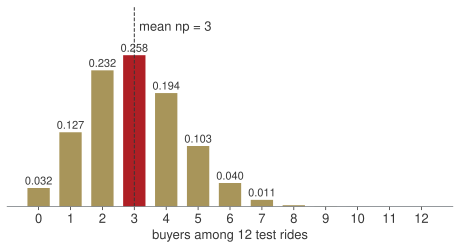
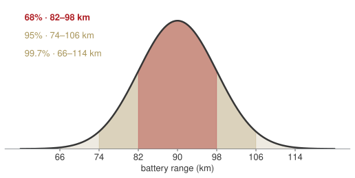
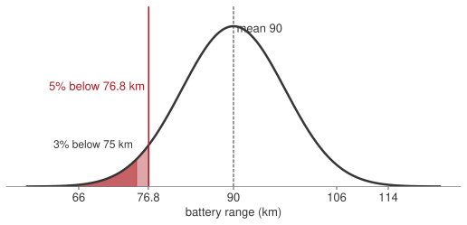
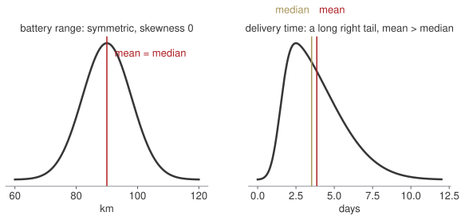
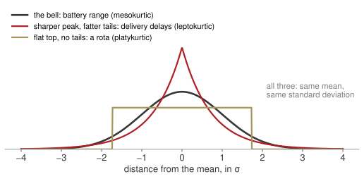
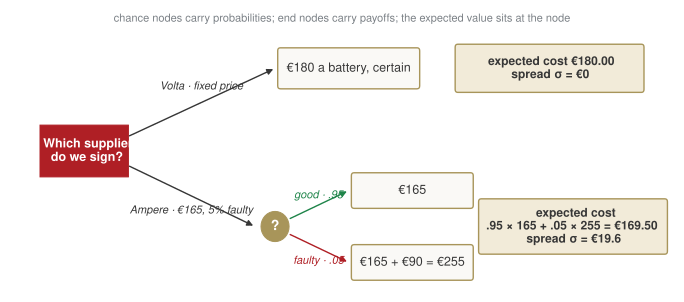
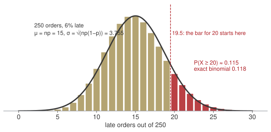

## Last Thursday, in one minute

::: {.blocks}
::: {.blk .recap}
[Block A]{.blk-letter}"Or" and "given"["Or" adds the two shares and takes the overlap out once. "Given" means: look only at that row or column, and divide by its total.]{.blk-answer}
:::
::: {.blk .recap}
[Block B]{.blk-letter}Count the ways[Order matters: multiply down the tree. Order does not: divide by $k!$. A supplier's share, times its defect rate, is its share of the faulty.]{.blk-answer}
:::
::: {.blk .recap}
[Block C]{.blk-letter}A number with its shares[Five weeks of returns: mean 5, give or take 1.6. Next week's number, before we see it, with a share on each value: $E(x) = \sum x\,P(x)$.]{.blk-answer}
:::
::: {.blk .recap}
[Homework 6]{.blk-letter}At the board, now[Bring what you tried. Fifteen minutes, three items and the memo; the mistakes are the useful part.]{.blk-answer}
:::
:::

[Thursday you learnt to count and to condition. Today the counts get a shape, and the shape gives a decision.]{.red}

## Where we are

:::: {.columns}
::: {.column width="58%"}
| Wk | Date | What you can do by hand |
|---|---|---|
| 6 | 5 Nov · in person | count, condition, update; mean and spread ✓ |
| **7** | **9 Nov · online** | **three shapes: binomial, Poisson, normal; decide with them** |
| 8 | 16 Nov · online | how sure are we of a number: intervals, tests, one regression line |
| 9 | 23 Nov · online | several causes at once; a trend through time |
| 10 | 30 Nov · online | review; one last round of practice on paper |

: {tbl-colwidths="[8,26,66]"}
:::
::: {.column width="42%"}
**Online, like the rest of the second half.** Paper, a calculator, and the normal table — or `NORM.S.DIST` on your computer.

Everything in weeks 8–10 stands on today's bell and on two words: *mean* and *standard deviation*.
:::
::::

[Every technique today is here because an assessment asks for it. I will tell you which one, every time.]{.red}

## Today's question

::: {.callout-note title="Arno Bikes, this month"}
The founder has three numbers she does not know. **How many** of Saturday's test riders will buy. **How far** a battery really goes, so that she can print a range on the box. **Which supplier** to sign for next year's batteries, when one of them is cheaper but less reliable.

And a fourth she has not thought of yet: of the 250 orders shipping this month, **how many will be late**?
:::

. . .

Thursday gave each unknown number a mean and a spread. Today gives it a **shape** — and a shape is something you can read a probability off.

. . .

[Three shapes cover almost every number a firm does not know: a count out of $n$, a count at a rate, a measurement.]{.red}

## How today runs

::: {.blocks .four}
::: {.blk .recap}
[10:00 · 15']{.blk-letter}Homework 6[At the board, together.]{.blk-answer}
:::
::: {.blk .now}
[10:15 → 12:35]{.blk-letter}Four questions from the founder[Each one: her question and your bet typed in the chat → the picture → one formula with a number → the sentence for the Board. Break at 11:15.]{.blk-tool}
:::
::: {.blk .recap}
[12:35 · 15']{.blk-letter}Take home[Four lines to remember, the four answers for the founder, the homework.]{.blk-answer}
:::
::: {.blk .recap}
[Next Monday]{.blk-letter}Online[How sure are we of that number?]{.blk-answer}
:::
:::

[Bets are written, not said. Write a number before I compute; the surprise is where the learning is.]{.muted}

## Four questions from the founder {.hub auto-animate=true}

::: {.blocks}
::: {.blk .now data-id="blkA"}
[Block A]{.blk-letter}How many returns next week?[binomial · Poisson · one family]{.blk-tool}
:::
::: {.blk .next}
[Block B]{.blk-letter}What range do we promise?[the normal · skewness and kurtosis]{.blk-tool}
:::
::: {.blk .next}
[Block C]{.blk-letter}Which supplier do we sign?[expected value to decide]{.blk-tool}
:::
::: {.blk .next}
[Block D]{.blk-letter}How many late orders in 250?[normal approximation · Monte Carlo]{.blk-tool}
:::
:::

## [Block A · binomial, Poisson, one family]{.section-kicker} How many returns next week? {.section-slide background-color="#AF1F25" auto-animate=true}

::: {.blk-fill data-id="blkA"}
:::

## Binomial: twelve test rides, how many buy?

:::: {.columns}
::: {.column width="55%"}
Saturday: **12** test rides. From the CRM, one rider in four buys: $p = .25$, and each decides alone.

::: {.callout-important title="Bet before we compute"}
How many buyers is most likely? And the chance of exactly 3? Write both.
:::

::: {.fragment}
The **binomial**: a fixed number $n$ of yes/no trials, the same $p$ each time, independent.

$$P(x) = \binom{n}{x}\, p^{x}\, (1-p)^{n-x}$$

- $\binom{n}{x}$: the ways to pick **which** $x$ of the $n$ riders buy
- $p^{x}$: those $x$ all buy
- $(1-p)^{n-x}$: the other $n - x$ all do not
:::
:::
::: {.column width="45%" .fragment}

[The shape for $n = 12$, $p = .25$: the bar at 3 is the tallest.]{.muted style="font-size:.8em"}
:::
::::

## Binomial: exactly 3 buyers out of 12, the four steps

:::: {.columns}
::: {.column width="55%"}
**1. The ways to pick which 3 buy.**

$$\binom{12}{3} = \frac{12 \cdot 11 \cdot 10}{3 \cdot 2 \cdot 1} = \frac{1320}{6} = 220$$

::: {.fragment}
**2. Those 3 buy.** $\;p^{3} = .25^{3} = .25 \times .25 \times .25 = .015625$
:::

::: {.fragment}
**3. The other 9 do not.** $\;(1-p)^{9} = .75^{9} = .0751$
:::

::: {.fragment}
**4. Multiply.**

$$P(3) = 220 \times .015625 \times .0751 = \textbf{.258}$$
:::

:::
::: {.column width="45%" .fragment}
**Reading.** One Saturday in four ends with exactly three buyers.

**The mean**, with no table at all:

$$np = 12 \times .25 = \textbf{3 buyers}$$

$$\sigma = \sqrt{np(1-p)} = \sqrt{12 \times .25 \times .75} = \sqrt{2.25} = \textbf{1.5}$$

**Nobody buys:** $x = 0$, so $\binom{12}{0} = 1$, $p^{0} = 1$:

$$P(0) = .75^{12} = .032$$

**At least one buys:** $1 - P(0) = 1 - .032 = \textbf{.968}$
:::
::::

. . .

[Every binomial question is these four steps. "At least one" is always 1 minus "none".]{.red}

## Try it: move the number of test rides and the share who buy {.lab-app}

<iframe class="app" src="apps/w07_binomial.html?n=12&p=0.25" loading="lazy"></iframe>

[Push $n$ to 40 and watch the bars become a bell. Drop $p$ to .05: where does the peak go, and what shape is left?]{.muted style="font-size:.7em"}

## Poisson: the helpline, three calls an hour

:::: {.columns}
::: {.column width="50%"}
Calls arrive at random, **3 an hour** on average. One person answers; she steps out for **half an hour**.

::: {.callout-important title="Bet before we compute"}
Chance that nobody calls in that half hour? Write a share.
:::

::: {.fragment}
The **Poisson**: a count in an interval, constant rate, no upper limit. Write $\mu$ = rate × interval **before** any number.

Half an hour: $\mu = 3 \times \tfrac{1}{2} = 1.5$.

$$P(x) = \frac{\mu^{x} e^{-\mu}}{x!} \;\Rightarrow\; P(0) = \frac{1.5^{0} e^{-1.5}}{0!} = e^{-1.5} = \textbf{.223}$$
:::
:::
::: {.column width="50%" .fragment}
In a full hour, $\mu = 3$:

$$P(0) = e^{-3} = .050$$

$$P(\ge 1) = 1 - .050 = \textbf{.950}$$

$$P(2) = \frac{3^{2} e^{-3}}{2!} = \frac{9 \times .0498}{2} = .224$$

::: {.fragment}
[Without the rescaling you would say 5% for the half hour. It is 22%: four times out. $\mu$ first, always.]{.red}
:::

:::
::::

## Calls arrive at random, and the hours pile into a shape {.clip background-color="#000000"}

<video class="clipvideo" width="1000" height="562" controls muted loop playsinline data-autoplay preload="auto" poster="media/w07_poisson_poster.png"><source src="media/w07_poisson.mp4" type="video/mp4"></video>

## Binomial or Poisson? Decide in words before you compute

:::: {.columns}
::: {.column width="50%"}
**Binomial** — *how many of these $n$?*

- a fixed number of trials, each yes or no
- the same $p$ every time, each trial alone
- the count cannot exceed $n$
- you are given $n$ and $p$

[12 test rides, one in four buys.]{.muted}
:::
::: {.column width="50%" .fragment}
**Poisson** — *how many in this interval?*

- events arriving over time or space
- a constant rate, arrivals independent
- no ceiling on the count
- you are given a rate; $\mu$ = rate × interval

[3 calls an hour; a half hour means $\mu = 1.5$.]{.muted}
:::
::::

::: {.callout-tip title="Board sentence"}
Of twelve test rides we expect three sales, and nobody buying is a one-in-thirty Saturday. Leaving the helpline for half an hour, we miss at least one call three times out of four.
:::

## One family, three shapes: what changes as $n$ and $p$ move {.clip background-color="#000000"}

<video class="clipvideo" width="1000" height="562" controls muted loop playsinline data-autoplay preload="auto" poster="media/w07_family_poster.png"><source src="media/w07_family.mp4" type="video/mp4"></video>

## One family, three shapes: in words

::: {.bigtable}
| from | to | when | in Arno Bikes words |
|---|---|---|---|
| Binomial | Poisson | many trials, each one rare | thousands of riders a week, a handful of complaints |
| Binomial | Normal | many trials, $p$ not tiny | late orders among the 250 shipping this month |
| Poisson | Normal | a high rate | calls over a whole week, not one hour |
:::

Twelve rides stay binomial. Count the late orders among **250**, or calls over a whole week, and the bars smooth into a bell: with enough trials, every count behaves like a measurement.

. . .

[Small $n$: count the ways. Rare events at a rate: Poisson. Large numbers of anything: the bell — block B teaches you to read it, block D uses it on a count.]{.red}

## Four questions from the founder {.hub auto-animate=true}

::: {.blocks}
::: {.blk .done}
[Block A]{.blk-letter}How many returns next week?[binomial · Poisson · one family]{.blk-tool}
:::
::: {.blk .now data-id="blkB"}
[Block B]{.blk-letter}What range do we promise?[the normal · skewness and kurtosis]{.blk-tool}
:::
::: {.blk .next}
[Block C]{.blk-letter}Which supplier do we sign?[expected value to decide]{.blk-tool}
:::
::: {.blk .next}
[Block D]{.blk-letter}How many late orders in 250?[normal approximation · Monte Carlo]{.blk-tool}
:::
:::

## [Block B · the normal, skewness and kurtosis]{.section-kicker} What range do we promise? {.section-slide background-color="#AF1F25" auto-animate=true}

::: {.blk-fill data-id="blkB"}
:::

## The normal: two hundred bikes on the same loop

:::: {.columns}
::: {.column width="55%"}
Marketing wants a number on the box: "range **X** km". Engineering measured 200 bikes on the same loop: **90 km on average**, standard deviation **8 km**.

Range is not a count. It is a measurement, any value on a line, and the bikes pile up into a **bell**: most near 90, fewer and fewer further out, symmetric.

::: {.callout-important title="Bet before we compute"}
Print 75 km: what share of riders will see less than the box promised? Write a share.
:::
:::
::: {.column width="45%" .fragment}
**The normal**, in words:

- continuous, bell-shaped, symmetric
- two numbers fix it: $\mu$ the centre, $\sigma$ the width
- mean = median = mode; skewness zero
- a probability is an **area** under the curve; a single value has none

[$X \sim N(90,\, 8)$]{.muted}
:::
::::

## Two hundred battery ranges pile into a bell {.clip background-color="#000000"}

<video class="clipvideo" width="1000" height="562" controls muted loop playsinline data-autoplay preload="auto" poster="media/w07_normal_poster.png"><source src="media/w07_normal.mp4" type="video/mp4"></video>

## The empirical rule: one σ, two σ, three σ

:::: {.columns}
::: {.column width="60%"}

:::
::: {.column width="40%" .fragment}
Count in units of $\sigma$ from the centre:

- **68%** within one σ: 82 to 98 km
- **95%** within two σ: 74 to 106 km
- **99.7%** within three σ: 66 to 114 km

A bike at 74 km is two σ below the mean — one in forty does that badly.

::: {.fragment}
[The same three numbers for every bell. That is why we measure distance in σ and not in km.]{.red}
:::

:::
::::

## The normal: four steps, every time

::: {.blocks .four}
::: {.blk .recap .fragment}
[1]{.blk-letter}Sketch and shade[Draw the bell, mark $\mu$, mark $x$, shade the area the question asks for.]{.blk-answer}
:::
::: {.blk .recap .fragment}
[2]{.blk-letter}Standardise[$z = (x - \mu)/\sigma$: how many σ from the centre, and on which side.]{.blk-answer}
:::
::: {.blk .recap .fragment}
[3]{.blk-letter}Table[The standard normal table gives the area to the **left** of $z$. Or `NORM.S.DIST(z, TRUE)`.]{.blk-answer}
:::
::: {.blk .recap .fragment}
[4]{.blk-letter}Sentence[Turn the area back into bikes, riders, euros.]{.blk-answer}
:::
:::

. . .

[One table serves every bell, because step 2 turns every bell into the same one: centre 0, width 1.]{.red}

## Standardise: steps 1 and 2, the share below 75 km

:::: {.columns}
::: {.column width="48%"}

[Step 1. The shaded area is the question: riders who see less than 75 km.]{.muted style="font-size:.8em"}
:::
::: {.column width="52%" .fragment}
**Step 2. Standardise.** 75 km is 15 km below the mean of 90. In units of σ = 8:

$$z = \frac{x - \mu}{\sigma} = \frac{75 - 90}{8} = \frac{-15}{8} = -1.875 \approx \textbf{-1.88}$$

**Reading.** 75 km sits 1.88 standard deviations **below** the centre. The minus sign says "below"; the 1.88 says "how far".

[Same picture for a bike at 74 km from the previous slide: $z = -2$, two σ below. Now we can do any value, not only whole σ.]{.muted}
:::
::::

## The normal table: steps 3 and 4, then the sentence

:::: {.columns}
::: {.column width="50%"}
**Step 3.** The table splits $z$ in two: the **row** is $z$ to one decimal, the **column** adds the second. $-1.88 = -1.8 + .08$: row $-1.8$, column $.08$. The entry is the area to the **left** of $z$.

::: {.bigtable}
| $z$ | .00 | .04 | .05 | **.08** |
|---:|---:|---:|---:|---:|
| −2.0 | .0228 | .0207 | .0202 | .0188 |
| −1.9 | .0287 | .0262 | .0256 | .0239 |
| **−1.8** | .0359 | .0329 | .0322 | **.0301** |
| −1.7 | .0446 | .0409 | .0401 | .0375 |
| −1.6 | .0548 | .0505 | .0495 | .0465 |
:::

[An excerpt of the standard normal table (areas to the left of $z$). In Excel: `=NORM.S.DIST(-1.88, TRUE)` → .0301.]{.muted style="font-size:.75em"}
:::
::: {.column width="50%" .fragment}
$$P(X < 75) = P(z < -1.88) = \textbf{.030}$$

::: {.fragment}
**Step 4. Sentence.** Print 75 km and **three riders in a hundred** will see less than the box promised.

Want the share **above** 75 km? The whole area is 1:

$$P(X > 75) = 1 - .030 = .970$$
:::

::: {.fragment}
[The table only gives "to the left". Everything else is 1 minus, or a difference of two lookups. The sketch tells you which.]{.red}
:::

:::
::::

## Try it: move the mean, the spread and the threshold {.lab-app}

<iframe class="app" src="apps/w07_normal.html?mu=90&sigma=8&x=75" loading="lazy"></iframe>

[Double $\sigma$ to 16: what happens to the 75-km tail? Then flip the toggle and ask the app for the threshold that leaves 5% below.]{.muted style="font-size:.7em"}

## The normal, backwards: the guarantee

:::: {.columns}
::: {.column width="55%"}
The Board accepts **5%** of riders seeing less than the box. What do we print?

Now the area is given and $x$ is wanted: the four steps, **backwards**.

**Table, backwards.** Find .05 *inside* the table: between $z = -1.64$ (.0505) and $-1.65$ (.0495), so $z = -1.645$. Excel: `=NORM.S.INV(0.05)`.

**Undo the standardisation**, solving $z = (x - \mu)/\sigma$ for $x$:

$$x = \mu + z\,\sigma = 90 - 1.645 \times 8 = \textbf{76.8 km}$$

Print **76 km**, a promise rounds down: the share below it is $P(z < -1.75) = .040$.

::: {.fragment}
[Forwards: $x \to z \to$ area. Backwards: area $\to z \to x$.]{.red}
:::

:::
::: {.column width="45%" .fragment}
::: {.bigtable}
| print | share who see less |
|---:|---:|
| 85 km | 27% |
| 80 km | 11% |
| 76.8 km | 5% |
| 75 km | 3% |
:::

::: {.callout-tip title="Board sentence"}
Print 76 km. About one rider in twenty-five will see less, and every km we add to the box adds one or two complaints in a hundred.
:::
:::
::::

## Skewness: when the bell leans

:::: {.columns}
::: {.column width="62%"}

:::
::: {.column width="38%" .fragment}
Battery range is symmetric: **skewness zero**, mean and median coincide.

Delivery time is not: most parcels take two days, a few take ten. A long **right tail** pulls the mean above the median: **positive skewness**.

::: {.fragment}
[Before you use the table, ask whether the data are a bell. A mean above the median says they are not.]{.red}
:::

:::
::::

## Kurtosis: when the bell has the wrong tails

:::: {.columns}
::: {.column width="58%"}

[Three shapes, the **same mean and the same σ**. Skewness asks whether the curve leans; **kurtosis** asks how much of it sits in the tails.]{style="font-size:.85em"}
:::
::: {.column width="42%" .fragment}
- **The bell** (mesokurtic): battery range. The 68–95–99.7 rule holds.
- **Sharp peak, fat tails** (leptokurtic): delivery delays. Most parcels on the usual day, but a "three σ" delay comes far more often than one in three hundred.
- **Flat top, no tails** (platykurtic): a rota, every slot equally likely. Nothing extreme ever happens.

::: {.fragment}
[Same σ, different surprises. Fat tails mean the rare bad day is not as rare as the bell says.]{.red}
:::

:::
::::

## Four questions from the founder {.hub auto-animate=true}

::: {.blocks}
::: {.blk .done}
[Block A]{.blk-letter}How many returns next week?[binomial · Poisson · one family]{.blk-tool}
:::
::: {.blk .done}
[Block B]{.blk-letter}What range do we promise?[the normal · skewness and kurtosis]{.blk-tool}
:::
::: {.blk .now data-id="blkC"}
[Block C]{.blk-letter}Which supplier do we sign?[expected value to decide]{.blk-tool}
:::
::: {.blk .next}
[Block D]{.blk-letter}How many late orders in 250?[normal approximation · Monte Carlo]{.blk-tool}
:::
:::

## [Block C · expected value to decide]{.section-kicker} Which supplier do we sign? {.section-slide background-color="#AF1F25" auto-animate=true}

::: {.blk-fill data-id="blkC"}
:::

## Two suppliers, one contract for next year's batteries

:::: {.columns}
::: {.column width="52%"}
Arno Bikes buys **1,000 batteries a month**. Two offers are on the table.

::: {.bigtable}
| | Volta | Ampere |
|---|---|---|
| price per battery | **€180** | **€165** |
| faulty on arrival | none, replaced by Volta | **5%** |
| a faulty battery costs us | — | **€90** to swap on the line |
:::

::: {.callout-important title="Bet before we compute"}
Which contract, and how much does it save (or cost) per battery? Write a name and a number.
:::
:::
::: {.column width="48%" .fragment}
Volta is a **certain** number: €180, every battery.

Ampere is a **random variable**: Thursday's table, two rows.

::: {.bigtable}
| what happens | share $P(x)$ | cost $x$ |
|---|---:|---:|
| the battery is good | .95 | €165 |
| the battery is faulty | .05 | €165 + €90 = €255 |
:::

::: {.fragment}
[A cheaper price with a catch is not a price. It is a distribution, and you compare distributions by their mean — and then by their spread.]{.red}
:::

:::
::::

## The decision tree: a square to choose, a circle for chance

{width="92%"}

[Read it left to right. At the square **we** choose; at the circle **chance** chooses, with its probabilities. The number written at a node is the expected value of everything to its right.]{.muted style="font-size:.8em"}

## Expected value at the chance node: Thursday's formula

:::: {.columns}
::: {.column width="56%"}
$$E(x) = \sum x\,P(x) = .95 \times 165 + .05 \times 255$$

$$= 156.75 + 12.75 = \textbf{€169.50 a battery}$$

::: {.fragment}
**Reading.** On average Ampere costs €169.50 a battery: the €165 price plus €4.50 for the faulty ones. Against Volta's €180: **€10.50 cheaper a battery, €10,500 a month**.
:::

::: {.fragment}
**The spread, same recipe as Thursday:**

$$\sigma^{2} = \sum (x - \mu)^{2} P(x) = .95\,(4.5)^{2} + .05\,(85.5)^{2}$$

$$= 19.24 + 365.51 = 384.75$$

$$\sigma = \sqrt{384.75} = \textbf{€19.6}$$
:::
:::
::: {.column width="44%" .fragment}
::: {.bigtable}
| | Volta | Ampere |
|---|---:|---:|
| expected cost | €180.00 | **€169.50** |
| spread σ | **€0** | €19.6 |
| worst battery | €180 | €255 |
:::

::: {.fragment}
**Expected value** picks Ampere. **Spread** picks Volta. A decision has two numbers, and the Board must hear both.

[The expected value is the price you pay on average. The spread is the surprise you pay sometimes.]{.red}
:::
:::
::::

## When does the spread matter? Volume

:::: {.columns}
::: {.column width="55%"}
**A thousand batteries a month.** The faulty count is binomial: $n = 1{,}000$, $p = .05$.

$$np = 50 \text{ faulty}$$

$$\sigma = \sqrt{1{,}000 \times .05 \times .95} = 6.9$$

The monthly bill is €165,000 plus €90 per faulty battery: **€169,500, give or take €620**. The €10,500 saving is never at risk.

::: {.fragment}
**A rush order of ten.** Same $p$, $n = 10$: the saving on ten batteries is €150. Two faulty batteries cost €180 and wipe it out, and two or more faulty happens

$$P(X \ge 2) = 1 - P(0) - P(1) = 1 - .599 - .315 = \textbf{.086}$$

one rush order in twelve.
:::
:::
::: {.column width="45%" .fragment}
::: {.callout-tip title="Board sentence"}
Sign Ampere for the volume contract: €10.50 a battery cheaper on average, €10,500 a month, and on a thousand batteries the faults average out to about fifty, give or take seven. Keep Volta for rush orders of a few units, where one faulty battery in a box of ten is a problem the saving cannot pay for.
:::

::: {.fragment}
[Expected value decides when the decision repeats. Spread decides when it does not.]{.red}
:::
:::
::::

## Four questions from the founder {.hub auto-animate=true}

::: {.blocks}
::: {.blk .done}
[Block A]{.blk-letter}How many returns next week?[binomial · Poisson · one family]{.blk-tool}
:::
::: {.blk .done}
[Block B]{.blk-letter}What range do we promise?[the normal · skewness and kurtosis]{.blk-tool}
:::
::: {.blk .done}
[Block C]{.blk-letter}Which supplier do we sign?[expected value to decide]{.blk-tool}
:::
::: {.blk .now data-id="blkD"}
[Block D]{.blk-letter}How many late orders in 250?[normal approximation · Monte Carlo]{.blk-tool}
:::
:::

## [Block D · normal approximation and Monte Carlo]{.section-kicker} How many late orders in 250? {.section-slide background-color="#AF1F25" auto-animate=true}

::: {.blk-fill data-id="blkD"}
:::

## 250 orders this month, 6% ship late: how many late?

:::: {.columns}
::: {.column width="52%"}
Each order ships late with $p = .06$, alone. **Binomial**, $n = 250$: how many of these 250?

The logistics partner charges a penalty when a month has **20 or more** late orders.

::: {.callout-important title="Bet before we compute"}
How likely is a penalty month? Write a share.
:::

::: {.fragment}
The four steps of block A would need $\binom{250}{20}$ and $.94^{230}$ — and then the same for 21, 22, … up to 250. Nobody does that by hand.
:::
:::
::: {.column width="48%" .fragment}
**The mean and spread, we already have:**

$$\mu = np = 250 \times .06 = \textbf{15 late orders}$$

$$\sigma = \sqrt{np(1-p)} = \sqrt{250 \times .06 \times .94}$$

$$= \sqrt{14.1} = \textbf{3.755}$$

::: {.fragment}
And the clip said what happens with many trials: **the bars become a bell**. So treat the count as if it were $N(15,\, 3.755)$ and use block B.

[It works when $np \ge 5$ and $n(1-p) \ge 5$: here 15 and 235.]{.muted}
:::
:::
::::

## The bars become a bell: the normal approximation

{width="88%"}

[The bars are the exact binomial; the curve is $N(15, 3.755)$. The bar for 20 starts at 19.5, so the area the question wants starts there too.]{.muted style="font-size:.8em"}

## Twenty or more late: the four steps on a count

:::: {.columns}
::: {.column width="55%"}
**1. Sketch and shade.** The bell at 15, the bar for 20 and everything to its right. A bar for a whole number spans half a unit each side: "20 or more" starts at **19.5**.

::: {.fragment}
**2. Standardise.**

$$z = \frac{19.5 - 15}{3.755} = \frac{4.5}{3.755} = 1.198 \approx \textbf{1.20}$$
:::

::: {.fragment}
**3. Table.** Area to the left of 1.20 is .8849, so to the right:

$$P(X \ge 20) = 1 - .8849 = \textbf{.115}$$
:::

::: {.fragment}
**4. Sentence.** A penalty month happens about **one month in nine**.
:::
:::
::: {.column width="45%" .fragment}
The exact binomial, summed by a computer, gives .118: the bell is off by three in a thousand.

[Without the half unit: $z = 5/3.755 = 1.33$, area .092 — a tenth too small. The half unit is called the continuity correction; use it, and move on.]{.muted}

::: {.fragment}
::: {.callout-tip title="Board sentence"}
Of 250 orders, expect 15 late, give or take four. A penalty month — twenty or more — comes about once in nine months. Cut the late rate to 4% and it becomes rarer than one in fifty.
:::
:::

::: {.fragment}
[A count with many trials is read like a measurement: $np$, $\sqrt{np(1-p)}$, then the four steps.]{.red}
:::
:::
::::

## Monte Carlo: when you cannot compute, simulate

:::: {.columns}
::: {.column width="52%"}
Twelve test rides, $p = .25$. Instead of the formula, **play the Saturday**: twelve coin flips, each lands "buy" one time in four, count the buyers. Write the count down.

Now play **a thousand Saturdays**. The counts pile into bars.

::: {.fragment}
Block A said $P(3) = .258$. In a thousand simulated Saturdays, about **258** end with three buyers, about **32** with none. Not exactly: a thousand is a sample too.
:::

::: {.fragment}
Same trick for the 250 orders: play the month a thousand times. About **118** of them have twenty or more late — the number the bell estimated as 115.
:::
:::
::: {.column width="48%" .fragment}
**Why a manager cares.** The formula needs the model to be clean: same $p$, independent trials. A simulation only needs you to describe one Saturday honestly; the computer plays it a thousand times, and the shape appears.

Two couriers, a rate that changes with the weather, a supplier whose faults come in batches: no formula, but a simulation still runs.

::: {.fragment}
[The histogram of the simulation **is** the binomial. The formula is the shortcut; the simulation is the thing itself.]{.red}
:::
:::
::::

## Try it: simulate a thousand Saturdays {.lab-app}

<iframe class="app" src="apps/w07_simulate.html?n=12&p=0.25" loading="lazy"></iframe>

[Run 10 Saturdays, then 1,000: watch the bars settle onto the binomial. Then set $n = 250$, $p = .06$ and count the months with 20 or more.]{.muted style="font-size:.7em"}

## [Close]{.section-kicker} Take home {.section-slide background-color="#AF1F25"}

## Take home

::: {.blocks}
::: {.blk .recap .fragment}
[A]{.blk-letter}Name the shape before the formula[How many of these $n$: binomial, mean $np$. How many in this interval: Poisson, $\mu$ = rate × interval first. "At least one" is 1 − "none".]{.blk-answer}
:::
::: {.blk .recap .fragment}
[B]{.blk-letter}A normal question is an area[Sketch, standardise, table, sentence. Backwards for a guarantee: area → $z$ → $x$. Then ask whether the data are a bell: skewness and kurtosis.]{.blk-answer}
:::
::: {.blk .recap .fragment}
[C]{.blk-letter}Decide on two numbers[Expected value is the price you pay on average; spread is the surprise you pay sometimes. A repeated decision follows the mean; a one-off weighs the spread.]{.blk-answer}
:::
::: {.blk .recap .fragment}
[D]{.blk-letter}Many trials: a count is a measurement[$np$ and $\sqrt{np(1-p)}$, then the four steps with the half unit. And when there is no formula, simulate: the histogram is the distribution.]{.blk-answer}
:::
:::

. . .

[Three shapes, one table, two numbers per decision. That is the whole of today.]{.red}

## Four answers for the founder

::: {.blocks}
::: {.blk .done .fragment}
[A]{.blk-letter}How many of Saturday's riders buy?[Three of twelve, give or take one and a half; nobody buying is a one-in-thirty Saturday. Leave the helpline half an hour and you miss a call three times in four.]{.blk-answer}
:::
::: {.blk .done .fragment}
[B]{.blk-letter}What range do we print?[76 km. One rider in twenty-five sees less; every km added to the box adds one or two complaints in a hundred.]{.blk-answer}
:::
::: {.blk .done .fragment}
[C]{.blk-letter}Which supplier do we sign?[Ampere for volume: €10,500 a month cheaper, and on a thousand batteries the faults average out. Volta for rush orders, where one faulty battery in ten is a problem.]{.blk-answer}
:::
::: {.blk .done .fragment}
[D]{.blk-letter}How many late orders in 250?[Fifteen, give or take four. A penalty month, twenty or more, about once in nine months.]{.blk-answer}
:::
:::

. . .

[Next Monday, online: how sure are we of that number? 200 bikes gave 90 km. The true average is not 90. Week 8 says how far off it can be.]{.red}

## Formulas, on one page: the ones we used

::: {.bigtable style="font-size:.78em"}
| question | formula | this morning |
|---|---|---|
| how many of these $n$ | $P(x) = \binom{n}{x} p^{x} (1-p)^{n-x}, \quad E = np, \quad \sigma = \sqrt{np(1-p)}$ | $P(3) = .258$, $np = 3$, $\sigma = 1.5$ |
| how many in this interval | $P(x) = \dfrac{\mu^{x} e^{-\mu}}{x!}, \quad \mu = \text{rate} \times \text{interval}$ | $\mu = 1.5$, $P(0) = .223$ |
| a share under the bell | $z = \dfrac{x - \mu}{\sigma}$, table gives the area to the left | $z = -1.88 \to .030$ |
| the bell, backwards | $x = \mu + z\,\sigma$ | $90 - 1.645 \times 8 = 76.8$ |
| a decision with chance in it | $E(x) = \sum x\,P(x), \quad \sigma^{2} = \sum (x-\mu)^{2} P(x)$ | $€169.50$, $\sigma = €19.6$ |
| a count with many trials | $\mu = np, \; \sigma = \sqrt{np(1-p)}$, then $z$ with the half unit | $z = (19.5 - 15)/3.755 = 1.20 \to .115$ |
:::

[Six lines. None of them was the hard part. The hard part was saying which one.]{.muted}

## Homework 7

:::: {.columns}
::: {.column width="58%"}
**Five exercises on paper**, one per block and one mixed, plus a **memo to the Board** on the range to print. `homework.md` on the course site.

- **H1** twelve becomes twenty: a binomial on financing quotes
- **H2** returns at a rate: a Poisson with the interval rescaled twice
- **H3** charging time: the normal forwards, and backwards for a flag
- **H4** two couriers: a decision tree, expected value and spread
- **H5** two hundred bikes, 10% back: the normal approximation

Due **Sunday 15 November, 23:59 on Moodle**. Corrected together at the start of next Monday.
:::
::: {.column width="42%"}
**The memo.** 150–250 words to the Board: what range we print and why, two candidate numbers with the share of riders who will complain, one recommendation, and one line on what changes if the spread were 12 km.

[If you want more: the probability chapters of any business statistics text. Not required.]{.muted}
:::
::::
