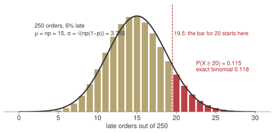
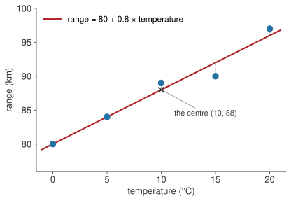
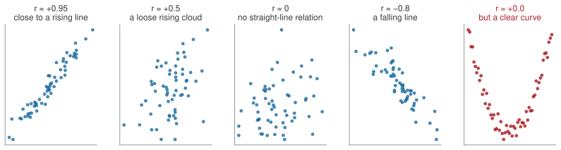

## Last Monday, in one minute

::: {.blocks .four}
::: {.blk .recap}
[Block A]{.blk-letter}A number with its shares[Mean and spread: a list divides by $n - 1$, a random variable weights by the shares.]{.blk-answer}
:::
::: {.blk .recap}
[Block B]{.blk-letter}Name the shape[How many of these $n$: binomial. How many in this interval: Poisson, $\mu$ first.]{.blk-answer}
:::
::: {.blk .recap}
[Block C]{.blk-letter}The bell[Sketch, standardise, table, sentence. Backwards for a guarantee: area → $z$ → $x$.]{.blk-answer}
:::
::: {.blk .recap}
[Block D]{.blk-letter}Decide on two numbers[Expected value for a repeated decision; spread for a one-off.]{.blk-answer}
:::
:::

[Last week the bell gave us shares of bikes. Today it tells us how far a number from data can be from the truth.]{.red}

## [Homework 7]{.section-kicker} Corrected together, step by step {.section-slide background-color="#AF1F25"}

## H1: a list, then a random variable

:::: {.columns}
::: {.column width="48%"}
**(a)** Walk-ins: 12, 9, 15, 10, 14, 12.

::: {.bigtable}
| $x$ | $x - \bar{x}$ | $(x - \bar{x})^{2}$ |
|---:|---:|---:|
| 12 | 0 | 0 |
| 9 | −3 | 9 |
| 15 | 3 | 9 |
| 10 | −2 | 4 |
| 14 | 2 | 4 |
| 12 | 0 | 0 |
| **72** | 0 ✓ | **26** |
:::

::: {.fragment}
$$\bar{x} = \frac{72}{6} = \textbf{12}$$

$$s^{2} = \tfrac{26}{5} = 5.2, \;\; s = \textbf{2.28}$$
:::
:::
::: {.column width="52%" .fragment}
**(b)** Bookings a day, shares .10 / .25 / .30 / .25 / .10: they add to 1 ✓.

$$E(x) = .10 + .50 + .90 + 1.00 + .50 = \textbf{3.0}$$

$$\sigma^{2} = 4(.10) + 1(.25) + 0$$

$$+ 1(.25) + 4(.10) = 1.30$$

$$\sigma = \sqrt{1.30} = \textbf{1.14}$$

**Reading.** Three bookings a day, give or take one.

::: {.fragment}
[The slip: dividing the list by 6. A list from data divides by $n - 1 = 5$; a random variable never divides, the shares already do it.]{.red}
:::
:::
::::

## H2: twenty quotes, one in five becomes a sale

:::: {.columns}
::: {.column width="52%"}
**(a)** **Binomial**: 20 quotes, each sale or no sale, the same $p = .2$, each alone.

::: {.fragment}
**(b)** Exactly 4, the four steps:

$$\binom{20}{4} = \frac{20 \cdot 19 \cdot 18 \cdot 17}{4 \cdot 3 \cdot 2 \cdot 1} = 4{,}845$$

$$P(4) = 4{,}845 \times .2^{4} \times .8^{16}$$

$$= 4{,}845 \times .0016 \times .02815 = \textbf{.218}$$
:::
:::
::: {.column width="48%" .fragment}
**(c)** $P(0) = .8^{20} = \textbf{.012}$; at least one: $1 - .012 = \textbf{.988}$.

**(d)** $np = 20 \times .2 = \textbf{4}$ sales; $\sigma = \sqrt{20 \times .2 \times .8} = \sqrt{3.2} = \textbf{1.79}$.

::: {.callout-tip title="Board sentence"}
Twenty quotes bring four sales, give or take two; a week with no sale at all is about one in a hundred.
:::
:::
::::

## H3: returns at a rate, rescaled twice

:::: {.columns}
::: {.column width="50%"}
**(a)** Five a week, five working days: **one a day**. $\mu = 5 \times \tfrac{1}{5} = 1$ first.

$$P(0) = e^{-1} = \textbf{.368}$$

$$P(1) = \frac{1^{1} e^{-1}}{1!} = \textbf{.368}$$

$$P(\ge 2) = 1 - .368 - .368 = \textbf{.264}$$
:::
::: {.column width="50%" .fragment}
**(b)** Two days: $\mu = 5 \times \tfrac{2}{5} = 2$.

$$P(2) = \frac{2^{2} e^{-2}}{2!} = \frac{4 \times .1353}{2} = \textbf{.271}$$

**(c)** A count over time at a constant rate, with no fixed number of trials and no ceiling: Poisson. A binomial needs an $n$.

::: {.fragment}
[The slip: $\mu = 5$ for one day. Rate × interval, every time, before any number.]{.red}
:::
:::
::::

## H4 (a), (b): charging time, forwards

$X \sim N(240,\, 20)$ minutes. Sketch first, every time.

:::: {.columns}
::: {.column width="50%" .fragment}
**(a)** More than 270: the right tail.

$$z = \frac{270 - 240}{20} = 1.50 \qquad \text{table: } .9332$$

$$P(X > 270) = 1 - .9332 = \textbf{.067}$$

About seven charges in a hundred take more than four and a half hours.
:::
::: {.column width="50%" .fragment}
**(b)** Between 220 and 260: $z = -1$ and $z = +1$.

$$P = .8413 - .1587 = \textbf{.683}$$

One σ each side: the **68%** of the empirical rule, no table needed.
:::
::::

## H4 (c): the guarantee on a time rounds up

:::: {.columns}
::: {.column width="55%"}
"Fully charged in **X** minutes", and 5% may take longer. The bad tail is on the **right**: 95% to the left.

$$z = +1.645$$

$$x = \mu + z\,\sigma = 240 + 1.645 \times 20 = 272.9$$

A promise on a time rounds **up**: print **275 minutes** (273 is also right).

::: {.fragment}
[The slip: $240 - 32.9 = 207$. That promises a charge faster than most batteries manage. Draw the sketch: which tail is the bad one?]{.red}
:::
:::
::: {.column width="45%" .fragment}
::: {.callout-tip title="Board sentence"}
Print "fully charged in 4 hours 35 minutes". About one charge in twenty takes longer — the share the Board accepted.
:::
:::
::::

## The same move, in euros: the worst day at 95%

:::: {.columns}
::: {.column width="55%"}
Arno Bikes keeps its cash buffer in a fund. The value moves every day: **on average by zero**, standard deviation **€2,000**, bell-shaped.

::: {.callout-important title="Bet before we compute"}
What loss will we not exceed on 19 days out of 20? Write a number in euros.
:::

::: {.fragment}
The bad tail is the **left** one: the worst 5% of days.

$$x = \mu + z\,\sigma = 0 - 1.645 \times 2{,}000 = \textbf{−€3,290}$$
:::
:::
::: {.column width="45%" .fragment}
**Reading.** On 95 days in 100 the fund loses less than **€3,290**; on about one day in twenty it loses more.

This number has a name in finance: the **maximum loss at 95%**. It is last week's guarantee, with euros instead of kilometres.

[Same four steps, backwards. Only the units changed.]{.red}
:::
::::

## H5: two couriers, a tree, two numbers

:::: {.columns}
::: {.column width="50%"}
**Local** is a random variable: €30 with share .9, €30 + €60 = €90 with share .1.

$$E = .9 \times 30 + .1 \times 90 = 27 + 9 = \textbf{€36}$$

Against Fast's €40: **€4 saved a delivery**.

::: {.fragment}
$$\sigma^{2} = .9\,(30 - 36)^{2} + .1\,(90 - 36)^{2}$$

$$= 32.4 + 291.6 = 324$$

$$\sigma = \sqrt{324} = \textbf{€18}$$
:::
:::
::: {.column width="50%" .fragment}
**(d)** 400 deliveries: $400 \times 4 = $ **€1,600 a month**.

::: {.callout-tip title="Board sentence"}
Use Local for the monthly volume: €1,600 saved, and on 400 deliveries the late ones average out. Use Fast for the delivery to our most important customer: one late parcel there costs more than €4 of saving.
:::

[The slip: €60 as the whole cost of a late delivery. The €30 is paid anyway.]{.muted}
:::
::::

## The memo: what range do we print?

:::: {.columns}
::: {.column width="55%"}
::: {.bigtable}
| print | below it, σ = 8 | below it, σ = 12 |
|---:|---:|---:|
| 85 km | 27% | 34% |
| 80 km | 11% | 20% |
| 76 km | 4% | 12% |
| 75 km | 3% | 11% |
:::

[$z = (x - 90)/8$, then the table; the same with 12.]{.muted style="font-size:.75em"}
:::
::: {.column width="45%" .fragment}
**What we look for**

- at least two candidates, each with its share of disappointed riders
- one recommendation (76 or 75 km) and its cost in complaints
- the line on σ = 12: the same 5% would mean printing **70 km** — a less consistent battery costs 6 km on the box
- no formulas; 150–250 words

::: {.fragment}
[The best memos say what the spread costs: consistency is worth kilometres on the box.]{.red}
:::
:::
::::

## Where we are

:::: {.columns}
::: {.column width="58%"}
| Wk | Date | What you can do by hand |
|---|---|---|
| 6 | 5 Nov | count, condition, update ✓ |
| 7 | 9 Nov | a number with its shares; three shapes; decide ✓ |
| **8** | **16 Nov** | **how sure: the standard error, an interval, a test; one line through points** |
| 9 | 23 Nov | read a regression output; a trend through time; this month from last month |
| 10 | 30 Nov | review; the in-class quiz |

: {tbl-colwidths="[8,16,76]"}
:::
::: {.column width="42%"}
Last week: from a known shape to a share of bikes.

**Today the arrow turns round**: from one sample back to the number we do not know, with an honest error bar.
:::
::::

[Blocks A–C are exactly what the final asks about intervals and tests. Block D opens next week.]{.red}

## Today's question

::: {.callout-note title="Arno Bikes, this month"}
Engineering measured 200 bikes and found **90 km**. The founder asks: is the true average 90? A new battery batch looks a bit worse. Returns seem lower since we dropped Ionix. And does the range change with the weather?
:::

. . .

A number from data is a **random variable**: another sample would give another number. Today we measure how much it wobbles.

. . .

[One idea runs the whole morning: the **standard error**, the σ of a number computed from data.]{.red}

## Four questions from the founder {.hub auto-animate=true}

::: {.blocks .four}
::: {.blk .now data-id="blkA"}
[Block A]{.blk-letter}Will we pay the courier's penalty?[a count read as a bell · simulation · standard error]{.blk-tool}
:::
::: {.blk .next}
[Block B]{.blk-letter}How far off is our 90 km?[confidence interval · sample size]{.blk-tool}
:::
::: {.blk .next}
[Block C]{.blk-letter}Has dropping Ionix cut returns?[a test on a proportion · p-value]{.blk-tool}
:::
::: {.blk .next}
[Block D]{.blk-letter}Does range depend on the weather?[correlation · least-squares line · R²]{.blk-tool}
:::
:::

## [Block A · a count read as a bell, the standard error]{.section-kicker} Will we pay the courier's penalty? {.section-slide background-color="#AF1F25" auto-animate=true}

::: {.blk-fill data-id="blkA"}
:::

## 250 orders this month, 6% ship late

:::: {.columns}
::: {.column width="52%"}
Each order ships late with $p = .06$, alone: **binomial**, $n = 250$. The courier charges a penalty in a month with **20 or more** late orders.

::: {.callout-important title="Bet before we compute"}
How often is a month a penalty month? Write a share.
:::

::: {.fragment}
Last week's four steps would need $P(20) + P(21) + \dots + P(250)$. Nobody does that by hand.
:::
:::
::: {.column width="48%" .fragment}
**Mean and spread, we already have them:**

$$\mu = np = 250 \times .06 = \textbf{15 late orders}$$

$$\sigma = \sqrt{np(1-p)} = \sqrt{250 \times .06 \times .94}$$

$$= \sqrt{14.1} = \textbf{3.755}$$

::: {.fragment}
And last week's app showed it: with many trials **the bars become a bell**. Read the count as $N(15,\, 3.755)$.

[It works when $np \ge 5$ and $n(1-p) \ge 5$: here 15 and 235.]{.muted}
:::
:::
::::

## Twenty or more late: the four steps on a count

:::: {.columns}
::: {.column width="48%"}

[The bars are the exact binomial, the curve the bell. The bar for 20 starts at **19.5**.]{.muted style="font-size:.75em"}
:::
::: {.column width="52%"}
::: {.fragment}
**1. Sketch.** "20 or more" starts at 19.5: a bar spans half a unit each side.
:::

::: {.fragment}
**2. Standardise.** $z = \dfrac{19.5 - 15}{3.755} = 1.198 \approx \textbf{1.20}$
:::

::: {.fragment}
**3. Table.** $P(X \ge 20) = 1 - .8849 = \textbf{.115}$
:::

::: {.fragment}
**4. Sentence.** A penalty month comes about **one month in nine**.

[The exact binomial, summed by a computer: .118. The bell is off by three in a thousand.]{.muted}
:::
:::
::::

## When there is no formula: simulate

:::: {.columns}
::: {.column width="52%"}
Describe **one month** honestly: 250 orders, each late one time in sixteen or so. Let the computer play that month a **thousand** times and count the late orders each time.

::: {.fragment}
About **118** of the thousand months have twenty or more late: the share the bell estimated as .115.
:::
:::
::: {.column width="48%" .fragment}
**Why a manager cares.** A formula needs a clean model. A simulation needs only one honest description of a month. Late rates that change with the weather, faults that come in batches: no formula, but the simulation still runs.

[This is called **Monte Carlo**: when you cannot compute it, play it a thousand times.]{.red}
:::
::::

## Try it: play a thousand months {.lab-app}

<iframe class="app" src="apps/w07_simulate.html?n=250&p=0.06&k=20&label=orders" loading="lazy"></iframe>

[Run 10 months, then 1,000: the bars settle onto the bell. Count the months with 20 or more late.]{.muted style="font-size:.7em"}

## One bike, or the average of sixteen?

:::: {.columns}
::: {.column width="52%"}
One bike's range: $N(90,\, 8)$. A single bike can easily do 82 or 98.

Now take **16 bikes** and average their ranges.

::: {.callout-important title="Bet before we compute"}
The average of 16 bikes: give or take how many km? Still 8, less, or more?
:::
:::
::: {.column width="48%" .fragment}
Averaging cancels the luck: a bike above 90 meets a bike below. The average wobbles **less** than one bike.

How much less is one formula:

$$SE = \frac{\sigma}{\sqrt{n}} = \frac{8}{\sqrt{16}} = \frac{8}{4} = \textbf{2 km}$$

This is the **standard error**: the σ of a number computed from a sample.

::: {.fragment}
[**Above 94 km?** One bike: $z = 4/8 = 0.50$, share .31. The average of 16: $z = 4/2 = 2.00$, share **.023**. Same four steps, with $SE$ in place of σ.]{style="font-size:.75em"}
:::
:::
::::

## Many samples of sixteen pile into a narrow bell {.clip background-color="#000000"}

<video class="clipvideo" width="1000" height="562" controls muted loop playsinline data-autoplay preload="auto" poster="media/w08_samples_poster.png"><source src="media/w08_samples.mp4" type="video/mp4"></video>

## The standard error: precision is bought with data

:::: {.columns}
::: {.column width="50%"}
::: {.bigtable}
| bikes tested $n$ | $SE = 8 / \sqrt{n}$ |
|---:|---:|
| 1 | 8 km |
| 16 | 2 km |
| 64 | 1 km |
| 256 | 0.5 km |
:::

[Four times the bikes halves the error. Halving it again costs four times more.]{.muted}
:::
::: {.column width="50%" .fragment}
**The central limit theorem**, in one line: for a sample of about 30 or more, the average is bell-shaped **whatever** the data look like.

::: {.fragment}
- The **data** do not become a bell; their **average** does.
- σ is the spread of one bike; $\sigma/\sqrt{n}$ is the spread of the average.
- A large sample of the wrong bikes is still wrong: the sample must be **random**.
:::
:::
::::

::: {.fragment}
::: {.callout-tip title="Board sentence"}
Of 250 orders, expect 15 late, give or take four; a penalty month comes about once in nine. And any average we quote has its own error: the spread divided by the square root of the sample.
:::
:::

## Four questions from the founder {.hub auto-animate=true}

::: {.blocks .four}
::: {.blk .done}
[Block A]{.blk-letter}Will we pay the courier's penalty?[a count read as a bell · simulation · standard error]{.blk-tool}
:::
::: {.blk .now data-id="blkB"}
[Block B]{.blk-letter}How far off is our 90 km?[confidence interval · sample size]{.blk-tool}
:::
::: {.blk .next}
[Block C]{.blk-letter}Has dropping Ionix cut returns?[a test on a proportion · p-value]{.blk-tool}
:::
::: {.blk .next}
[Block D]{.blk-letter}Does range depend on the weather?[correlation · least-squares line · R²]{.blk-tool}
:::
:::

## [Block B · the confidence interval]{.section-kicker} How far off is our 90 km? {.section-slide background-color="#AF1F25" auto-animate=true}

::: {.blk-fill data-id="blkB"}
:::

## The new battery batch: 64 bikes, 88.5 km

:::: {.columns}
::: {.column width="52%"}
A new batch of batteries arrives. Engineering tests **64 bikes**: average **88.5 km**. From two years of tests, σ = **8 km**.

::: {.callout-important title="Bet before we compute"}
Write a range of km that you are 95% sure contains the true average of the new batch.
:::

::: {.fragment}
The recipe: **estimate ± margin**, and the margin is $z$ standard errors.

$$\bar{x} \pm z\,\frac{\sigma}{\sqrt{n}}$$
:::
:::
::: {.column width="48%" .fragment}
$$SE = \frac{8}{\sqrt{64}} = \frac{8}{8} = 1 \text{ km}$$

95%: the middle 95% of a bell lies within $z = 1.96$.

$$88.5 \pm 1.96 \times 1 = 88.5 \pm 1.96$$

$$\textbf{86.54 to 90.46 km}$$

**Reading.** The new batch's true average is somewhere between 86.5 and 90.5 km. **90 is inside**: the data do not show that the new batch is worse.
:::
::::

## 90% or 95%: the same recipe, a different $z$

:::: {.columns}
::: {.column width="50%"}
::: {.bigtable}
| confidence | $z$ | interval |
|---:|---:|---|
| 90% | 1.645 | $88.5 \pm 1.645$: **86.86 to 90.15** |
| 95% | 1.960 | $88.5 \pm 1.960$: **86.54 to 90.46** |
| 99% | 2.576 | $88.5 \pm 2.576$: 85.92 to 91.08 |
:::

[More confidence, a wider interval. The only way to be sure *and* narrow is more data.]{.muted}
:::
::: {.column width="50%" .fragment}
**Choose the right one, and say why the others are wrong.** The 95% interval is:

- (a) 86.86 to 90.15 — [that is $z = 1.645$: the 90% interval]{.muted}
- (b) 72.82 to 104.18 — [$1.96 \times 8$: forgot the $\sqrt{n}$, the spread of one bike]{.muted}
- (c) **86.54 to 90.46** ✓
- (d) 88.26 to 88.75 — [divided by $n$, not $\sqrt{n}$]{.muted}

::: {.fragment}
[Three wrong roads, every time: the wrong $z$, no $\sqrt{n}$, $n$ instead of $\sqrt{n}$.]{.red}
:::
:::
::::

## Twenty intervals, and the one that misses {.clip background-color="#000000"}

<video class="clipvideo" width="1000" height="562" controls muted loop playsinline data-autoplay preload="auto" poster="media/w08_intervals_poster.png"><source src="media/w08_intervals.mp4" type="video/mp4"></video>

## What "95% confident" means, and what it does not

:::: {.columns}
::: {.column width="50%"}
**Right.** If we tested 64 bikes again and again and built the interval each time, **about 19 intervals in 20 would contain the true average**. Ours is one of them; we do not know which.

::: {.fragment}
**Wrong.** "95% of the bikes do between 86.5 and 90.5 km." No: one bike moves by ±8 km. The interval is about the **average**, not about a bike.
:::
:::
::: {.column width="50%" .fragment}
::: {.callout-tip title="Board sentence"}
The new batch averages between 86.5 and 90.5 km, at 95% confidence. That includes our 90: so far, no evidence the new batch is worse. To know to within one km, we need more bikes.
:::
:::
::::

## Try it: draw a hundred intervals {.lab-app}

<iframe class="app" src="apps/w08_intervals.html?mu=90&sigma=8&n=64&conf=95" loading="lazy"></iframe>

[Draw 100 at 95%: about five miss. Switch to 90%: about ten. Then cut $n$ to 16 and watch every interval get twice as wide.]{.muted style="font-size:.7em"}

## How many bikes for ±1 km?

:::: {.columns}
::: {.column width="52%"}
The Board wants the average known to **within 1 km**, at 95%. How many bikes do we test?

Set the margin to 1 and solve for $n$:

$$1.96 \times \frac{8}{\sqrt{n}} = 1 \;\Rightarrow\; \sqrt{n} = 1.96 \times 8 = 15.68$$

$$n = 15.68^{2} = 245.9 \;\Rightarrow\; \textbf{246 bikes}$$

Always round **up**: 245 bikes would give a margin a hair above 1 km.
:::
::: {.column width="48%" .fragment}
$$n = \left(\frac{z\,\sigma}{E}\right)^{2}$$

$E$ is the margin we want. Half the margin, four times the bikes: ±0.5 km needs **984**.

[Decide the margin before the data come in. It is a budget line: each bike tested costs a day on the loop.]{.red}
:::
::::

## Four questions from the founder {.hub auto-animate=true}

::: {.blocks .four}
::: {.blk .done}
[Block A]{.blk-letter}Will we pay the courier's penalty?[a count read as a bell · simulation · standard error]{.blk-tool}
:::
::: {.blk .done}
[Block B]{.blk-letter}How far off is our 90 km?[confidence interval · sample size]{.blk-tool}
:::
::: {.blk .now data-id="blkC"}
[Block C]{.blk-letter}Has dropping Ionix cut returns?[a test on a proportion · p-value]{.blk-tool}
:::
::: {.blk .next}
[Block D]{.blk-letter}Does range depend on the weather?[correlation · least-squares line · R²]{.blk-tool}
:::
:::

## [Block C · the hypothesis test]{.section-kicker} Has dropping Ionix cut returns? {.section-slide background-color="#AF1F25" auto-animate=true}

::: {.blk-fill data-id="blkC"}
:::

## 8% of bikes came back. Since spring: 22 of 400

:::: {.columns}
::: {.column width="52%"}
For years, **8%** of bikes sold came back under warranty. In spring we dropped Ionix (Homework 6). Since then: **400 bikes sold, 22 returned** — 5.5%.

::: {.callout-important title="Bet before we compute"}
Is 5.5% proof that returns changed, or could it be luck? Write "changed" or "luck".
:::
:::
::: {.column width="48%" .fragment}
A test starts by **assuming nothing changed** and asks how surprising the data are under that assumption.

- $H_0$: $p = .08$ — nothing changed
- $H_1$: $p \neq .08$ — the rate changed, up or down

Two-tailed: a change in either direction would matter.

[$H_0$ is the boring story. We drop it only if the data make it hard to believe.]{.muted}
:::
::::

## The test in six steps

::: {.bigtable}
| step | what you write | our returns |
|---|---|---|
| 1 | the hypotheses | $H_0$: $p = .08$ · $H_1$: $p \neq .08$ |
| 2 | the level | 5%, two tails: cut-offs $z = \pm 1.96$ |
| 3 | the standard error **under $H_0$** | $\sqrt{\dfrac{.08 \times .92}{400}} = \sqrt{.000184} = .01356$ |
| 4 | the test statistic | $z = \dfrac{.055 - .08}{.01356} = \dfrac{-.025}{.01356} = \mathbf{-1.84}$ |
| 5 | the p-value | $2 \times P(z < -1.84) = 2 \times .0329 = \mathbf{.066}$ |
| 6 | decision and sentence | $.066 > .05$: **do not reject $H_0$** |
:::

. . .

[$z$ is last week's $z$: how many standard errors the data sit from what $H_0$ says.]{.red}

## The p-value is a tail, on both sides {.clip background-color="#000000"}

<video class="clipvideo" width="1000" height="562" controls muted loop playsinline data-autoplay preload="auto" poster="media/w08_pvalue_poster.png"><source src="media/w08_pvalue.mp4" type="video/mp4"></video>

## Same 5.5%, twice the bikes: another verdict

:::: {.columns}
::: {.column width="50%"}
**The p-value in words.** If nothing had changed, a sample as far from 8% as ours — either way — would turn up **6.6 times in 100**. Not rare enough: luck is still a fair explanation.

::: {.fragment}
Wait until **800 bikes**, **44 returned**: still 5.5%.

$$SE = \sqrt{\frac{.08 \times .92}{800}} = .00959$$

$$z = \frac{-.025}{.00959} = -2.61$$

$$p = 2 \times .0045 = \textbf{.009} < .05: \textbf{reject } H_0$$
:::
:::
::: {.column width="50%" .fragment}
**Two ways to be wrong.**

- **Type I**: reject $H_0$ when nothing changed — we celebrate a luck. Its chance is the 5% we chose.
- **Type II**: keep $H_0$ when the rate did change — with 400 bikes, we may simply not have enough data yet.

::: {.callout-tip title="Board sentence"}
Returns fell from 8% to 5.5%, but 400 bikes are not enough to rule out luck (p = .066). On 800 bikes at the same rate the drop would be clear. Keep counting until the end of the year.
:::
:::
::::

## A test and an interval say the same thing

:::: {.columns}
::: {.column width="52%"}
Back to the battery batch: 64 bikes, 88.5 km, σ = 8. Is the true average still 90?

$H_0$: $\mu = 90$ · $H_1$: $\mu \neq 90$

$$z = \frac{\bar{x} - \mu_0}{\sigma / \sqrt{n}} = \frac{88.5 - 90}{1} = -1.50$$

$$p = 2 \times P(z < -1.50) = 2 \times .0668 = \textbf{.134}$$

$.134 > .05$: do not reject.
:::
::: {.column width="48%" .fragment}
The 95% interval was **86.54 to 90.46**, and **90 is inside**.

- 90 inside the 95% interval ⟺ the two-tailed test at 5% does not reject 90.
- 90 outside ⟺ it rejects.

[Two views of one calculation. The interval says where the truth may be; the test says whether one particular value survives.]{.red}
:::
::::

## Four questions from the founder {.hub auto-animate=true}

::: {.blocks .four}
::: {.blk .done}
[Block A]{.blk-letter}Will we pay the courier's penalty?[a count read as a bell · simulation · standard error]{.blk-tool}
:::
::: {.blk .done}
[Block B]{.blk-letter}How far off is our 90 km?[confidence interval · sample size]{.blk-tool}
:::
::: {.blk .done}
[Block C]{.blk-letter}Has dropping Ionix cut returns?[a test on a proportion · p-value]{.blk-tool}
:::
::: {.blk .now data-id="blkD"}
[Block D]{.blk-letter}Does range depend on the weather?[correlation · least-squares line · R²]{.blk-tool}
:::
:::

## [Block D · correlation and the least-squares line]{.section-kicker} Does range depend on the weather? {.section-slide background-color="#AF1F25" auto-animate=true}

::: {.blk-fill data-id="blkD"}
:::

## Five test days, five temperatures

:::: {.columns}
::: {.column width="45%"}
The same bike on the same loop, on five days:

::: {.bigtable}
| temperature $x$ (°C) | range $y$ (km) |
|---:|---:|
| 0 | 80 |
| 5 | 84 |
| 10 | 89 |
| 15 | 90 |
| 20 | 97 |
:::

::: {.callout-important title="Bet before we compute"}
How many km does one more degree add? Write a number.
:::
:::
::: {.column width="55%" .fragment}

The points climb from left to right: a **positive** relation, close to a straight line. The **correlation** $r$ measures how close, from −1 to +1.
:::
::::

## Correlation: one number for the shape of the cloud

{width="86%"}

[$r$ near +1 or −1: the points sit close to a line. $r$ near 0: no straight-line relation — which is not the same as no relation at all. And a strong $r$ is not a cause: ice cream and sunburn rise together because of the sun.]{.muted style="font-size:.8em"}

## The line by hand: five rows, two sums

:::: {.columns}
::: {.column width="55%"}
$\bar{x} = 50/5 = 10$ °C, $\quad \bar{y} = 440/5 = 88$ km.

::: {.bigtable}
| $x - \bar{x}$ | $y - \bar{y}$ | product | $(x - \bar{x})^{2}$ |
|---:|---:|---:|---:|
| −10 | −8 | 80 | 100 |
| −5 | −4 | 20 | 25 |
| 0 | 1 | 0 | 0 |
| 5 | 2 | 10 | 25 |
| 10 | 9 | 90 | 100 |
| | | **200** | **250** |
:::
:::
::: {.column width="45%" .fragment}
$$b = \frac{\sum (x - \bar{x})(y - \bar{y})}{\sum (x - \bar{x})^{2}} = \frac{200}{250} = \textbf{0.8}$$

$$a = \bar{y} - b\,\bar{x} = 88 - 0.8 \times 10 = \textbf{80}$$

$$\hat{y} = 80 + 0.8\,x$$

**Reading.** Each extra degree adds **0.8 km** of range. At 0 °C, the line says 80 km.
:::
::::

## Least squares, literally {.clip background-color="#000000"}

<video class="clipvideo" width="1000" height="562" controls muted loop playsinline data-autoplay preload="auto" poster="media/w08_leastsq_poster.png"><source src="media/w08_leastsq.mp4" type="video/mp4"></video>

## How good is the line? $R^{2}$

:::: {.columns}
::: {.column width="52%"}
Without the line, our best guess is $\bar{y} = 88$ every day: the squared distances from 88 add to **166**. With the line, the squared distances left over add to **6**.

$$R^{2} = 1 - \frac{6}{166} = \textbf{.964}$$

$$r = +\sqrt{.964} = \textbf{.982}$$

**Reading.** Temperature explains **96%** of the day-to-day differences in range. The sign of $r$ is the sign of the slope.
:::
::: {.column width="48%" .fragment}
**Use it inside the data.** At 12 °C: $80 + 0.8 \times 12 = \textbf{89.6 km}$.

**Not outside.** At −10 °C the line says 72 km; we never tested below zero, and batteries are not straight lines in the cold.

::: {.callout-tip title="Board sentence"}
Range rises by about 0.8 km per degree, and temperature explains almost all the variation in our tests. Print the range for a mild day, and say so on the box.
:::
:::
::::

## Try it: drag the points {.lab-app}

<iframe class="app" src="apps/w08_line.html?preset=temp" loading="lazy"></iframe>

[Drag the 20 °C day down to 85 km: the slope falls, $R^2$ collapses. One odd point can move the whole line — always look at the picture.]{.muted style="font-size:.7em"}

## [Close]{.section-kicker} Take home {.section-slide background-color="#AF1F25"}

## Take home

::: {.blocks .four}
::: {.blk .recap .fragment}
[A]{.blk-letter}A number from data wobbles[A big count is a bell: $np$, $\sqrt{np(1-p)}$, then the four steps. An average wobbles by $\sigma/\sqrt{n}$: the standard error.]{.blk-answer}
:::
::: {.blk .recap .fragment}
[B]{.blk-letter}Estimate ± margin[$\bar{x} \pm z\,\sigma/\sqrt{n}$: 1.645 for 90%, 1.96 for 95%. 95% is about the method: 19 intervals in 20.]{.blk-answer}
:::
::: {.blk .recap .fragment}
[C]{.blk-letter}Assume nothing changed[Six steps; $z$ in standard errors; the p-value is the tail beyond the data, both sides. Below .05: reject.]{.blk-answer}
:::
::: {.blk .recap .fragment}
[D]{.blk-letter}One line through the points[$b$ = products over squares, $a = \bar{y} - b\bar{x}$. $R^2$: the share explained. Inside the data only.]{.blk-answer}
:::
:::

. . .

[One number, its standard error, and the bell: that is all of inference.]{.red}

## Four answers for the founder

::: {.blocks .four}
::: {.blk .done .fragment}
[A]{.blk-letter}Will we pay the courier's penalty?[About one month in nine: 15 late orders on average, give or take four.]{.blk-answer}
:::
::: {.blk .done .fragment}
[B]{.blk-letter}How far off is our 90 km?[The new batch averages 86.5 to 90.5 km at 95%: not shown to be worse. ±1 km needs 246 bikes.]{.blk-answer}
:::
::: {.blk .done .fragment}
[C]{.blk-letter}Has dropping Ionix cut returns?[Down to 5.5%, but not yet proven: p = .066 on 400 bikes. Keep counting.]{.blk-answer}
:::
::: {.blk .done .fragment}
[D]{.blk-letter}Does range depend on the weather?[Yes: 0.8 km per degree, $R^2$ = .96 — inside the temperatures we tested.]{.blk-answer}
:::
:::

. . .

[Next Monday: the line's slope has a standard error too. We read it off a computer output — and add a second cause, and time.]{.red}

## Formulas, on one page: the ones we used

::: {.bigtable style="font-size:.7em"}
| question | formula | this morning |
|---|---|---|
| a big count as a bell | $\mu = np, \quad \sigma = \sqrt{np(1-p)}$, then $z$ with the half unit | $z = 1.20 \to .115$ |
| the worst day at 95% | $x = \mu - 1.645\,\sigma$ | $-1.645 \times 2{,}000 = -3{,}290$ |
| how much an average wobbles | $SE = \sigma / \sqrt{n}$ | $8/\sqrt{64} = 1$ |
| an interval for a mean | $\bar{x} \pm z\,\sigma/\sqrt{n}$, $z = 1.645$ (90%), $1.96$ (95%) | $88.5 \pm 1.96$ |
| how many to test | $n = (z\,\sigma / E)^{2}$, round up | 246 |
| a test on a proportion | $z = \dfrac{\hat{p} - p_0}{\sqrt{p_0(1-p_0)/n}}$, p-value = both tails | $z = -1.84$, $p = .066$ |
| a test on a mean | $z = \dfrac{\bar{x} - \mu_0}{\sigma/\sqrt{n}}$ | $z = -1.50$, $p = .134$ |
| the line | $b = \dfrac{\sum(x-\bar{x})(y-\bar{y})}{\sum(x-\bar{x})^2}, \; a = \bar{y} - b\bar{x}, \; R^2 = 1 - \dfrac{SSE}{SST}$ | $\hat{y} = 80 + 0.8x$, $R^2 = .964$ |
:::

[Eight lines, one idea: a number from data, and how many standard errors it sits from somewhere.]{.muted}

## Homework 8

:::: {.columns}
::: {.column width="58%" style="font-size:.82em"}
**Five exercises on paper**, plus a **memo to the Board**. `homework.md` on the course site.

- **H1** a big count read as a bell, with the half unit
- **H2** the standard error and the worst week at 95%
- **H3** an interval at 90% and 95%, and how many to test
- **H4** a two-tailed test on a proportion, six steps
- **H5** a line through five points, by hand

Due **Sunday 22 November, 23:59 on Moodle**. Corrected together at the start of next Monday.
:::
::: {.column width="42%"}
**The memo.** 150–250 words to the Board: has the new helpline script cut complaints? A test, its p-value in words, and what you would do next.
:::
::::
