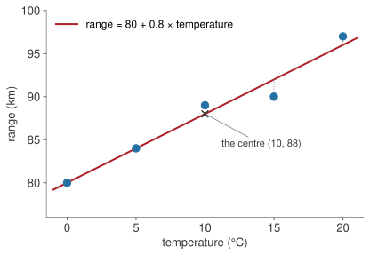
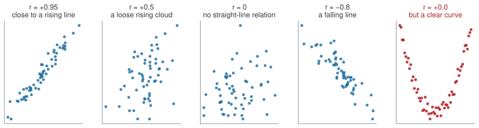
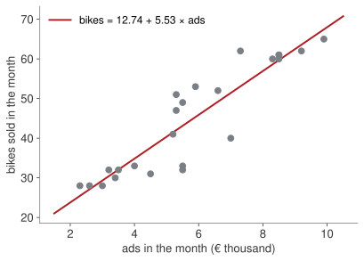
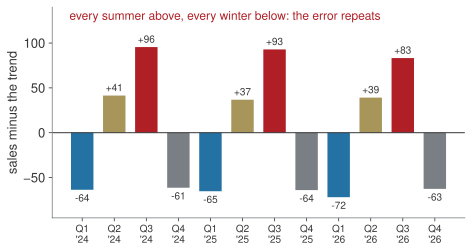
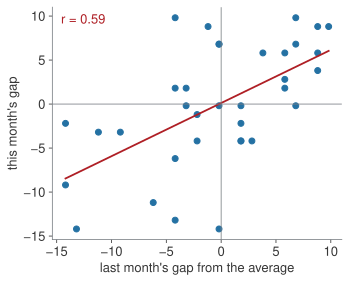
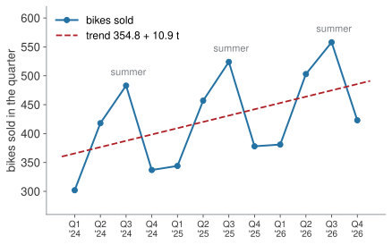

## Last Monday, in one minute

::: {.blocks style="grid-template-columns:repeat(3,1fr)"}
::: {.blk .recap}
[Block A]{.blk-letter}A number from data wobbles[A big count is a bell; an average wobbles by $\sigma/\sqrt{n}$, the standard error.]{.blk-answer}
:::
::: {.blk .recap}
[Block B]{.blk-letter}Estimate ± margin[$\bar{x} \pm z\,\sigma/\sqrt{n}$; 1.645 for 90%, 1.96 for 95%.]{.blk-answer}
:::
::: {.blk .recap}
[Block C]{.blk-letter}Assume nothing changed[$z$ in standard errors; the p-value is both tails beyond the data. Below .05: reject.]{.blk-answer}
:::
:::

[Today we fit a line by hand, then read the slope and its uncertainty in a regression output.]{.red}

## [Homework 8]{.section-kicker} Corrected together, step by step {.section-slide background-color="#AF1F25"}

## H1: 400 orders, two couriers

:::: {.columns}
::: {.column width="50%"}
**(a)** $np = 16$, $n(1-p) = 384$: the bell can be used.

$$\mu = 400 \times .04 = \textbf{16}$$

$$\sigma = \sqrt{400 \times .04 \times .96} = \sqrt{15.36} = \textbf{3.919}$$

::: {.fragment}
**(b)** "20 or more" starts at 19.5:

$$z = \frac{19.5 - 16}{3.919} = 0.893 \approx 0.89$$

$$P = 1 - .8133 = \textbf{.187}$$
:::
:::
::: {.column width="50%" .fragment}
**(c)** At 3%: $\mu = 12$, $\sigma = \sqrt{11.64} = 3.412$.

$$z = \frac{19.5 - 12}{3.412} = 2.198 \approx 2.20$$

$$P = 1 - .9861 = \textbf{.014}$$

::: {.callout-tip title="Board sentence"}
With today's courier a penalty month comes about one in five; with the new one, about one in seventy.
:::

[Far in the tail the bell is a little optimistic: the exact binomial gives .020. Close enough to decide.]{.muted}
:::
::::

## H2: the standard error, and the worst week

:::: {.columns}
::: {.column width="50%"}
**(a)** $SE = 20/\sqrt{16} = \textbf{5}$ minutes; $20/\sqrt{64} = \textbf{2.5}$ minutes.

For $SE = 1$: $20/\sqrt{n} = 1 \Rightarrow \sqrt{n} = 20 \Rightarrow n = \textbf{400}$ charges.

[Four times the charges, half the error: 16 → 64 halves it; 64 → 256 halves it again.]{.muted}
:::
::: {.column width="50%" .fragment}
**(b)** Mean 0, σ = €4,500 a week, the worst tail on the left.

$$95\%: \; 1.645 \times 4{,}500 = \textbf{€7,402.50}$$

$$99\%: \; 2.33 \times 4{,}500 = \textbf{€10,485}$$

**Reading.** Nineteen weeks in twenty the fund loses less than about €7,400; ninety-nine weeks in a hundred, less than about €10,500.

::: {.fragment}
[The slip: using 1.96 for "95% maximum loss". Only one tail is bad: 1.645.]{.red}
:::
:::
::::

## H3: an interval, chosen, then sized

:::: {.columns}
::: {.column width="50%"}
**(a)** $SE = 21/\sqrt{49} = 21/7 = \textbf{€3}$.

**(b)** 90%: $126 \pm 1.645 \times 3 = 126 \pm 4.94$: **€121.07 to €130.94**.
95%: $126 \pm 1.96 \times 3 = 126 \pm 5.88$: **€120.12 to €131.88**.

::: {.fragment}
**(d)** $n = (1.96 \times 21 / 2.5)^{2} = 16.46^{2} = 271.1$: **272 customers**.
:::
:::
::: {.column width="50%" .fragment}
**(c)** The 95% interval is **(iii)**.

- (i) is the 90% interval: $z = 1.645$.
- (ii) uses $1.96 \times 21$: one customer's spread, no $\sqrt{n}$.
- (iv) divides by $n = 49$ instead of $\sqrt{49}$.

[Same three wrong roads as in class. In the exam they are the three wrong options.]{.red}
:::
::::

## One tail or two: 1.645 or 1.96?

::: {.bigtable}
| the question | where the 5% (or 10%) goes | $z$ |
|---|---|---:|
| maximum loss at 95%; "the heaviest 5%"; a guarantee | **one** bad tail: 5% on one side | **1.645** |
| a 95% interval; a two-tailed test at 5% | **two** tails: 2.5% on each side | **1.96** |
| a 90% interval; a two-tailed test at 10% | **two** tails: 5% on each side | **1.645** |
| maximum loss at 99% | **one** tail: 1% | **2.33** |
:::

. . .

[Ask first: is only one side bad, or both? Then put the area in the tails and read $z$ from the table. 1.645 appears twice — for different reasons.]{.red}

## H4: the same share, two verdicts

:::: {.columns}
::: {.column width="50%"}
$H_0$: $p = .10$ · $H_1$: $p \neq .10$ · 5%, cut-offs ±1.96.

**250 orders, 17 damaged**: $\hat{p} = .068$.

$$SE = \sqrt{\frac{.10 \times .90}{250}} = .0190$$

$$z = \frac{.068 - .10}{.0190} = \textbf{−1.69}$$

$$p = 2 \times .0455 = \textbf{.091} > .05: \text{ do not reject}$$
:::
::: {.column width="50%" .fragment}
**500 orders, 34 damaged**: still 6.8%.

$$SE = \sqrt{\frac{.10 \times .90}{500}} = .0134$$

$$z = \textbf{−2.39}$$

$$p = 2 \times .0084 = \textbf{.017} < .05: \text{ reject}$$

**What changed:** the standard error shrank by $\sqrt{2}$, so the same gap is more standard errors away. More data, more certainty — not a different packaging.
:::
::::

## The memo: has the new script cut complaints?

:::: {.columns}
::: {.column width="56%"}
::: {.callout-tip title="To the Board · from Customer Service · the new call script"}
Before the new script, 12 calls in 100 ended in a complaint. Last month, with the script, 45 of 500 did: 9 in 100.

If the script had changed nothing, we would expect about 60 complaints, give or take 7. We saw 45: a gap that large, in either direction, would happen by luck only about 4 times in 100. The complaint rate fell after the introduction of the script. Other changes that month could also explain the fall.

**Recommendation:** keep the script, and check again after three months — 4 in 100 is rare, not impossible.
:::
:::
::: {.column width="44%" .fragment}
$$SE = \sqrt{\frac{.12 \times .88}{500}} = .01453$$

$$z = \frac{.09 - .12}{.01453} = -2.06$$

$$p = 2 \times .0197 = .039$$

**What we look for**

- what "nothing changed" predicts, in calls
- the p-value as a sentence, not a number alone
- reject at 5%, and an honest "but"
- one recommendation; no formulas in the text
:::
::::

## Four questions for Arno Bikes

| Decision | What we compare |
|---|---|
| What range can we quote for a test ride? | Five rides at different temperatures. Fit a line and move one point. |
| How should we plan sales, test rides and workshop time? | Compare like with like. Name what stays fixed each time you interpret a coefficient. |
| When can we trust the output? | Read the residuals: four assumptions, LINE. |
| How many bikes should we build for winter? | Separate quarterly growth from the usual winter dip, and use last month's memory. |

## [Block A · simple linear regression]{.section-kicker} From temperature and range to advertising and sales {.section-slide background-color="#AF1F25" auto-animate=true}

::: {.blk-fill data-id="blkA"}
:::

## Five test days, five temperatures

:::: {.columns}
::: {.column width="45%"}
The same bike on the same loop, on five days:

::: {.bigtable}
| temperature $x$ (°C) | range $y$ (km) |
|---:|---:|
| 0 | 80 |
| 5 | 84 |
| 10 | 89 |
| 15 | 90 |
| 20 | 97 |
:::

::: {.callout-important title="Bet before we compute"}
How many km does one more degree add? Write a number.
:::
:::
::: {.column width="55%" .fragment}

The points climb from left to right: a **positive** relation, close to a straight line. The **correlation** $r$ measures how close, from −1 to +1.
:::
::::

## Correlation: one number for the shape of the cloud

{width="86%"}

[$r$ near +1 or −1: the points sit close to a line. $r$ near 0: no straight-line relation — which is not the same as no relation at all. And a strong $r$ is not a cause: ice cream and sunburn rise together because of the sun.]{.muted style="font-size:.8em"}

## The line by hand: five rows, two sums

:::: {.columns}
::: {.column width="55%"}
$\bar{x} = 50/5 = 10$ °C, $\quad \bar{y} = 440/5 = 88$ km.

::: {.bigtable}
| $x - \bar{x}$ | $y - \bar{y}$ | product | $(x - \bar{x})^{2}$ |
|---:|---:|---:|---:|
| −10 | −8 | 80 | 100 |
| −5 | −4 | 20 | 25 |
| 0 | 1 | 0 | 0 |
| 5 | 2 | 10 | 25 |
| 10 | 9 | 90 | 100 |
| | | **200** | **250** |
:::
:::
::: {.column width="45%" .fragment}
$$b = \frac{\sum (x - \bar{x})(y - \bar{y})}{\sum (x - \bar{x})^{2}} = \frac{200}{250} = \textbf{0.8}$$

$$a = \bar{y} - b\,\bar{x} = 88 - 0.8 \times 10 = \textbf{80}$$

$$\hat{y} = 80 + 0.8\,x$$

**Reading.** Each extra degree adds **0.8 km** of range. At 0 °C, the line says 80 km.
:::
::::

## Least squares, literally {.clip background-color="#000000"}

<video class="clipvideo" width="1000" height="562" controls muted loop playsinline data-autoplay preload="auto" poster="media/w08_leastsq_poster.png"><source src="media/w08_leastsq.mp4" type="video/mp4"></video>

## How good is the line? $R^{2}$

:::: {.columns}
::: {.column width="52%"}
$$R^{2} = 1 - \frac{SSE}{SST}$$

- $SST = \sum (y - \bar{y})^{2}$: the squared misses **without** the line, predicting $\bar{y} = 88$ every day: $64 + 16 + 1 + 4 + 81 = \textbf{166}$
- $SSE = \sum (y - \hat{y})^{2}$: the squared misses **left by** the line: $0 + 0 + 1 + 4 + 1 = \textbf{6}$

$$R^{2} = 1 - \frac{6}{166} = \textbf{.964}$$

$$r = +\sqrt{.964} = \textbf{.982}$$

**Reading.** Temperature explains **96%** of the day-to-day differences in range. The sign of $r$ is the sign of the slope.
:::
::: {.column width="48%" .fragment}
**Use it inside the data.** At 12 °C: $80 + 0.8 \times 12 = \textbf{89.6 km}$.

**Not outside.** At −10 °C the line says 72 km; we never tested below zero, and batteries are not straight lines in the cold.

::: {.callout-tip title="Board sentence"}
Range rises by about 0.8 km per degree, and temperature explains almost all the variation in our tests. Print the range for a mild day, and say so on the box.
:::
:::
::::

## The model behind the line

:::: {.columns}
::: {.column width="52%"}
Every output we read today rests on one model:

$$y_i = \beta_0 + \beta_1 x_i + \varepsilon_i$$

- $\beta_0, \beta_1$: the **true** intercept and slope, which we never see
- $a, b$: our **estimates** from the data (80 and 0.8)
- $\varepsilon_i$: the **error**, everything that moves $y$ and is not $x$ — the wind, the rider, the tyres
:::
::: {.column width="48%" .fragment}
We never see $\varepsilon$. We see the **residual**, what the line misses:

$$e_i = y_i - \hat{y}_i$$

::: {.bigtable}
| °C | range | line | residual |
|---:|---:|---:|---:|
| 0 | 80 | 80 | 0 |
| 5 | 84 | 84 | 0 |
| 10 | 89 | 88 | +1 |
| 15 | 90 | 92 | −2 |
| 20 | 97 | 96 | +1 |
:::

[The residuals add to 0; their squares add to 6, the SSE of $R^2$.]{.muted}
:::
::::

## Four assumptions, one word: LINE

::: {.bigtable style="font-size:.85em"}
| | the assumption | in words | look at |
|---|---|---|---|
| **L** | Linearity | the average of $y$ moves along a straight line in $x$ | residuals against $x$: no curve |
| **I** | Independence | one error says nothing about the next | residuals in time order: no streaks |
| **N** | Normality | the errors are bell-shaped around 0 | a histogram of residuals |
| **E** | Equal spread | the errors have the same σ at every $x$ | residuals against $x$: no fan |
:::

. . .

[The slope $b$ only needs **L** to be right on average. The standard errors, the p-values and the intervals need **I** and **E** too — and **N** when the sample is small.]{.red}

## Try it: drag the points {.lab-app}

<iframe class="app" src="apps/w08_line.html?preset=temp" loading="lazy"></iframe>

[Drag the 20 °C day down to 85 km: the slope falls, $R^2$ collapses. One odd point can move the whole line — always look at the picture.]{.muted style="font-size:.7em"}

## Homework 8, H5: the same table on your data

:::: {.columns}
::: {.column width="50%"}
$\bar{x} = 4$, $\bar{y} = 48$.

::: {.bigtable}
| $x - \bar{x}$ | $y - \bar{y}$ | product | $(x - \bar{x})^{2}$ |
|---:|---:|---:|---:|
| −4 | −8 | 32 | 16 |
| −2 | −5 | 10 | 4 |
| 0 | 1 | 0 | 0 |
| 2 | 2 | 4 | 4 |
| 4 | 10 | 40 | 16 |
| | | **86** | **40** |
:::
:::
::: {.column width="50%" .fragment}
$$b = \frac{86}{40} = \textbf{2.15}$$

$$a = 48 - 2.15 \times 4 = \textbf{39.4}$$

Each extra point of discount goes with about 2 more bikes a month.

$$R^{2} = 1 - \frac{SSE}{SST} = 1 - \frac{9.1}{194} = \textbf{.953}$$

[$SST$: square the $y - \bar{y}$ column, $64 + 25 + 1 + 4 + 100 = 194$. $SSE = 9.1$ was given. $r = +\sqrt{.953} = .976$.]{.muted style="font-size:.8em"}

At 5%: $39.4 + 2.15 \times 5 = \textbf{50.15}$, about 50 bikes. At 25%: never tried — and a 25% discount may sell bikes at a loss.
:::
::::

## The same line, in every department

::: {.bigtable style="font-size:.8em"}
| department | the question | $y$ | $x$ | the slope, in words |
|---|---|---|---|---|
| **Marketing** | Does advertising pay? | sales | ad spend | extra sales per €1,000 of ads |
| **Pricing** | What happens if we raise the price? | units sold | price | units lost per €1 more on the price |
| **Operations** | How long will the job take? | hours | units produced, distance | extra hours per unit, per km |
| **HR** | Is pay in line with experience? | salary | years of experience | extra salary per year, at the same role |
| **Finance** | How risky is this stock? | stock return | market return | the stock's move per 1% of the market (its **beta**) |
| **Sales planning** | What will next quarter bring? | sales | the quarter number | the growth per quarter (the trend) |
:::

[Every row is the same picture: a cloud of points, a line, a slope with units — and a sentence that says what is held fixed.]{.red}

## Finance: the beta of a stock

:::: {.columns}
::: {.column width="52%"}
Sixty months of returns: a stock against the whole market.

$$\widehat{\text{stock return}} = 0.2\% + 1.3 \times \text{market return}$$

[$R^2 = .45$ · p-value of the slope < .001]{.muted}

::: {.fragment}
**1.3 is the beta.** When the market moves by 1%, this stock moves by **1.3%** on average, in the same direction: it amplifies the market.
:::
:::
::: {.column width="48%" .fragment}
**A bad month.** The market falls by 4%:

$$0.2 + 1.3 \times (-4) = -5.0\%$$

**$R^2 = .45$**: 45% of the stock's ups and downs come with the market; the other 55% are the company's own news.

[A beta above 1 is an aggressive stock, below 1 a defensive one. Fund managers, banks and analysts read this one number every day.]{.muted}
:::
::::

## Other sectors, the same reading

::: {.bigtable style="font-size:.8em"}
| sector | regression | what the coefficient tells the manager |
|---|---|---|
| **Real estate** | price on square metres, rooms, a dummy for the centre | what one more m² is worth, with the location held fixed |
| **Energy** | electricity use on temperature and working days | how much demand rises on a cold day — to buy power in advance |
| **Retail** | store sales on footfall, size and a dummy for a promotion | what a promotion adds, at the same footfall |
| **Insurance** | claim cost on age of the car, region, past claims | how to price a policy fairly, risk factor by risk factor |
| **Healthcare** | hospital cost on length of stay and type of treatment | the cost of one more night, at the same treatment |
| **Public policy** | unemployment change on GDP growth | how many points of growth it takes to cut unemployment |
:::

[Same four questions every time: units, sign, what is held fixed, could it be zero? And the same warning: associated, not caused.]{.red}

## 24 shop-months: ads against bikes sold

:::: {.columns}
::: {.column width="55%"}

:::
::: {.column width="45%"}
Two shops, twelve months each: what each spent on ads (€ thousand) and how many bikes it sold.

::: {.callout-important title="Bet before we compute"}
How many extra bikes does €1,000 of ads buy? Write a number.
:::

::: {.fragment}
The points climb: more ads, more bikes. The computer fits the line using the same two sums we used for the five test rides.
:::
:::
::::

## The output, line by line

::: {.bigtable}
| | coefficient | std. error | $t$ | p-value | 95% interval |
|---|---:|---:|---:|---:|---|
| intercept | 12.74 | 3.29 | 3.87 | .001 | 5.92 to 19.55 |
| **ads (€ thousand)** | **5.53** | **0.53** | **10.38** | **< .001** | **4.42 to 6.63** |
:::

[$n = 24$ shop-months · $R^2 = .830$]{.muted}

. . .

:::: {.columns}
::: {.column width="50%"}
**The equation.** $\widehat{\text{bikes}} = 12.74 + 5.53 \times \text{ads}$

**The slope.** Each extra €1,000 of ads goes with about **5.5 more bikes** a month.

**$R^2$.** Ads explain 83% of the differences in sales between shop-months.
:::
::: {.column width="50%" .fragment}
**Std. error.** The slope is a number from data: it wobbles. Give or take 0.53 bikes.

**$t$ and p-value.** Last week's test, on $H_0$: *the slope is zero, there is no linear association*. $t = 5.53 / 0.53 = 10.4$ standard errors from zero: p < .001, reject.

**Interval.** About two standard errors each side: 4.4 to 6.6 bikes per €1,000.
:::
::::

## Four numbers, four sentences

::: {.bigtable}
| in the output | the question it answers | the sentence |
|---|---|---|
| coefficient | how much $y$ moves when $x$ moves by one | "€1,000 more ads, about 5.5 more bikes" |
| p-value | could the true slope be zero? | "the data give strong evidence of a linear association (p < .001)" |
| 95% interval | how precisely do we know it? | "somewhere between 4.4 and 6.6 bikes" |
| $R^2$ | how much of $y$ does the line explain? | "83% of the month-to-month differences" |
:::

. . .

::: {.callout-important title="Bet, again"}
When the shops spend more on ads, they also tend to offer more hours of test rides. Which activity is the slope of 5.53 picking up?
:::

## [Block B · multiple regression]{.section-kicker} What changes when we hold test-ride hours fixed? {.section-slide background-color="#AF1F25"}

## One outcome, two budget decisions

We add the number of staffed test-ride hours to the same 24 shop-months.

| Predictor | Ads only | Ads and test-ride hours | Standard error in the second model |
|---|---:|---:|---:|
| Intercept | 12.74 | 13.95 | 0.99 |
| Ad spend (€1,000s) | 5.53 | 2.94 | 0.24 |
| Test-ride hours | | 1.16 | 0.08 |
| $R^2$ | .830 | .985 | |

::: {.fragment}
At fixed test-ride hours, an extra €1,000 in advertising is associated with **2.94 more bikes**. At fixed spending, one more staffed hour is associated with **1.16 more bikes**.
:::

## Which comparison isolates the ad coefficient?

$$\widehat{\text{bikes}}=13.95+2.94\,\text{ads}+1.16\,\text{hours}$$

| Monthly plan | Ads | Staffed hours | Predicted bikes |
|---|---:|---:|---:|
| A | €5,000 | 10 | 40.25 |
| B | €6,000 | 10 | 43.19 |
| C | €6,000 | 15 | 48.99 |

::: {.fragment}
**B versus A:** €1,000 more in ads at the same hours gives 2.94 more predicted sales. **C versus B:** five additional hours at the same spend give $5\times1.16=5.80$ more. Predictions use the rounded coefficients shown above.
:::

## Which estimate belongs in the budget meeting?

The founder proposes increasing the ad budget by €1,000 while keeping the test-ride rota unchanged. Would you use 5.53 or 2.94 to forecast the difference?

::: {.fragment}
Use **2.94**. The first model compares months that can differ in both spending and test-ride hours. The second holds hours fixed. Managers may also raise spending when they expect demand to grow, so the predicted difference alone cannot establish a return on advertising.
:::

## Try it: held fixed, live {.lab-app}

<iframe class="app" src="apps/w09_heldfixed.html?ads=6&hours=10" loading="lazy"></iframe>

[Move the hours: the red line, slope 2.94, moves up and down but keeps its slope. The grey line, 5.53, lets hours rise with ads.]{.muted style="font-size:.7em"}

## Test rides with a passenger

For a new set of loaded rides, engineering gives you this model. Temperature is in °C and extra load is in kg.

$$\widehat{\text{range (km)}}=82+0.7\,\text{temperature}-0.4\,\text{load}$$

**Before calculating:** one ride is 10 °C warmer but carries 20 kg more. Which bike goes farther?

::: {.fragment}
| Ride | Temperature | Extra load | Predicted range |
|---|---:|---:|---:|
| A | 10 °C | 5 kg | 87 km |
| B | 20 °C | 25 kg | 86 km |

At fixed load, 10 °C adds 7 km to predicted range. At fixed temperature, 20 extra kg costs 8 km. Together the changes give **1 km less**.
:::

## Would a deeper discount sell more bikes?

36 shop-months, with prices discounted by 2 to 10 percentage points. Read the ad and discount slopes with the other predictor fixed.

| Predictor | Coefficient | Standard error | p-value |
|---|---:|---:|---:|
| Intercept | 22.1 | 3.0 | < .001 |
| Ads (€1,000s) | 2.8 | 0.6 | < .001 |
| Discount (percentage points) | 1.1 | 0.9 | .23 |

**Try D2.** At €4,000 of ads, compare discounts of 5% and 7%. How confident would you be about the direction of the change?

::: {.fragment}
Predicted sales rise from **38.8 to 41.0**. The estimated difference is **2.2 bikes**. The approximate 95% interval for the slope is $1.1\pm2(0.9)$, or **−0.7 to 2.9** bikes per point, so even the direction is uncertain. The p-value says the same: **.23 > .05**, so the discount is not shown to matter once ads are held fixed — which is not proof that it does nothing.
:::

## [Block C · the assumptions]{.section-kicker} When the assumptions break {.section-slide background-color="#AF1F25"}

## What breaks, what it costs, what we do

::: {.bigtable style="font-size:.82em"}
| the residuals show | what is broken | what it costs | what we do |
|---|---|---|---|
| a curve | L | the slope is wrong at the ends | add $x^2$, or take a log |
| a fan, wider to the right | E | standard errors and p-values are off | log of $y$, or robust standard errors |
| one point far away | (an outlier) | one row moves the whole line | check that row; report with and without |
| streaks over time | I | standard errors too small, p-values too optimistic | model the time: trend, season, **last month** |
:::

[The last row is the opening of block D: sales over time break the I.]{.muted}

## Try it: which assumption breaks? {.lab-app}

<iframe class="app" src="apps/w09_residuals.html?case=good" loading="lazy" style="height:610px; flex:none"></iframe>

## [Block D · time: a trend, a season, memory]{.section-kicker} What will we sell next quarter? {.section-slide background-color="#AF1F25" auto-animate=true}

::: {.blk-fill data-id="blkC"}
:::

## A straight trend is not enough

:::: {.columns}
::: {.column width="58%"}

:::
::: {.column width="42%"}
Fit only a straight line through the twelve quarters, $\text{sales} = a + b\,t$, and look at what it misses.

::: {.fragment}
Every summer the residual is about **+90**, every winter about **−65**. Knowing this quarter's error tells you next year's: the errors are **not independent**. The I of LINE is broken.
:::

::: {.fragment}
[The trend's standard error and p-value would be too optimistic, and every winter forecast would be about 65 bikes too high.]{.red}
:::
:::
::::

## Errors that remember last month

:::: {.columns}
::: {.column width="48%"}

:::
::: {.column width="52%"}
Web orders, 36 months. Plot each month's gap from the average against the gap of the month before.

::: {.fragment}
A good month is followed by a good month: $r = .59$. The error of one month carries into the next — again, **not independent**.
:::

::: {.fragment}
Neither a trend nor a season explains this. It is **memory**.
:::
:::
::::

## Try it: errors linked in time {.lab-app}

<iframe class="app" src="apps/w09_timeerrors.html?phi=0.8" loading="lazy"></iframe>

[Move φ from 0 to 0.9: the residuals start to run in streaks. Then tick "add last month as a predictor" and watch the streaks disappear.]{.muted style="font-size:.7em"}

## The fix: put in the model what the errors remember

:::: {.columns}
::: {.column width="50%"}
**Fix 1 — the calendar.** If the error repeats every year, add the season:

$$\text{sales} = a + b\,t + \text{the quarter's gap}$$

The four gaps (−67, +39, +90, −63) take the summer and the winter out of the error.
:::
::: {.column width="50%" .fragment}
**Fix 2 — memory.** If the error carries from one month to the next, add last month:

$$y_t = c + \phi\,y_{t-1} + \varepsilon_t$$

This is the **autoregressive model, AR(1)**. With last month in the model, the residuals of the web orders lose their link: $r = .59$ becomes $r = -.04$.
:::
::::

. . .

[A pattern in the residuals is information the model has not used yet. Put it in, and the errors become independent again.]{.red}

## Quarterly sales: a trend and a season

:::: {.columns}
::: {.column width="55%"}

:::
::: {.column width="45%"}
Three years of quarters. Two patterns at once: the sales **climb** year after year, and every year has the same **shape** — a quiet winter, a busy summer.

Compare Q1 with Q1 in another year to spot growth. Compare winter with summer within each year to spot the seasonal pattern.

::: {.fragment}
[Which of the two patterns matters when planning production for next winter?]{.red}
:::
:::
::::

## Trend + season + noise {.clip background-color="#000000"}

<video class="clipvideo" width="1000" height="562" controls muted loop playsinline data-autoplay preload="auto" poster="media/w09_decomp_poster.png"><source src="media/w09_decomp.mp4" type="video/mp4"></video>

## Next year's first quarter, by substitution

:::: {.columns}
::: {.column width="52%"}
**The trend**, least squares on the quarter number $t = 1, \dots, 12$:

$$\text{trend} = 354.8 + 10.9\,t$$

About 11 more bikes every quarter.

**The season**, the average gap from the trend for each quarter:

::: {.bigtable}
| Q1 | Q2 | Q3 | Q4 |
|---:|---:|---:|---:|
| −67.0 | +39.1 | +90.5 | −62.7 |
:::
:::
::: {.column width="48%" .fragment}
**Forecast** = trend + season. Next year's Q1 is $t = 13$:

$$354.8 + 10.9 \times 13 - 67.0$$

$$= 354.8 + 141.7 - 67.0 = \textbf{429.5}$$

Round to **430 bikes** for the production plan.

::: {.callout-tip title="Board sentence"}
At quarter 13 the trend points to about 497 bikes. Winter typically runs 67 bikes below trend, giving a first-quarter plan of about 430.
:::
:::
::::

## Fix 2 in practice: next month's web orders

:::: {.columns}
::: {.column width="52%"}
Regress each month on **the month before**:

::: {.bigtable}
| | coefficient | std. error | p-value |
|---|---:|---:|---:|
| intercept $c$ | 39.8 | 14.6 | .010 |
| last month, $\phi$ | **0.60** | 0.15 | < .001 |
:::

$\phi = 0.60$: this month keeps **60%** of last month's gap from the average; p < .001, the memory is real.
:::
::: {.column width="48%" .fragment}
Last month: **110** orders. Forecast one month at a time:

$$y_{+1} = 39.8 + 0.6 \times 110 = \textbf{105.8}$$

$$y_{+2} = 39.8 + 0.6 \times 105.8 = 103.3$$

**Where it settles:** $\mu = \dfrac{c}{1 - \phi} = \dfrac{39.8}{0.4} = \textbf{99.5}$

::: {.callout-tip title="Board sentence"}
Last month's 110 was partly luck: plan about 106 web orders next month and 103 the month after, drifting back to 100.
:::
:::
::::

## Today remembers yesterday {.clip background-color="#000000"}

<video class="clipvideo" width="1000" height="562" controls muted loop playsinline data-autoplay preload="auto" poster="media/w09_ar1_poster.png"><source src="media/w09_ar1.mp4" type="video/mp4"></video>

## Formulas and outputs, on one page

::: {.bigtable style="font-size:.7em"}
| question | how to read or compute it | this morning |
|---|---|---|
| a slope from an output | coefficient: change in $y$ for one more $x$; p-value: test of slope = 0; interval ≈ coefficient ± 2 SE | 5.53, p < .001, 4.4 to 6.6 |
| additive model | compare observations with the other predictors held fixed | 2.94 per €1,000 at fixed test-ride hours |
| fit | $R^2 = 1 - SSE/SST$: the share of the squared misses the line removes; adjusted $R^2$ fines extra variables | $1 - 6/166 = .964$; .830 → .985 (adj. .984) |
| when to trust it | LINE: linearity, independence, normality, equal spread; read the residuals | temperature residuals 0, 0, +1, −2, +1 |
| trend and season | forecast = $a + b\,t$ + the quarter's gap | $354.8 + 10.9 \times 13 - 67.0 = 429.5$ |
| memory | $\hat{y}_{t+1} = c + \phi\,y_t$, settles at $c/(1-\phi)$ | 105.8, then 103.3; 99.5 |
:::

[For each slope, name the outcome, the unit of change and what stays fixed.]{.muted}

## Homework 9

:::: {.columns}
::: {.column width="58%" style="font-size:.82em"}
**Four exercises on paper**, plus a **memo to the Board**. `homework.md` on the course site.

- **H1** one output, four sentences, and the slope's test
- **H2** kilometres and delivery stops: what each coefficient means, two predictions
- **H3** trend and seasonal gaps for accessory sales
- **H4** can we trust it? the assumptions, and a forecast from last month

Due **Sunday 29 November, 23:59 on Moodle**. Corrected together at the start of next Monday.
:::
::: {.column width="42%"}
**The memo.** 150–250 words to the production manager: how many bikes to plan for next quarter, and how sure you are.

[Next Monday: the last session, a review of the second half on paper. Bring a calculator and the normal table.]{.muted}
:::
::::
